# Supply Chain Optimization

### Late Delivery Risk Prediction and Supply Chain Analytics


[Screenshots](#screenshots) · [Architecture](#system-architecture) · [ML Pipeline](#ml-pipeline) · [Evaluation](#model-evaluation) · [MLOps](#mlops) · [Database](#database-design) · [Setup](#installation-and-local-setup) · [API](#api-reference) · [Limitations](#limitations-and-future-work)

---

## What this project is

Supply chains generate orders with many interacting attributes — shipping mode, payment type,
origin/destination geography, customer identity — any of which can be associated with an order
arriving late. This repository contains a full-stack web application that scores **open orders**
against a trained classifier and surfaces each order's late-delivery risk to an operations
analyst, alongside the model-evaluation and monitoring tooling needed to trust that score.

Concretely, the application:

- **Scores orders in batches** by calling a separate ML inference service with each order's nine
  approved features, and persists the resulting risk score, risk band, and the exact feature
  snapshot used, as an auditable row per scoring cycle (never overwriting history).
- **Lets an authenticated operations analyst** browse the resulting risk queue, filter/search it,
  drill into a single order's current and historical scores, and read aggregate reports and
  per-feature model-monitoring data.
- **Does not** send alerts, re-route shipments, or otherwise intervene on an order automatically —
  there is no code path in this repository that acts on a risk score besides displaying it. The
  "late delivery is prevented" part of the business case is a human analyst's job once they see
  the score; the application's job stops at making that score visible, traceable, and honest about
  what it does and doesn't know.

This repository actually began as a single data-science notebook
([supply_chain_late_delivery.ipynb](supply_chain_late_delivery.ipynb)) exploring whether late
delivery is predictable at all. That notebook is still here, unmodified, as the origin of the
feature-selection and modeling approach the production model reuses. Everything described below —
the database, the two backend services, the Angular client, and the retrained, leakage-free
model that actually runs in production — was built on top of it. See
[§ Research and Engineering Contribution](#research-and-engineering-contribution) for exactly
where the notebook's analysis ends and the productionized pipeline begins.

---

## Screenshots

All screenshots below are from a live run of the full stack (`docker compose up`), using the
real backend, the real ML service, and the seeded demo dataset of 305 orders — not mockups.

<table>
<tr>
<td width="50%">

**Sign in** (`/login`)
<br/>Session-based authentication (FR-034); unauthenticated requests are rejected server-side.
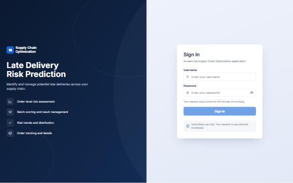

</td>
<td width="50%">

**Late Delivery Risk dashboard** (`/dashboard`)
<br/>KPI cards and a real risk-distribution donut computed from the current `GET /orders`
response. The "Risk Trend" card is an explicit *unavailable* notice — there is no endpoint
serving historical batch-scoring data, so no trend line is drawn.
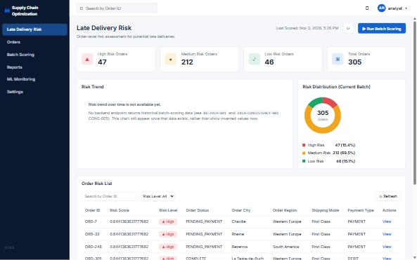

</td>
</tr>
<tr>
<td width="50%">

**Orders** (`/orders`)
<br/>Searchable, filterable, paginated listing of all 305 orders with their current risk band
and score.
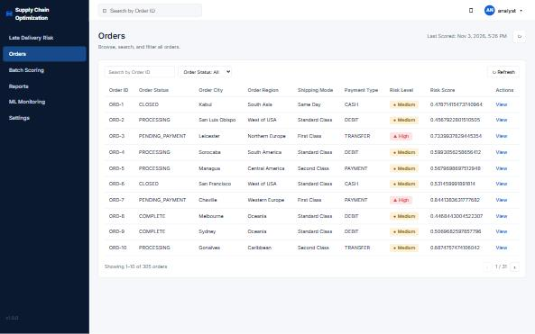

</td>
<td width="50%">

**Order detail** (`/orders/:orderId`)
<br/>A single order's placement/shipping attributes alongside its current risk assessment and
which model version produced it.
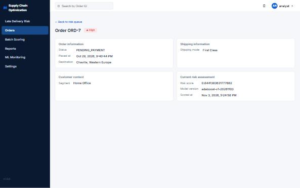

</td>
</tr>
<tr>
<td width="50%">

**Batch Scoring** (`/batch-scoring`)
<br/>Manually triggers a real batch-scoring run against the live ML service. The result shown
here — 0 scored / 305 skipped as unchanged — demonstrates the incremental-scoring optimization:
orders whose nine ML features haven't changed since their last score are not re-sent to the ML
service.
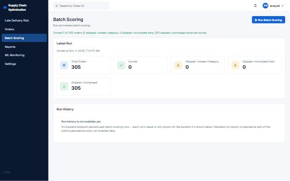

</td>
<td width="50%">

**Reports** (`/reports`)
<br/>Risk-by-category breakdowns (order status, shipping mode, destination region, payment type),
aggregated client-side from the same `GET /orders` response — no separate reporting endpoint
exists.
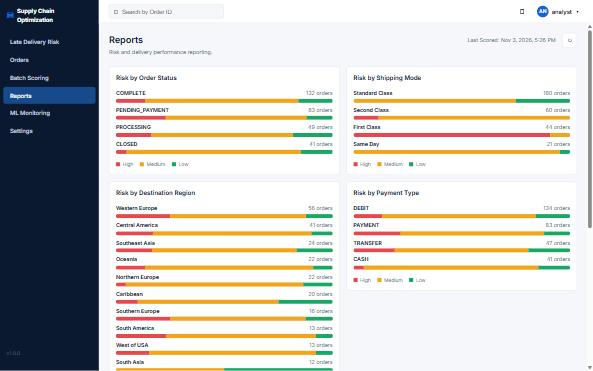

</td>
</tr>
<tr>
<td width="50%">

**ML Monitoring — overview & configuration** (`/ml-monitoring`)
<br/>Real, read-only model metadata (active version, algorithm, training timestamp, feature
list, library versions) served by the backend's `GET /system/model-info` proxy.
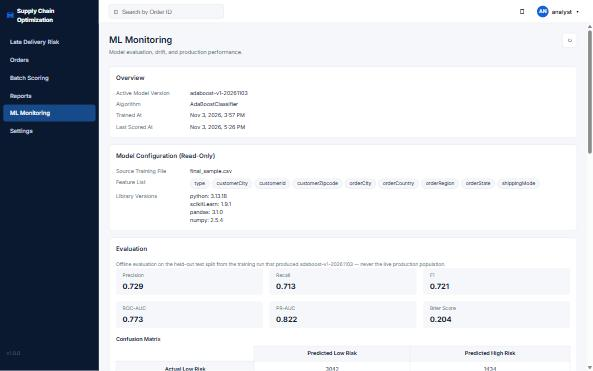

</td>
<td width="50%">

**ML Monitoring — evaluation & data drift**
<br/>The trained model's held-out test-set metrics and confusion matrix, plus a real
Population-Stability-Index comparison between training-time category frequencies and the live
order population.
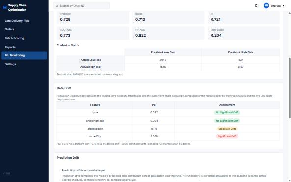

</td>
</tr>
<tr>
<td width="50%">

**Settings** (`/settings`)
<br/>Account/sign-out and live backend/ML-service reachability — plus several sections that are
*intentionally empty*, each with a stated reason (no preferences endpoint, thresholds live in
backend code not an API, etc.) rather than a placeholder implying a feature that doesn't exist.
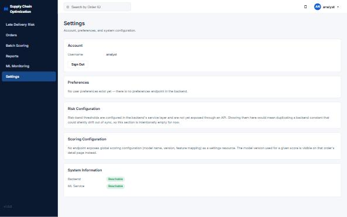

</td>
<td width="50%">

**Data drift (PSI)**
<br/>Per-feature Population Stability Index between the training distribution and the live
305-order population, with the standard interpretation bands (`<0.10` none, `0.10–0.25`
moderate, `≥0.25` significant) shown as a caveated guideline, not a project SLA.


</td>
</tr>
</table>

---

## Key Features

Status legend — **Implemented**: real code path, verified against a running stack. **Planned**:
documented as a future requirement but not present in any service today.

### Operational (Implemented)

| Feature | Description |
|---|---|
| Order risk assessment | `POST /system/batch-scoring` scores every order against the live ML service and persists one `risk_assessment` row per order per cycle. |
| Risk classification | Each score is banded into High (≥ 0.70) / Medium (0.40–0.70) / Low (< 0.40) by the backend's `RiskBandThresholds`. |
| Risk queue & filtering | `GET /orders` supports filtering by risk band (`high`/`medium`/`low`/`stale`) and order status. |
| Order inspection | `GET /orders/{orderId}` and `GET /orders/{orderId}/risk-assessments` return an order's current score and its full scoring history. |
| Incremental batch scoring | Orders whose nine ML features are unchanged since their last score (compared via a persisted JSON feature snapshot) are skipped, not re-sent to the ML service. |
| Historical risk retrieval | Every scoring cycle writes a new row rather than overwriting the last — `risk_assessment` is a full history table, not a single mutable field. |

### Analytics (Implemented)

| Feature | Description |
|---|---|
| Dashboard KPIs | High/Medium/Low/Total order counts and a risk-distribution donut, computed client-side from the current order listing. |
| Category reporting | Risk-by-order-status, risk-by-shipping-mode, risk-by-destination-region, and risk-by-payment-type breakdowns on the Reports page. |
| Risk trend | **Not implemented.** No endpoint persists a time series of past batch-scoring runs, so the dashboard shows an explicit "not available" notice instead of a fabricated trend line. |

### ML Capabilities (Implemented)

| Feature | Description |
|---|---|
| Leakage-free model training | `scripts/ml/train_model.py` fits target encoders on the training fold only, and out-of-fold-encodes the high-cardinality `customerId` feature so the classifier never sees its own label. |
| Feature preprocessing | Nine approved features (`type`, five geography fields, `customerId`, `customerZipcode`, `shippingMode`), smoothed target encoding + one-hot dummies, exactly mirrored between training and inference. |
| Prediction generation | The FastAPI ML service loads the persisted `model.joblib` + `encoders.json` and scores `POST /score` requests. |
| Model evaluation | Precision, recall, F1, ROC-AUC, PR-AUC, Brier score, and a confusion matrix, computed on a held-out test split and persisted alongside the model artifact. |
| Model versioning | File-based (`adaboost-v1-YYYYMMDD`), surfaced through both the ML service's own `/model-info` and the backend's proxy endpoint. |
| Data drift detection | Population Stability Index between training-time category frequencies and the live order population, computed per feature. |
| Prediction drift | **Not implemented.** No run history is persisted, so there is nothing to compare predicted-score distributions against across runs. |
| Production performance monitoring | **Not implemented.** No endpoint records verified delivery outcomes, so live precision/recall against ground truth cannot be computed. |

### Engineering Capabilities (Implemented)

| Feature | Description |
|---|---|
| Angular 18 standalone-component frontend | No NgModules; routing, auth guard, and all 7 screens are standalone components. |
| Spring Boot 3.3.4 / Java 21 backend | Layered controllers → services → Spring Data JPA repositories over PostgreSQL. |
| Session-based authentication | Spring Security, `HttpSession`-backed, with a login rate limiter and structured audit logging. |
| Separate Python/FastAPI ML service | Inference is isolated behind its own HTTP contract; the backend never imports model code. |
| Containerized deployment | Four Dockerfiles + one `docker-compose.yml` bring up postgres, ml-service, backend, and frontend together. |
| Backend-side caching | `ConcurrentMapCacheManager`-backed `@Cacheable`/`@CacheEvict` on the orders listing, invalidated on any real batch-scoring write. |
| Client-side caching | A short-lived (10s), explicit-refresh-bypassable cache in the Angular `OrderService`. |

---

## System Architecture

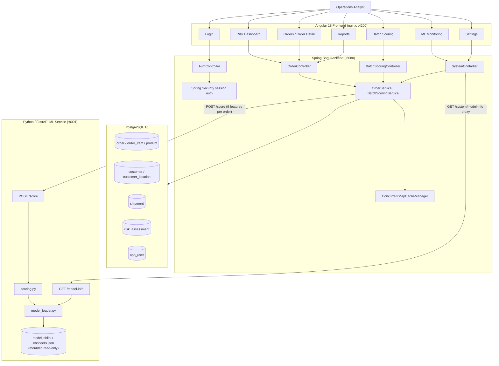

**Frontend** — Angular 18, standalone components, no NgModules. An `authGuard` gates every
route except `/login` using an in-memory `authenticated` signal (a documented limitation: a hard
page reload loses this client-side flag even though the server-side session cookie is still
valid — see [ADR-0005](docs/decisions/ADR-0005-authentication-strategy.md)).

**Backend** — Spring Boot 3.3.4 on Java 21. Controllers are thin; `OrderService` and
`BatchScoringService` hold the actual logic, backed by Spring Data JPA repositories. Spring
Security provides `HttpSession`-based authentication (no JWT, no OAuth) per
[ADR-0005](docs/decisions/ADR-0005-authentication-strategy.md). A `ConcurrentMapCacheManager`
(no Redis — not justified at this traffic scale) caches the orders listing, evicted on any real
scoring write.

**Database** — PostgreSQL 16, eight normalized tables (see [§ Database Design](#database-design)).

**ML service** — a separate FastAPI process. Per
[ADR-0004](docs/decisions/ADR-0004-ml-inference-architecture.md), the backend never imports
model code or the `scikit-learn`/`joblib` runtime directly — the two services communicate only
over this one HTTP contract, so the model's Python dependency tree never touches the JVM process.

**Authentication** — single-role, session-based (FR-034). There is no multi-tenant authorization
model; this is explicitly out of MVP scope per
[`PD-VISION-001`](docs/generated/product/PD-VISION-001-mvp-scope.md).

### Deployment view

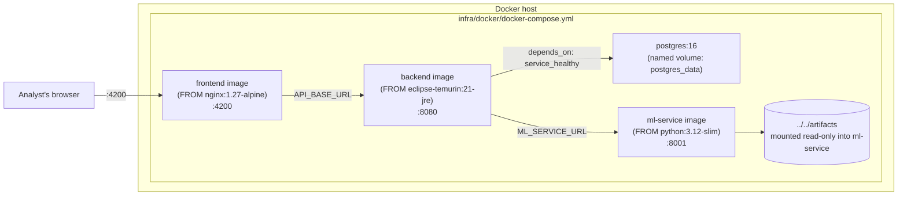

All four services are built from Dockerfiles committed in this repository
(`src/backend/Dockerfile`, `src/frontend/Dockerfile`, `src/ml-service/Dockerfile`) and brought up
together with `docker compose up --build` from `infra/docker/`. This is a **local/development**
deployment target — no cloud provider, orchestrator, reverse proxy, or TLS termination is
configured or implied anywhere in the repository (see
[ADR-0006](docs/decisions/ADR-0006-deployment-architecture.md), which deliberately leaves the
provider choice open).

---

## End-to-End Data Flow

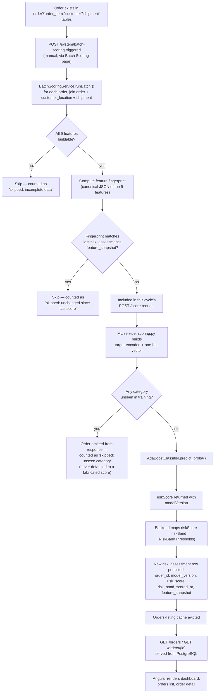

**Training data vs. inference input vs. model output vs. persisted prediction vs. actual
outcome — five distinct things this repository keeps separate:**

| Concept | Where it lives | Notes |
|---|---|---|
| Training data | `final_sample.csv` (repo root) | The 50,000-row statistically-validated sample the notebook produced; also what `scripts/ml/train_model.py` reads. |
| Inference input | The `Features` object in a `POST /score` request | Exactly nine fields, assembled by the backend from `order`/`order_item`/`customer_location`/`shipment` at scoring time. |
| Model output | `riskScore` (a float in `[0, 1]`) in the `POST /score` response | A probability, not a label, and not a guarantee. |
| Persisted prediction | A `risk_assessment` row (`risk_score`, `risk_band`, `feature_snapshot`) | What the UI actually displays. One new row per order per scoring cycle — history is kept, not overwritten. |
| Actual delivery outcome | `shipment.actual_late_delivery` (nullable, post-hoc only) | The **ground truth** label, from the original dataset's `Late_delivery_risk` column. It is never used as an inference input, and the application never claims a `risk_score` *is* this outcome. |

One naming note carried through deliberately: the approved database column `order.payment_type`
maps to the ML feature named `type` in the inference contract — the same underlying attribute
(DEBIT / TRANSFER / PAYMENT / CASH), two names, because the database and the ML contract were
designed by two different documents
([`DB-ARCH-REVISION-001`](docs/generated/database/DB-ARCH-REVISION-001-type-feature.md) and
[`ML-INFERENCE-001`](docs/generated/ml/ML-INFERENCE-001-service-contract.md)) that were never
silently reconciled into one name after the fact.

---

## ML Pipeline

### Data

- **Source**: [`final_sample.csv`](final_sample.csv), 50,000 rows × 32 columns — a Mann-Whitney-U
  / Chi-square statistically-validated sample of a larger source dataset (the original
  `DataCoSupplyChainDataset.csv` is not present in this repository; see
  [docs/PRD.md § 6](docs/PRD.md#6-business-context) for the provenance caveat).
- **Target**: `Late_delivery_risk` (binary: 1 = late, 0 = on-time), already present in the source
  data.
- **Approved feature set** (9 fields, per
  [`ML-PIPELINE-001`](docs/generated/ml/ML-PIPELINE-001-leakage-free-training.md)'s statistical
  feature selection): `Type` (payment type), `Customer City`, `Customer Id`, `Customer Zipcode`,
  `Order City`, `Order Country`, `Order Region`, `Order State`, `Shipping Mode` — all confirmed
  available **at order-placement time**, unlike the post-hoc shipping-duration/`Delivery Status`
  fields, which are explicitly excluded as label leakage.
- **Missing-value handling**: rows missing any of the 9 features or the target are dropped before
  the train/test split (`scripts/ml/train_model.py`'s `dropna`).
- **Class distribution**: see [`class-distribution.png`](docs/assets/graphs/class-distribution.png)
  below — computed directly from the same CSV, not estimated.

### Preprocessing — leakage prevention, specifically

The original notebook's own target encoding was fit on the **entire** dataset before any
train/test split (`docs/PRD.md` GAP-008) — the retrained production pipeline fixes exactly this:

1. **Train/test split first** (80/20, stratified, `random_state=34` — the same seed the original
   notebook used, for comparability), *then* every encoder is fit on the training fold only.
2. **`customerId` out-of-fold encoding.** `Customer Id` is high-cardinality and cold-start-prone.
   During training only, it is encoded via 5-fold out-of-fold smoothed target encoding, so the
   classifier is never fit against a row's own label leaking into its own encoded feature. The
   artifact still persists one final, non-OOF map (fit on the whole training fold) for inference.
3. **Smoothed target encoding**, not raw category means — `(count·mean + smoothing·global_mean) /
   (count + smoothing)`, with heavier smoothing (50 vs. 10) for the higher-cardinality
   `customerId`.
4. **One-hot dummies** for the two low-cardinality nominal fields (`type`, `shippingMode`).
5. **Unseen categories at test/inference time are never defaulted.** A City/Region/State/Country
   value not seen during training excludes that row from evaluation (112 of 10,000 test rows) and,
   in production, from the ML service's response entirely — never silently scored with a
   fabricated default.

### Training

- **Algorithm**: `AdaBoostClassifier` (scikit-learn), chosen for its measured recall advantage
  over the alternatives evaluated in
  [`ML-PIPELINE-001`](docs/generated/ml/ML-PIPELINE-001-leakage-free-training.md), consistent with
  the product's stated priority on catching high-risk orders over raw accuracy.
- **Reproducibility**: fixed split seed (34), deterministic encoder-fitting order, and a
  `train_and_evaluate()` function separated from artifact-writing specifically so a regression
  test ([`src/ml-service/tests/test_feature_contract.py`](src/ml-service/tests/test_feature_contract.py))
  can re-run training and compare metrics without clobbering the committed artifact.
- **Artifacts produced**: [`artifacts/model.joblib`](artifacts/model.joblib) (the fitted
  classifier) and [`artifacts/encoders.json`](artifacts/encoders.json) (target-encoding maps,
  one-hot category lists, the customer-ID fallback value, training metadata, offline metrics, and
  category frequencies for drift comparison) — file-based storage, per
  [ADR-0007](docs/decisions/ADR-0007-model-storage-and-versioning.md).
- **Versioning**: `adaboost-v1-YYYYMMDD`, generated at training time and carried through every
  downstream `risk_assessment` row and API response.

### Inference

- **Request contract** (`POST /score` on the ML service): a list of `{orderId, features}`, where
  `features` is exactly the nine approved fields — Pydantic's `extra="forbid"` rejects any request
  with a missing or additional key.
- **Response contract**: `{orderId, riskScore, modelVersion, confidence?}` per order — orders
  omitted from the response (unseen category) are a backend-side "skipped" count, never a
  fabricated score.
- **Preprocessing consistency**: `app/scoring.py`'s feature-vector assembly order is hand-matched,
  field for field, against `scripts/ml/train_model.py`'s `TARGET_ENCODED_FIELDS`/`DUMMY_FIELDS`
  ordering — verified by
  [`test_feature_contract.py`](src/ml-service/tests/test_feature_contract.py), which dynamically
  imports the training script and asserts the two stay in lock-step.
- **Model loading**: `model_loader.py` loads `model.joblib` + `encoders.json` once at startup from
  a path the service never writes to (mounted read-only in `docker-compose.yml`); a missing or
  unreadable artifact fails the service's `/health` check rather than silently falling back to an
  untrained model.

**Training happens offline, as a developer-run script** (`python scripts/ml/train_model.py`) —
the ML service itself **never fits or refits anything**; it only ever applies an already-persisted
artifact. This separation is a direct architectural constraint, not an implementation accident
(see [ML-INFERENCE-001 § 3](docs/generated/ml/ML-INFERENCE-001-service-contract.md)).

---

## Model Evaluation

All figures below are from the production artifact actually loaded by the running ML service
(`artifacts/encoders.json`, `modelVersion: adaboost-v1-20261103`) — **not** the earlier notebook's
self-reported, leakage-affected numbers (see the callout at the end of this section for why those
two sets of numbers are not comparable). Every graph here was regenerated by re-running
`scripts/ml/train_model.py`'s exact pipeline (same source file, same split seed, same encoders)
and independently cross-checked against the committed artifact's stored metrics before being
included — see the recomputed-vs-persisted comparison in the generating script,
`scripts/ml/` (the committed artifact is the source of truth; the regeneration is reproduction, not re-estimation).

**Held-out test set**: 9,888 rows (112 of 10,000 excluded — unseen City/Region/State/Country
category not present in the training fold's encoding map, the same rule the live service applies).

| Metric | Value |
|---|---|
| Precision | 0.729 |
| Recall | 0.713 |
| F1 | 0.721 |
| ROC-AUC | 0.773 |
| PR-AUC | 0.822 |
| Brier Score | 0.204 |

<table>
<tr>
<td width="50%">

**Confusion Matrix**
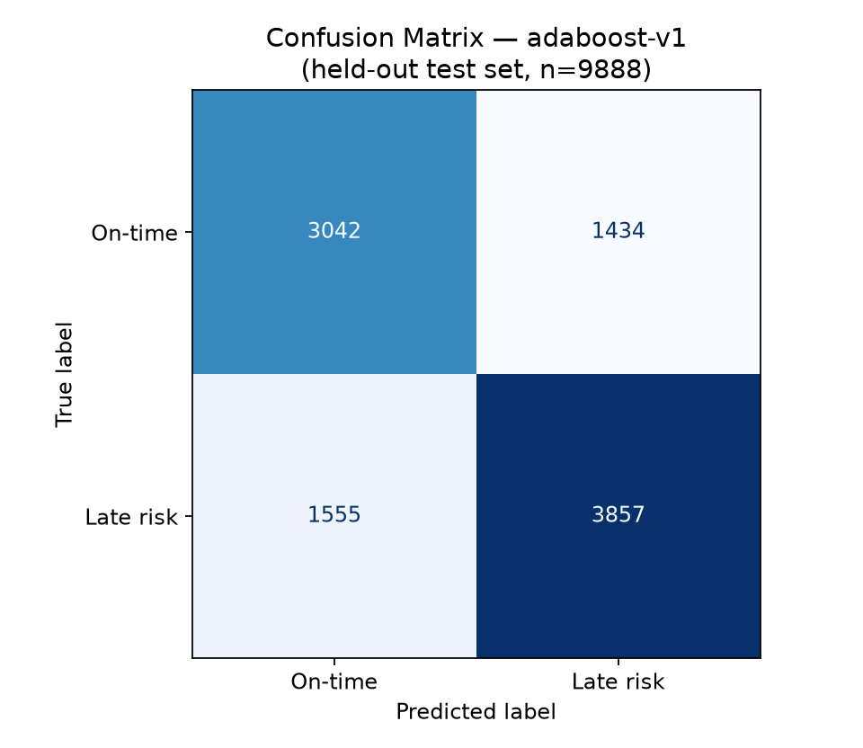

</td>
<td width="50%">

**ROC Curve**
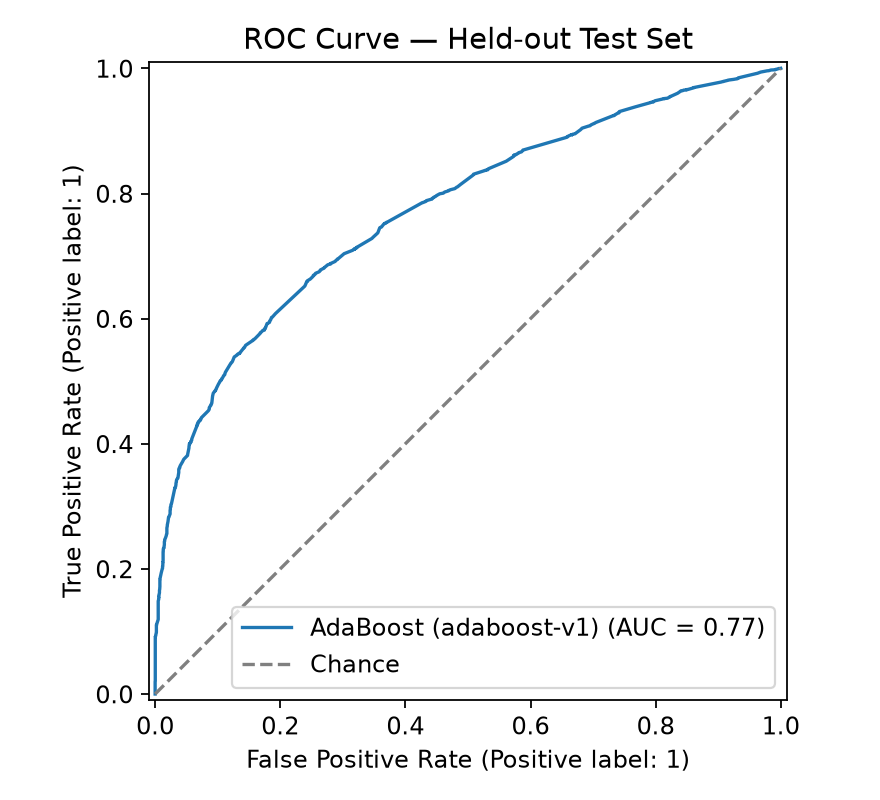

</td>
</tr>
<tr>
<td width="50%">

**Precision–Recall Curve**
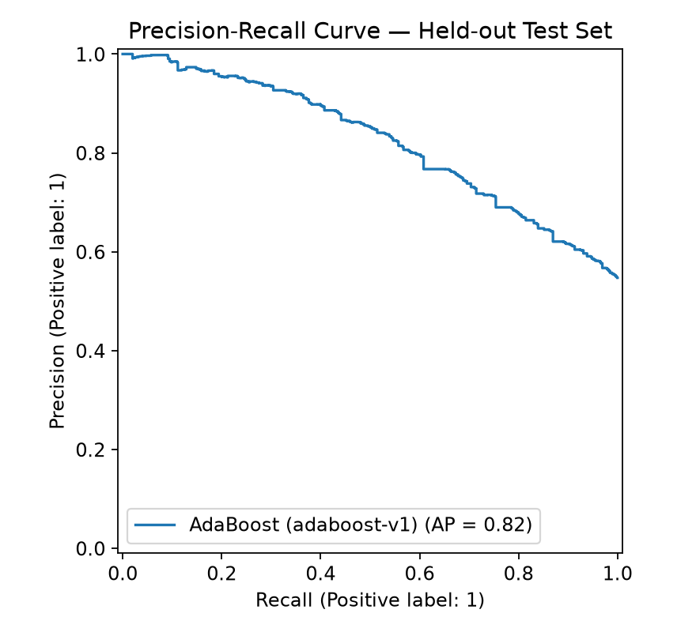

</td>
<td width="50%">

**Target Class Distribution** (training data)
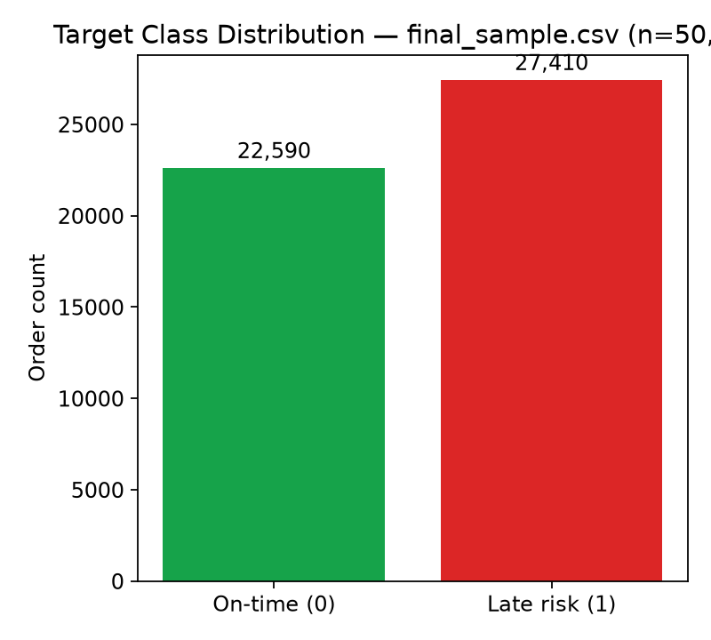

</td>
</tr>
</table>

**Feature importance** (AdaBoost, top 15 of the full one-hot-expanded feature vector):

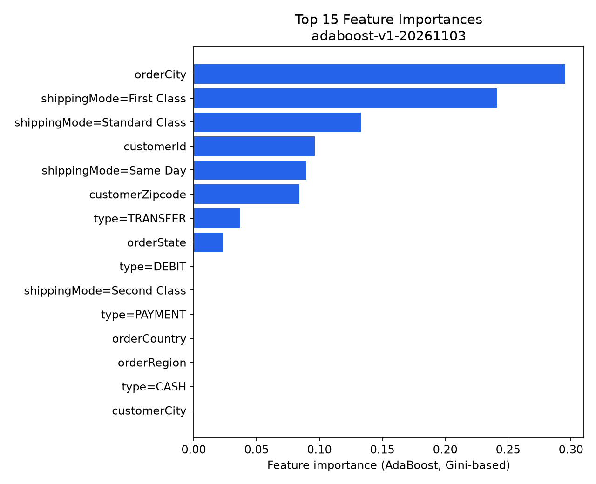

`orderCity` and the `shippingMode` dummies dominate, consistent with the original notebook's own
business interpretation (shipping mode and destination geography as the strongest predictors).

> **Why the original notebook's reported numbers (recall ≈ 0.86–0.90, accuracy ≈ 0.85–0.91,
> `docs/PRD.md § 23`) are not shown side-by-side with the numbers above as a "model comparison":**
> those figures came from nine classifiers evaluated across three encoding strategies in the
> original exploratory notebook, where target encoding was fit on the *entire* dataset before the
> train/test split (`docs/PRD.md` GAP-008) — a leakage pattern that inflates test-set performance.
> They are self-reported, not independently re-verified, and were never the output of a
> leakage-free pipeline. Presenting them next to the honest numbers above as if they were
> comparable model candidates would overstate what the historical exploration proved. They are
> recorded in [`docs/PRD.md § 23`](docs/PRD.md#23-success-metrics-and-kpis) as a historical
> record of the analysis that *led to* choosing AdaBoost, not as a production baseline.

---

## MLOps

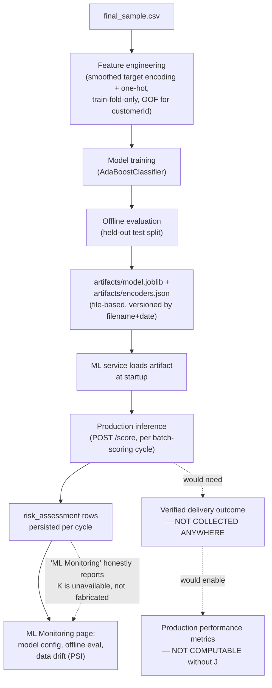

| Capability | Status | Detail |
|---|---|---|
| Model configuration | **Implemented** | `GET /system/model-info` (backend) proxies `GET /model-info` (ML service): active version, algorithm, training timestamp, source file, feature list, library versions. |
| Model artifact management | **Implemented** | File-based (`ADR-0007`); one `model.joblib` + `encoders.json` pair per training run, read-only-mounted into the ML service container. |
| Model versions | **Partially implemented** | The *currently active* version is reported; no registry of prior versions exists — `GET /system/model-versions` reflects only what `risk_assessment` rows actually show. |
| Evaluation history | **Not implemented** | Only the most recent training run's metrics are persisted; there is no history of evaluation runs over time. |
| Data drift | **Implemented** | Population Stability Index, per feature, between `encoders.json`'s `categoryFrequencies` (training) and the live `GET /orders` population — computed live on each ML Monitoring page load, not cached or precomputed. |
| Prediction drift | **Not implemented** | Would require persisted batch-scoring run history, which does not exist (see Batch Scoring's own "not available" notice). |
| Production performance | **Not implemented** | Requires verified delivery outcomes (`shipment.actual_late_delivery`), which are not collected by any endpoint — a prediction alone cannot establish whether the predicted order actually arrived late. |
| Service health | **Implemented** | ML service `/health` reports `modelLoaded`; backend's `/system/model-info` surfaces ML-service reachability; Settings page shows both backend and ML-service "Reachable"/"Unreachable". |
| Alerts | **Not implemented** | No alert store exists; the ML Monitoring page states this explicitly rather than rendering an empty or fabricated alert list. |

**Why data drift and prediction drift are different things, and only one is implemented:** data
drift (implemented) compares the *inputs* the model currently sees against the inputs it was
trained on — it says nothing about whether predictions are still accurate. Prediction drift would
compare the model's own *output* distribution across time, which needs persisted run history this
backend does not keep. Model-performance degradation needs a third, even harder-to-get thing —
reliable ground-truth outcome labels for orders scored in production — which this repository also
does not collect. All three are listed above with their actual status, not conflated.

---

## Database Design

Eight tables, normalized out of the original flat CSV schema (per
[DB-ARCH-001](docs/generated/database/DB-ARCH-001-schema-design.md) +
[DB-ARCH-REVISION-001](docs/generated/database/DB-ARCH-REVISION-001-type-feature.md)), applied
verbatim by [`scripts/db/001_init_schema.sql`](scripts/db/001_init_schema.sql):

```mermaid
erDiagram
    CUSTOMER ||--|| CUSTOMER_LOCATION : "has (location fields)"
    CUSTOMER ||--o{ ORDER : places
    ORDER ||--|{ ORDER_ITEM : contains
    ORDER ||--|| SHIPMENT : "ships via"
    ORDER ||--o{ RISK_ASSESSMENT : "scored by (history)"
    PRODUCT ||--o{ ORDER_ITEM : "referenced by"

    CUSTOMER {
        int customer_id PK
        string customer_segment
    }
    CUSTOMER_LOCATION {
        int customer_id PK_FK
        string customer_city
        string customer_state
        string customer_zipcode
        string customer_country
        decimal latitude
        decimal longitude
    }
    ORDER {
        bigint order_id PK "GENERATED ALWAYS AS IDENTITY"
        int customer_id FK
        string order_city
        string order_country
        string order_region
        string order_state
        string market
        string order_status
        timestamp placed_at
        string payment_type "NOT NULL; the ML 'type' feature"
    }
    ORDER_ITEM {
        bigint order_item_id PK "GENERATED ALWAYS AS IDENTITY"
        bigint order_id FK
        int product_id FK
        decimal discount
        decimal discount_rate
        decimal item_product_price
        decimal profit_ratio
        int quantity
        decimal sales
        decimal item_total
        decimal profit_per_order
    }
    PRODUCT {
        int product_id PK
        int product_category_id
        string product_name
        decimal product_price
    }
    SHIPMENT {
        bigint order_id PK_FK
        string shipping_mode
        int scheduled_days
        int actual_days "nullable, post-hoc only"
        string delivery_status "nullable, post-hoc only"
        boolean actual_late_delivery "nullable; ground-truth label, post-hoc only"
    }
    RISK_ASSESSMENT {
        bigint risk_assessment_id PK "GENERATED ALWAYS AS IDENTITY"
        bigint order_id FK "not unique -- one row per scoring cycle"
        string model_version "NOT NULL"
        decimal risk_score
        string risk_band
        timestamp scored_at "NOT NULL"
        jsonb feature_snapshot "nullable; the 9 ML features used for this score"
    }
    APP_USER {
        bigint user_id PK "GENERATED ALWAYS AS IDENTITY"
        string username UK
        string credential_reference
        timestamp created_at
        timestamp last_login_at
    }
```

`APP_USER` has no FK relationship to any order/customer table — it exists solely to support
FR-034's authentication and is deliberately unconnected in the schema.

**Key design decisions:**

- **Predictions are persisted, not ephemeral.** `risk_assessment` gets a new row every scoring
  cycle rather than overwriting an order's last score, so "what did the model say about this order
  last Tuesday" is an answerable question, and so this README's own evaluation graphs can be
  regenerated and cross-checked against what's actually stored.
- **`feature_snapshot` (JSONB) deliberately duplicates data already in `order`/`customer_location`/
  `shipment`.** Those source rows can change after the fact; without the snapshot, a later
  drift/debugging pass could not reconstruct exactly what the model saw for a given score. This
  same column is what makes incremental batch-scoring possible (see
  [§ End-to-End Data Flow](#end-to-end-data-flow)).
- **`shipment` is structurally isolated from `order`** specifically so the scoring path cannot
  accidentally read a post-fulfillment field (`actual_days`, `delivery_status`,
  `actual_late_delivery`) when building an inference request — those three columns are nullable
  and populated only after a delivery outcome is known, never at order-placement time.
- **`customer_location` is a separate table from `customer`**, isolating the quasi-identifier
  combination (city/state/zip/lat/long) as a single, auditable access boundary rather than a
  column-level policy scattered across every query that touches `customer`.

Indexes: `risk_assessment (order_id, scored_at DESC)` and
`risk_assessment (risk_score DESC, scored_at DESC)`, matching the two query patterns the
application actually runs ("history for order X", "current high-risk queue").

---

## Repository Structure

```text
SupplyChainOptimization/
├── src/
│   ├── frontend/            # Angular 18 standalone-component client
│   │   ├── src/app/         # login, shell, risk-dashboard, orders, risk-detail,
│   │   │                    # batch-scoring, reports, ml-monitoring, settings, shared/
│   │   └── Dockerfile
│   ├── backend/              # Spring Boot 3.3.4 / Java 21 API
│   │   ├── src/main/java/com/supplychain/backend/
│   │   │   ├── auth/         # AuthController, SecurityConfig, rate limiter
│   │   │   ├── orders/       # OrderController, SystemController, OrderService
│   │   │   ├── scoring/      # BatchScoringController/Service, CacheConfig, RiskBandThresholds
│   │   │   ├── mlcheck/      # MlServiceClient + its own health-check controller
│   │   │   └── domain/       # JPA entities
│   │   ├── src/test/java/    # Integration + unit tests (JUnit)
│   │   └── Dockerfile
│   └── ml-service/           # Python / FastAPI inference service
│       ├── app/               # main.py, scoring.py, model_loader.py, schemas.py
│       ├── tests/              # pytest — feature-contract + service tests
│       └── Dockerfile
├── scripts/
│   ├── db/                    # 001_init_schema.sql … 005_seed_bulk_real_orders.sql
│   └── ml/                    # train_model.py (offline training pipeline)
├── infra/docker/              # docker-compose.yml, .env, README.md
├── artifacts/                 # model.joblib, encoders.json (committed model artifacts)
├── docs/
│   ├── PRD.md, PRD_VALIDATION.md, TECHNICAL_DESIGN.md, IMPLEMENTATION_ROADMAP.md
│   ├── decisions/              # ADR-0001 … ADR-0007
│   ├── architecture/            # pipeline-architecture.md, user-journeys.md
│   ├── generated/                # architecture/backend/database/deployment/frontend/ml/
│   │                              # product/security/testing/ui-ux design artifacts
│   ├── implementation/           # IMPLEMENTATION-PLAN-001.md, IMPLEMENTATION-READINESS-001.md
│   └── assets/
│       ├── screenshots/           # this README's product screenshots
│       └── graphs/                 # this README's ML evaluation graphs
├── prompt-library/              # the prompt-engineering process used to generate docs/generated
├── tests/README.md
├── final_sample.csv             # training data (50,000-row validated sample)
├── df_last.csv                   # leakage-column-dropped modeling table (notebook output)
├── supply_chain_late_delivery.ipynb  # the original exploratory notebook
└── requirements.txt               # notebook/EDA dependencies
```

---

## Technology Stack

| Layer | Technology | Notes |
|---|---|---|
| Frontend | Angular 18 (standalone components), TypeScript, RxJS | No NgModules; signals for local component state. |
| Frontend build/serve | Node 22 (build stage) → nginx 1.27-alpine (serve stage) | Multi-stage Docker build; nginx config adds the Angular SPA-fallback route. |
| Backend | Spring Boot 3.3.4, Java 21 | Maven build, multi-stage Docker image on `eclipse-temurin:21-jre`. |
| Backend auth | Spring Security (session/`HttpSession`-based) | No JWT/OAuth; `BCrypt`-hashed credentials. |
| Backend caching | Spring Cache abstraction + `ConcurrentMapCacheManager` | In-memory; no Redis. |
| Database | PostgreSQL 16 | `JSONB` for `feature_snapshot`; two targeted indexes. |
| ML service | Python 3.12, FastAPI, Pydantic v2 (`extra="forbid"`) | Multi-stage not needed — single-stage `python:3.12-slim` image. |
| ML training | scikit-learn (`AdaBoostClassifier`), pandas, numpy, joblib | Offline-only script, `scripts/ml/train_model.py`. |
| Original EDA/modeling | PySpark, pandas, seaborn, matplotlib, scipy.stats, statsmodels, XGBoost | `supply_chain_late_delivery.ipynb` — the project's origin, not part of the running application. |
| Containerization | Docker, Docker Compose | Four services: `postgres`, `ml-service`, `backend`, `frontend`. |
| Backend testing | JUnit 5, Spring Boot Test, H2 (test-only in-memory DB) | 7 test classes — integration tests for orders, batch scoring, security, and a unit test for risk-band thresholds. |
| ML service testing | pytest | Feature-contract parity test (training script ↔ inference service) + service-level tests. |
| Frontend testing | Karma + Jasmine | 2 spec files (risk-level badge, risk-dashboard page). |
| Visualization (this README) | matplotlib (graphs), Mermaid (diagrams) | Graphs regenerated from the real training pipeline, not hand-drawn. |

---

## Installation and Local Setup

### Prerequisites

- Docker and Docker Compose (the only hard requirement for running the full stack).
- For running components outside Docker: JDK 21 + Maven (backend), Node 22 (frontend),
  Python 3.12 (ML service).

### 1. Clone and configure environment variables

```bash
git clone <this-repository-url>
cd SupplyChainOptimization
cp .env.example infra/docker/.env
```

`infra/docker/.env` holds **local-development-only placeholder values** (see
[.env.example](.env.example) — `POSTGRES_PASSWORD`, `SESSION_SECRET`, etc. are all literally
`changeme_local_only`). Docker Compose reads `.env` from its own directory
(`infra/docker/.env`), not the repository root — the copy step above is required, not optional.

### 2. Bring up the full stack

```bash
cd infra/docker
docker compose up -d --build
```

This builds and starts, in dependency order: `postgres` → `ml-service` + `backend` →
`frontend`. The backend waits on Postgres's own healthcheck before starting.

### 3. Apply database migrations and seed data

```bash
cd ../../scripts
bash run_migration.sh
```

This applies every file in `db/*.sql` in order: schema creation, the Phase 3 dev-login seed
(`analyst` / `analyst123`), real-category corrections, the least-privilege app role, and a
300-order bulk seed sampled from `final_sample.csv`.

### 4. Train the model (artifacts are already committed, but to regenerate)

```bash
pip install -r scripts/ml/requirements.txt
python scripts/ml/train_model.py
```

Writes `artifacts/model.joblib` and `artifacts/encoders.json`, read-only-mounted into the
`ml-service` container by `docker-compose.yml`. The ML service must be restarted
(`docker compose restart ml-service`) to pick up a newly trained artifact.

### 5. Run a batch-scoring cycle

Use the **Batch Scoring** page in the running app (`http://localhost:4200/batch-scoring`), or
directly:

```bash
curl -X POST http://localhost:8080/system/batch-scoring \
  -H "Cookie: <your session cookie after logging in>"
```

### 6. Verify

```bash
curl http://localhost:8080/actuator/health      # backend
curl http://localhost:8001/health                 # ML service
```

Then open `http://localhost:4200`, sign in with `analyst` / `analyst123` (seed credentials —
**development only, never use in a shared environment**), and browse the dashboard.

### Running components individually (without Docker)

```bash
# Backend
cd src/backend && mvn spring-boot:run

# ML service
cd src/ml-service && pip install -r requirements.txt && uvicorn app.main:app --port 8001

# Frontend
cd src/frontend && npm install && npm start
```

---

## API Reference

### Backend (`:8080`)

| Method | Endpoint | Purpose | Auth |
|---|---|---|---|
| `POST` | `/auth/sessions` | Log in; creates a server-side session. Rate-limited (10 attempts / 15 min / username). | Public |
| `DELETE` | `/auth/sessions` | Log out; invalidates the session. | Session |
| `GET` | `/orders` | List orders, optionally filtered by `riskBand` (`high`/`medium`/`low`/`stale`) and `status`. Cached. | Session |
| `GET` | `/orders/{orderId}` | A single order's detail + current risk assessment. | Session |
| `GET` | `/orders/{orderId}/risk-assessments` | Full scoring history for one order. | Session |
| `POST` | `/system/batch-scoring` | Triggers a real batch-scoring cycle against the ML service. | Session |
| `GET` | `/system/model-versions` | Active model version + last-scored timestamp, from `risk_assessment` data. | Session |
| `GET` | `/system/model-info` | Proxies the ML service's `/model-info` (training metadata, offline metrics, category frequencies). | Session |
| `GET` | `/api/ml-check` | Low-level ML-service reachability check (used internally / for diagnostics). | Session |
| `GET` | `/api/ping`, `POST /api/ping` | Database connectivity proof (Phase 1 scaffolding, still present). | Session |
| `GET` | `/actuator/health` | Spring Boot Actuator health endpoint. | Public |

No OpenAPI/Swagger UI is exposed; the table above is derived directly from the
`@*Mapping` annotations in `src/backend/src/main/java/com/supplychain/backend`.

### ML Service (`:8001`)

| Method | Endpoint | Purpose |
|---|---|---|
| `GET` | `/health` | `{status, modelLoaded}` — fails if the artifact didn't load at startup. |
| `GET` | `/model-info` | Training metadata, offline metrics, category frequencies, library versions. `503` if no model is loaded. |
| `POST` | `/score` | Scores a batch of orders. Request/response schemas enforce the exact 9-feature contract (`extra="forbid"`). |

Full request/response field definitions:
[`src/ml-service/app/schemas.py`](src/ml-service/app/schemas.py) and
[`docs/generated/ml/ML-INFERENCE-001-service-contract.md`](docs/generated/ml/ML-INFERENCE-001-service-contract.md).

---

## Research and Engineering Contribution

This repository's engineering value is less "a novel ML technique" and more "closing the gap
between an exploratory notebook and a system someone could actually rely on":

- **Late delivery risk prediction**: reused the original notebook's statistically-validated
  feature selection (9 features, chosen via Chi-square/Mann-Whitney significance testing against
  the target), but retrained from scratch with leakage removed.
- **Reproducibility**: the retrained pipeline uses the same source file and split seed as the
  original notebook specifically so its results are comparable, while fixing the methodological
  issues (whole-dataset target encoding, an unbounded self-leaking `customerId` encoding) that the
  original notebook's own numbers didn't account for.
- **Reliable model inference**: a request/response contract enforced by Pydantic (`extra="forbid"`)
  and a parity test (`test_feature_contract.py`) that fails the build if the training script's
  feature-assembly order and the inference service's ever drift apart.
- **Incremental scoring**: a feature-fingerprint comparison (JSON-tree equality, not string
  equality — Postgres's `jsonb` column type reorders object keys on storage, which a naive string
  comparison would miss) that skips re-scoring orders whose inputs haven't changed, avoiding
  unnecessary ML-service calls on every batch-scoring cycle.
- **Model monitoring that doesn't overstate itself**: data drift (PSI) is real and computed live;
  prediction drift and production performance are explicitly reported as unavailable, with the
  specific missing precondition (persisted run history; verified outcome labels) named rather than
  hidden.

This is not an academic contribution and makes no such claim — no novel algorithm, no published
benchmark comparison. It is a worked example of taking a leakage-affected exploratory notebook
through retraining, contract-testing, persistence, and monitoring, while being explicit at every
step about what is and isn't verified.

---

## Limitations and Future Work

| Area | Current state | What's missing |
|---|---|---|
| Historical outcome labels | `shipment.actual_late_delivery` exists in the schema but is never populated by any pipeline in this repository. | A process to feed back real delivery outcomes once known, which production-performance monitoring depends on entirely. |
| Automated retraining | `scripts/ml/train_model.py` is a developer-run script. | A scheduled or triggered retraining job, plus a policy for when retraining is warranted (e.g., driven by the drift metrics already computed). |
| Model registry | File-based, single active version (`ADR-0007`). | Multiple stored versions with rollback, A/B comparison, or a formal promotion process. |
| Drift alerting | PSI is computed and displayed on demand. | No threshold-crossing alert, notification, or on-call integration — a human has to open the page. |
| Prediction-drift history | Not implemented — no run history is persisted anywhere. | A `batch_scoring_run` history table (the natural next step once this is prioritized). |
| Batch-scoring cadence | Manual trigger only, via the UI or `POST /system/batch-scoring`. | `BATCH_SCORING_CADENCE_CRON` exists as an env var but is explicitly `TBD` — no scheduler is wired up. |
| Risk-band thresholds | Fixed constants (0.70 / 0.40) chosen to roughly match earlier stub data, **not** calibrated against the real model's score distribution or a cost-benefit analysis of false positives vs. false negatives. | A deliberate threshold-calibration pass once a product/business owner defines acceptable trade-offs. |
| Model explainability | Global feature importances only (`feature-importance.png`). | Per-prediction explanations (e.g., SHAP) are not implemented. |
| Multi-role authorization | Single `app_user` role (operations analyst). | Any notion of roles/permissions — explicitly out of MVP scope (`NFR-WEB-004`). |
| Deployment automation | Docker Compose, local/dev only. | CI/CD pipeline (none exists — no `.github/workflows`), a chosen cloud provider/orchestrator (deliberately left open by `ADR-0006`), TLS, and a reverse proxy. |
| License | None present in this repository. | A license file, and a resolved question about the source dataset's own redistribution terms (`docs/PRD.md` Open Question 1). |

---

## Further Reading

This project was built through an explicit, documented requirements → architecture → decision
process, captured in full rather than summarized away:

- [docs/PRD.md](docs/PRD.md) — the full product requirements document (notebook baseline + web
  application extension), including a complete gap analysis and traceability matrix.
- [docs/decisions/](docs/decisions/) — ADR-0001 through ADR-0007 (frontend/backend framework,
  database, ML inference architecture, authentication, deployment, model storage).
- [docs/generated/](docs/generated/) — the full set of architecture, backend, database,
  deployment, frontend, ML, product, security, testing, and UI/UX design artifacts produced while
  building this system, including the backend API contract
  ([`BE-ARCH-001`](docs/generated/backend/BE-ARCH-001-api-and-layering.md)), the ML inference
  contract ([`ML-INFERENCE-001`](docs/generated/ml/ML-INFERENCE-001-service-contract.md)), and the
  security threat model
  ([`SEC-THREATMODEL-001`](docs/generated/security/SEC-THREATMODEL-001-threat-model.md)).
- [docs/implementation/IMPLEMENTATION-PLAN-001.md](docs/implementation/IMPLEMENTATION-PLAN-001.md)
  — the phase-by-phase build plan this repository's git history follows.
- [supply_chain_late_delivery.ipynb](supply_chain_late_delivery.ipynb) — the original
  exploratory-data-science notebook this entire project originates from.

---

*This README documents the repository as it exists today. Every screenshot is from a real run of
the application; every graph is regenerated from the real training pipeline and cross-checked
against the committed model artifact; every status label distinguishes what is implemented from
what is planned. Where a design document described something the code does not (yet) do, that
gap is named above rather than silently closed.*
