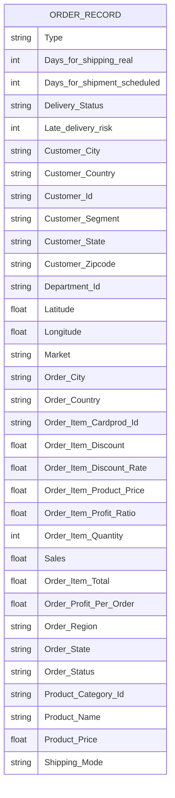
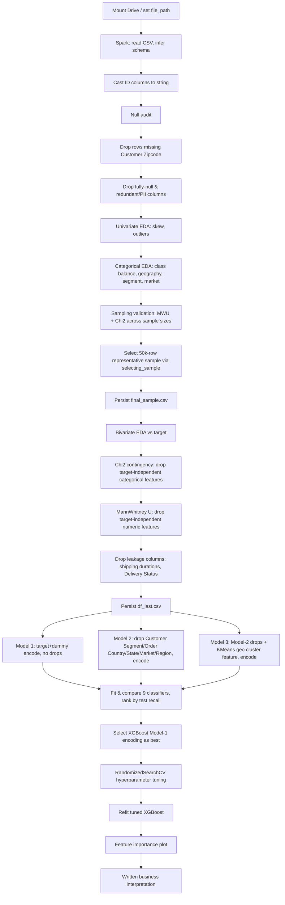
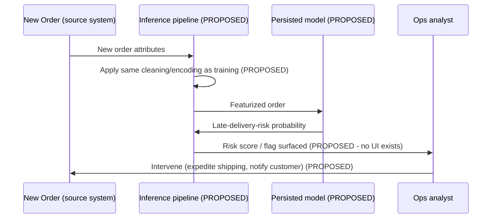
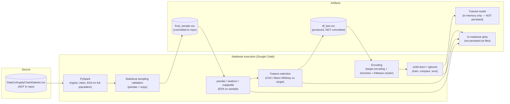

> **Approval note (§28 only).** §28 approved 2026-11-03 by the project stakeholder in this
> session, including FR-029–034, NFR-WEB-001–004, and the three open questions appended to §24.
> Approved as-is, with no requested scope changes. §1–25 were never a committing decision and
> carry no separate approval status.

# Product Requirements Document — Supply Chain Late Delivery Risk Prediction

| | |
|---|---|
| **Document owner** | Generated by repository reverse-engineering (FDE analysis) |
| **Repository** | `SupplyChainOptimization` (local path: `C:\Users\Admin\Desktop\SupplyChainOptimization`) |
| **Date** | 2026-11-03 |
| **Repository type** | Single-notebook data-science prototype (not a deployed application) |
| **Companion document** | [docs/PRD_VALIDATION.md](PRD_VALIDATION.md) |

> **Branding note (2026-11-04).** The product has been named **ShipGuard**. This is a naming
> decision only — it does not alter any requirement, section, or approval status below. § 1–25's
> "Name (from README)" field in § 2 is a historical quote of the README as it read during the
> original reverse-engineering pass and is left unchanged per that section's own frozen status;
> the current, live product name is ShipGuard. The repository/folder name remains
> `SupplyChainOptimization` for URL/clone compatibility.

> **Document History.** § 1–25 below are unchanged from the original reverse-engineering pass
> and remain the authoritative description of the notebook prototype **as it exists today**. An
> AI Engineering Knowledge System (prompt library, generated artifacts, ADRs) was subsequently
> established to govern the effort to turn this prototype into a web application — see
> [prompt-library/README.md](../prompt-library/README.md) and
> [prompt-library/PROJECT_CONTEXT.md](../prompt-library/PROJECT_CONTEXT.md). Per that system's
> additive-revision rule, prompt `PRD-001` (v1.0) appended new web-application requirements as
> § 28 on 2026-11-03, following `PD-001`'s digest
> ([docs/generated/product/PD-REVIEW-001-existing-project-digest.md](generated/product/PD-REVIEW-001-existing-project-digest.md))
> and `PD-002`'s approved MVP scope
> ([docs/generated/product/PD-VISION-001-mvp-scope.md](generated/product/PD-VISION-001-mvp-scope.md)).
> § 24 (Open Questions) was also extended additively — see the note at the start of that section.

> **Read this first.** This repository contains **no application code** — no backend, frontend, API, database, or deployment configuration. It consists of one Jupyter notebook, one sample CSV, a README, and a Word document of code explanations. Many sections of the standard enterprise-PRD template (APIs, architecture layers, auth, etc.) therefore have **no implementation to describe**. Rather than omit them, each such section states explicitly that no evidence exists, so this document can still serve as a complete baseline for a team that wants to operationalize the analysis that *is* here. Every claim below is traceable to a specific file and, for the notebook, a specific cell index (cell numbers refer to [supply_chain_late_delivery.ipynb](../supply_chain_late_delivery.ipynb), 0-indexed, 171 cells total).

---

## 1. Executive Summary

The repository is a **data-science research notebook** that explores whether machine learning can predict the risk that a supply-chain order will be delivered late (`Late_delivery_risk`, a binary label already present in the source dataset). The work covers data ingestion, cleaning, statistical sampling, exploratory data analysis (EDA), feature selection, three encoding/feature-selection strategies, baseline model comparison across nine classifiers, and hyperparameter tuning of the winning model (XGBoost).

There is **no trained model artifact, inference code, API, UI, or deployment path** in the repository. The deliverable, as it stands, is an analytical finding ("shipping mode and customer identity are the strongest predictors of late delivery, and a tuned XGBoost model reaches ~86% recall on a held-out test set") rather than a usable product. This PRD documents the analysis as implemented and lays out what would be required to turn it into an operational capability.

## 2. Product Overview

**Name (from README):** SupplyChainOptimization
**Stated purpose (README.md, lines 3–7):** "optimize supply chain operations by predicting the risk of late deliveries... By identifying high-risk orders, businesses can implement strategies to prevent delays."

**What exists today:**
- One Jupyter notebook ([supply_chain_late_delivery.ipynb](../supply_chain_late_delivery.ipynb)) that performs the full data-science lifecycle from raw CSV to a tuned classifier, run originally in Google Colab (cell 7 hardcodes `/content/drive/MyDrive/Colab Notebooks/Data/DataCoSupplyChainDataset.csv`).
- One data artifact, [final_sample.csv](../final_sample.csv) (50,000 rows × 32 columns), which is an intermediate statistically-validated sample of the full source dataset — **not** the final model-ready table (see [GAP-002](#7-gap-analysis-and-product-recommendations)).
- A README with a four-step narrative description of the intended process.
- A Word document, `Project Understandings.docx`, containing AI-generated, cell-by-cell prose explanations of the notebook's code (89 paragraphs covering roughly the second half of the notebook). It restates and sometimes elaborates on markdown already in the notebook; it introduces no new requirements, APIs, or business rules not already visible in the code.

**What does not exist:** a serving layer, a persisted/exportable model, a scheduling or retraining mechanism, tests, CI/CD, infrastructure-as-code, or any UI.

## 3. Problem Statement

Based on the README and the notebook's markdown narration (cells 9, 10, 170):

- Late deliveries are costly to a business — they reduce customer satisfaction, affect brand trust, and incur operational cost.
- A business processing many orders cannot manually assess which orders are at risk of late delivery; it needs an automated, data-driven way to flag high-risk orders *in advance* (i.e., before or during fulfillment) so it can intervene (e.g., change the carrier, escalate handling, proactively notify the customer).
- The source dataset already contains a `Late_delivery_risk` flag and a `Delivery Status` field computed after the fact ("Days for shipping (real)" vs "Days for shipment (scheduled)" — cell 110's comment). The real-world predictive problem is therefore to estimate this risk **using only information available at or before order placement**, not using the post-hoc shipping-duration fields — a constraint the notebook explicitly recognizes by dropping those columns before modeling (cell 110).

## 4. Product Vision and Objectives

No product vision statement exists in the repository. The following is **inferred** from the analytical choices made (explicitly marked as inferred, per instructions not to fabricate):

- **Objective (inferred):** Give supply-chain / logistics operations teams a predictive signal, at order-placement time, of which orders are likely to be delivered late, so they can intervene proactively.
- **Success framing chosen by the author (evidence):** The notebook explicitly optimizes for **recall** over accuracy (cells 129, 136–138; docx paragraphs ~407–409, 864–865), reasoning that a false negative (missing a genuinely late-risk order) is more costly to the business than a false positive (flagging an order that turns out to be on time).

## 5. Target Users and Personas

No personas are documented anywhere in the repository. The following personas are **inferred** from the shape of the work and should be validated with stakeholders (see [Open Questions](#26-open-questions)):

| Persona (inferred) | Needs | Evidence basis |
|---|---|---|
| Supply-chain / operations analyst | Wants to know which in-flight or newly placed orders are at risk, to prioritize intervention (expedite shipping, contact customer, escalate to carrier). | Implied by README's framing ("businesses can take proactive measures"); no UI or report exists for this persona today. |
| Data scientist / ML engineer (the actual, confirmed user of this repo) | Builds, evaluates, and compares candidate models; needs EDA tooling, statistical tests, and model-comparison scaffolding. | Directly evidenced — this is the only persona the notebook actually serves. |
| Business / product stakeholder | Wants a plain-language interpretation of what drives late deliveries (shipping mode, customer). | Evidenced by the "business Interpretation" markdown cells (cells 168–170) that translate feature importance into shipping-strategy language. |

## 6. Business Context

- The dataset's column vocabulary (Market = APAC/EMEA/LATAM/US/Canada; multi-country `Order Country`/`Customer Country`; multiple `Shipping Mode`s: Standard Class, Same Day, Second Class, First Class) indicates a **multinational e-commerce / retail distribution** business, not a single-warehouse or single-country operation.
- The underlying data strongly resembles the publicly known **"DataCo Smart Supply Chain for Big Data Analysis"** dataset (the column list in cell 9's markdown — Type, Days for shipping/shipment, Benefit per order, Late_delivery_risk, Category Id/Name, Customer Email/Fname/Lname/Password, Department Id/Name, Market, etc. — matches that public dataset's known schema). **This is an inference, not a confirmed fact** — the source CSV itself is not present in the repository, and no license or attribution for it appears anywhere.
- No real customer, financial, or organizational context (budget, team, timeline, stakeholders) is present in the repo.

## 7. Product Scope

In scope, as implemented:
1. Ingesting a CSV into a Spark DataFrame and performing schema/type correction.
2. Null-value auditing and removal.
3. Dropping columns that are entirely null, redundant with other columns, or privacy-sensitive (email, password, names).
4. Univariate EDA (distribution, skew, outliers) on numeric columns.
5. Categorical EDA (class balance, geographic/segment/market/payment-type distribution) via pie charts and count plots.
6. A custom statistical **sampling-validation procedure** (Mann-Whitney U for numeric columns, Chi-square goodness-of-fit for categorical columns) used to select a 50,000-row sample that statistically represents the full population, because the full Spark pipeline/EDA against the complete dataset was apparently too costly to repeat at full scale for the pandas-based modeling stage.
7. Statistical feature selection against the target (Chi-square contingency for categorical features, Mann-Whitney U for numeric features).
8. Three alternative encoding/feature-set strategies ("Model 1/2/3"), including a K-Means-derived geographic cluster feature in Model 3.
9. Baseline comparison of 9 classifiers per encoding strategy.
10. Hyperparameter tuning of XGBoost via `RandomizedSearchCV`.
11. Feature-importance analysis and a plain-language business interpretation of the top features.

## 8. Out of Scope

Explicitly absent from the repository (confirmed by its absence, not assumed):
- Any production inference path (REST/gRPC API, batch scoring job, or UI) for scoring new/live orders.
- Model persistence (no `.pkl`/`.joblib`/ONNX export; the notebook never calls `pickle.dump`, `joblib.dump`, or an MLflow equivalent).
- Automated tests of any kind.
- CI/CD, containerization, or infrastructure-as-code.
- Authentication/authorization, since there is no service to protect.
- Monitoring, alerting, data/model drift detection, or a retraining schedule.
- A dependency manifest (`requirements.txt`, `environment.yml`, `pyproject.toml`) — the notebook only shows one inline `!pip install pyspark` and `pip install scikit-posthocs` (cells 1, 3), so required versions of pandas, scikit-learn, xgboost, pyspark, etc. are undocumented.
- A license file.

## 9. Existing Feature Inventory

| # | Feature | Business objective | Persona | Status | Evidence (cells) |
|---|---|---|---|---|---|
| 1 | Spark-based CSV ingestion & schema typing | Load raw data reliably at scale | Data scientist | Implemented | 4–13 |
| 2 | Null audit & row/column pruning | Data quality | Data scientist | Implemented | 14–32 |
| 3 | Univariate EDA (hist/box plots) | Understand distributions & outliers | Data scientist | Implemented | 34–37 |
| 4 | Categorical EDA (pie/bar charts) | Understand class balance & population mix | Data scientist, business stakeholder | Implemented | 38–52 |
| 5 | Statistical sampling validation (MWU + Chi²) | Produce a smaller, statistically representative dataset for faster iteration | Data scientist | Implemented | 55–71 |
| 6 | `final_sample.csv` generation | Persist the validated sample | Data scientist | Implemented (but see GAP-002 on naming) | 72 |
| 7 | Bivariate EDA vs. target | Explore relationships between features and late-delivery risk | Data scientist, business stakeholder | Implemented | 79–92 |
| 8 | Statistical feature selection (Chi² contingency / MWU vs target) | Remove features independent of the target | Data scientist | Implemented | 93–106 |
| 9 | Leakage-column removal (shipping duration fields, Delivery Status) | Prevent the model from trivially "predicting" the label from the fields that define it | Data scientist | Implemented | 110–111 |
| 10 | Target encoding + dummy encoding (3 variants) | Convert categorical features into model-ready numeric features | Data scientist | Implemented | 119–159 |
| 11 | Geo K-Means clustering feature (Model 3 only) | Capture geographic patterns via Latitude/Longitude clustering | Data scientist | Implemented | 151–158 |
| 12 | 9-classifier baseline comparison (×3 encodings) | Identify the best-performing algorithm | Data scientist | Implemented | 131–145, 161 |
| 13 | XGBoost hyperparameter tuning (`RandomizedSearchCV`) | Improve the selected model's recall/accuracy | Data scientist | Implemented | 163–167 |
| 14 | Feature importance + business interpretation | Translate model internals into actionable business guidance | Business stakeholder | Implemented | 168–170 |
| 15 | Trained-model persistence / export | Reuse the model outside the notebook session | — | **Not implemented** | — |
| 16 | Inference on new/unseen orders (API, batch job, or CLI) | Score live orders | Ops analyst | **Not implemented** | — |
| 17 | Reporting/dashboard surfacing risk scores | Give ops team an actionable view | Ops analyst | **Not implemented** | — |
| 18 | Automated retraining / drift monitoring | Keep the model current | ML engineer | **Not implemented / Planned (proposed)** | — |

## 10. Functional Requirements

Status legend: **Implemented** = code executes this behavior in the notebook; **Partial** = only one of several needed variants exists; **Planned** = inferred as necessary for the stated product vision but not present in the repository (proposed, not existing).

| ID | Name | Description | Actor | Preconditions | Trigger | Expected behavior | Postconditions | Priority | Status | Evidence |
|---|---|---|---|---|---|---|---|---|---|---|
| FR-001 | CSV ingestion into Spark DataFrame | System shall load the raw CSV with header and schema inference | Data scientist | CSV accessible at configured path | Notebook cell execution | `spark.read.csv(path, header=True, inferSchema=True)` returns a populated DataFrame | DataFrame `df` available for downstream cells | P0 | Implemented | cell 7 |
| FR-002 | Type correction for ID/categorical columns | System shall cast ID-like numeric columns (`Late_delivery_risk`, `Product Category Id`, `Customer Id`, `Department Id`, `Order Item Cardprod Id`, `Customer Zipcode`) to string so they are treated as categorical, not continuous | Data scientist | DataFrame loaded | Manual cell execution | Columns cast via `withColumn(..., cast(StringType()))` | Downstream EDA/encoding treats these as categorical | P0 | Implemented | cell 12 |
| FR-003 | Null-value audit | System shall report per-column null counts | Data scientist | DataFrame loaded | Manual cell execution | `null_counts` DataFrame computed and displayed | Analyst can identify columns needing cleanup | P1 | Implemented | cells 15–16 |
| FR-004 | Row removal for missing `Customer Zipcode` | System shall drop rows with a null `Customer Zipcode` | Data scientist | Null audit complete | Manual cell execution | `df.dropna(subset=["Customer Zipcode"])` | Rows with missing zipcode removed | P1 | Implemented | cells 18–22 |
| FR-005 | Column removal — fully-null columns | System shall drop `Product Description` and `Order Zipcode` (100% / 86.23% null respectively) | Data scientist | Null audit complete | Manual cell execution | Columns dropped | Dataset narrowed | P1 | Implemented | cells 25–28 |
| FR-006 | Column removal — redundant/irrelevant/PII columns | System shall drop columns that duplicate other columns' information or contain direct PII (email, password, first/last name, street address, images, redundant IDs) | Data scientist | — | Manual cell execution | 16 columns dropped (list in cell 31) | Narrower, privacy-reduced dataset | P0 | Implemented | cells 29–32 |
| FR-007 | Univariate numeric EDA | System shall render histogram + boxplot per numeric column (excluding geo/shipping-duration columns) | Data scientist | Numeric columns identified | Manual cell execution | Grid of matplotlib/seaborn plots rendered | Analyst identifies skew/outliers | P2 | Implemented | cells 35–37 |
| FR-008 | Categorical distribution EDA | System shall render pie charts for target, `Customer Country`, `Delivery Status`, `Type` (payment), `Customer Segment`, `Market` | Data scientist | Pandas conversion of DataFrame available | Manual cell execution | Pie charts with percentage labels rendered | Analyst documents class/segment proportions in markdown | P2 | Implemented | cells 39–50 |
| FR-009 | Top/bottom category frequency analysis | System shall show top-20 and bottom-10 categories by count for `Customer City` and `Order Country` | Data scientist | — | Manual cell execution | Bar charts rendered | Analyst identifies concentration (e.g., Caguas City dominance) | P2 | Implemented | cell 51 |
| FR-010 | Sample-size validation via hypothesis testing | System shall, for a range of candidate sample sizes, repeatedly sample the population and test whether each column's distribution in the sample matches the population (Mann-Whitney U for numeric, Chi-square goodness-of-fit for categorical), returning the average number of columns passing both tests per sample size | Data scientist | Full population DataFrame (pandas) available | Manual cell execution, `sampling_validation(df_pd, 5000, 100000, 5000)` | Dict of {sample_size: avg_passing_columns} returned and plotted | Analyst selects 50,000 as adequate sample size | P1 | Implemented | cells 67–69 |
| FR-011 | Representative sample selection | System shall repeatedly draw a sample of the chosen size until **every** column passes both statistical tests against the population | Data scientist | Validated sample size chosen | Manual cell execution, `selecting_sample(df_pd, 50000)` | A DataFrame `df_new_trial`/`df_samp` returned once all columns pass; iteration count printed | A population-representative 50,000-row sample is produced | P1 | Implemented | cells 70–71 |
| FR-012 | Persist validated sample to CSV | System shall write the validated sample to disk | Data scientist | Sample selected | Manual cell execution | `final_sample.csv` written (Colab path); the copy checked into this repo is this file | Sample reusable without re-running the sampling procedure | P1 | Implemented (output committed to repo) | cell 72, [final_sample.csv](../final_sample.csv) |
| FR-013 | Re-cast ID columns on reload | System shall re-apply object dtype to ID-like columns after reading the sample CSV from disk (since CSV round-tripping loses the earlier Spark string casts) | Data scientist | Sample loaded via pandas | Manual cell execution | Columns re-cast to `object` dtype | Columns correctly treated as categorical in pandas | P2 | Implemented | cells 74–75 |
| FR-014 | Bivariate EDA vs. target | System shall visualize `Late_delivery_risk` against `Order City`/`Customer City`, `Shipping Mode`, `Customer Segment`, `Market`, `Customer Country` (count plots with % annotation) | Data scientist | Sample loaded | Manual cell execution | Annotated count plots rendered; markdown summarizes % late-delivery by category | Analyst identifies candidate predictive categorical features | P1 | Implemented | cells 81–92 |
| FR-015 | Categorical feature selection via Chi-square contingency test | System shall test each categorical feature's independence from the target and flag/drop features that are statistically independent of it | Data scientist | Sample with categorical columns identified | Manual cell execution, `cols_failing_chi2_contigency(df_sample)` | Prints p-value per column; function returns list of independent (droppable) columns; those columns are dropped | 6 columns removed (`Customer Country`, `Customer State`, `Department Id`, `Order Item Cardprod Id`, `Product Category Id`, `Product Name`) | P0 | Implemented | cells 95–98 |
| FR-016 | Numeric feature selection via Mann-Whitney U test | System shall test each numeric feature's association with the target by comparing its distribution between the two target classes, and drop features where no significant difference is found | Data scientist | Sample with numeric columns identified | Manual cell execution, `cols_failing_mannwhitneyu(df_sample)` | Prints p-value per column; non-significant columns dropped in place | Reduced numeric feature set | P0 | Implemented | cells 105–106 |
| FR-017 | Leakage-column removal | System shall drop `Days for shipping (real)`, `Days for shipment (scheduled)`, and `Delivery Status` before modeling, since these are definitionally related to / derived alongside the target | Data scientist | Feature-selected sample | Manual cell execution | Columns dropped; `df_last.csv` written | Model cannot trivially leak the answer via these fields | P0 | Implemented | cells 110–112 |
| FR-018 | Target encoding of categorical features | System shall replace each category of a feature with the empirical probability of `Late_delivery_risk == 1` for that category (computed on the full modeling dataset, not a held-out fold) | Data scientist | Feature set finalized | Manual cell execution, `Target_encode_test` / `map_categories_encode` | Categorical columns replaced with numeric probabilities | Model-ready numeric features for most categorical columns | P0 | Implemented (see GAP-007 for leakage risk) | cells 121–123, 137–142, 159 |
| FR-019 | Dummy (one-hot) encoding of low-cardinality nominal features | System shall one-hot encode `Type` and `Shipping Mode` (and, in Model 2/3, `Order Status`/`Market`), dropping the first level to avoid multicollinearity | Data scientist | — | Manual cell execution, `pd.get_dummies(..., drop_first=True)` | Binary indicator columns created | Model-ready numeric features | P0 | Implemented | cells 125, 142, 159 |
| FR-020 | Geographic clustering feature (Model 3) | System shall cluster orders by `Latitude`/`Longitude` using K-Means (k chosen via elbow method and confirmed via silhouette score), and add the resulting cluster label as a categorical feature | Data scientist | `Latitude`/`Longitude` present | Manual cell execution | `Cluster` column added, cast to object, included in Model 3's encoding | New feature available only in Model 3 | P2 | Implemented | cells 151–158 |
| FR-021 | Train/test split | System shall split the model-ready data 80/20 with a fixed random seed | Data scientist | Encoded dataset available | Manual cell execution, `train_test_split(..., test_size=0.20, random_state=34)` | `x_train/x_test/y_train/y_test` produced | Reproducible split for a given run | P0 | Implemented | cells 127–128, 142, 159 |
| FR-022 | Baseline multi-model comparison | System shall fit Gaussian Naive Bayes, Logistic Regression (statsmodels), Random Forest, AdaBoost, Gradient Boosting, XGBoost, and four Bagging variants, and report train/test accuracy and recall for each, sorted by test recall | Data scientist | Train/test split available | Manual cell execution | `model_report` DataFrame produced and sorted descending by `Test_Recall_score` | Analyst can compare 9 models per encoding strategy | P0 | Implemented (see GAP-004 for a breaking API call) | cells 131–138, 145, 161 |
| FR-023 | Cross-encoding model comparison | System shall repeat the full modeling procedure for three different encoding/feature-drop strategies ("Model 1/2/3") to determine which feature set best supports prediction | Data scientist | — | Manual cell execution across cells 120–161 | Three separate `model_report` tables produced; narrative conclusion favors Model 1 + XGBoost | Best encoding + algorithm combination identified | P0 | Implemented | cells 118–162 |
| FR-024 | Hyperparameter tuning of the selected model | System shall run `RandomizedSearchCV` over `n_estimators`, `max_depth`, `subsample`, `gamma` for XGBoost (5-fold CV, 50 iterations) and report the best parameters and score | Data scientist | Model 1's XGBoost selected as the leading candidate | Manual cell execution | Best hyperparameters and CV score printed | Tuned model trained with best parameters and re-evaluated | P1 | Implemented | cells 163–167 |
| FR-025 | Feature-importance reporting | System shall compute and plot XGBoost's feature importances for the tuned model | Data scientist | Tuned model fitted | Manual cell execution | Horizontal bar chart of feature importances, sorted descending | Analyst/stakeholder can see which features drive predictions | P1 | Implemented | cells 169 |
| FR-026 *(Planned)* | Persist the trained model | System should export the final tuned model to a reusable artifact (e.g., `joblib`/`pickle`/ONNX) | Data scientist / ML engineer | Tuned model exists in-session | New development | Model artifact saved to disk/registry with version metadata | Model can be loaded outside the notebook | P0 | **Planned — not implemented** | — (no evidence found) |
| FR-027 *(Planned)* | Score new orders | System should expose a function/service that takes a new order's feature values and returns a late-delivery-risk probability | Ops analyst (via tooling) | FR-026 complete | New order placed / batch job runs | Risk score returned, using the same encoding/preprocessing pipeline fit during training | Ops team can act on the score | P0 | **Planned — not implemented** | — |
| FR-028 *(Planned)* | Encoding pipeline persistence | System should persist the target-encoding maps and dummy-encoding column schema fit during training, so new data can be transformed identically at inference time | ML engineer | FR-026 | New development | Encoder artifact saved alongside model | Inference-time encoding is consistent with training | P0 | **Planned — not implemented** | — |

## 11. Non-Functional Requirements

| Category | Status | Detail |
|---|---|---|
| Performance | Not evidenced | No timing, profiling, or performance target appears anywhere. Spark is used for the full-population stage (implying the author anticipated the full dataset would not fit comfortably in pandas/memory), but no benchmark is recorded. |
| Scalability | Partially evidenced, not validated | PySpark is used for ingestion/cleaning (cells 4–51), suggesting an intent to scale beyond a single machine's memory; however, all modeling (cells 53+) is done in pandas on, at most, a 50,000-row sample, so the "scalable" portion of the pipeline is not connected to the modeling portion. |
| Reliability / availability | Not applicable | No running service exists to have an uptime/availability requirement. |
| Security | Not evidenced; partial good practice | The author actively removes several PII columns (email, password, names, street address — cell 31) before modeling, which is a privacy-positive decision. However, `Customer Id`, `Customer Zipcode`, `Latitude`/`Longitude`, and `Customer City/State` are retained as model features, which is itself a quasi-identifier combination; no anonymization, access control, or data-handling policy is documented. |
| Authentication/authorization | Not applicable | No service/API exists. |
| Data privacy | Partial, undocumented | See Security row. No data retention, consent, or regulatory (e.g., GDPR/CCPA) discussion exists. |
| Maintainability | Poor, by evidence | The notebook contains large blocks of commented-out alternative implementations (e.g., cells 57, 61, 65 keep dead PySpark-native versions of functions alongside the pandas versions actually used), duplicate redefinitions of the same helper functions (`cat_num_cols` defined twice — cells 56 and 94, with a typo-laden second version), and no modularization into importable `.py` files. |
| Extensibility | Poor, by evidence | All logic lives in notebook cells with implicit, order-dependent global state (e.g., `df_pd`, `df_sample`, `x_train` are reused and overwritten across "Model 1/2/3" sections); there is no function/class boundary that a new model or dataset could plug into without manually re-running cells in order. |
| Observability / logging | Not evidenced | Only `print()` statements for ad hoc values (shapes, iteration counts, recall scores); no structured logging, metrics export, or experiment tracking (e.g., MLflow) is used. |
| Error handling | Not evidenced | No `try/except` blocks exist anywhere in the notebook; cells assume prior cells succeeded and left the expected variables in scope. |
| Accessibility | Not applicable | No UI exists. |
| Compatibility | At risk — recommended | See [GAP-003](#7-gap-analysis-and-product-recommendations) and [GAP-004](#7-gap-analysis-and-product-recommendations): the notebook uses `DataFrame.append` (removed in pandas ≥ 2.0) and `BaggingClassifier(base_estimator=...)` (renamed `estimator` in scikit-learn ≥ 1.2), so the notebook as written will raise errors on currently-released versions of these libraries. |
| Backup and recovery | Not applicable | No persisted state beyond the one committed CSV. |

**Recommended (currently missing) NFRs**, proposed for a productionized version — not existing requirements:
- A pinned dependency manifest with tested version ranges.
- A target inference latency/throughput if scoring is to run in or near real time.
- A defined model-retraining cadence and drift-detection threshold.
- A documented data-privacy and retention policy for the customer/location fields retained as model features.

## 12. Data and API Specification

### 12.1 Data Model

There is no database — the dataset is a single flat tabular file. The table below documents `final_sample.csv` (50,000 rows, 32 data columns plus an unnamed pandas index column) as committed in the repo. **This is the post-sampling-validation, pre-feature-selection snapshot** (see [GAP-002](#7-gap-analysis-and-product-recommendations)); it is not the dataset the final models in cells 160+ were trained on (that dataset, `df_last.csv`, is produced by the notebook but not committed to the repository).

| Column | Inferred type | Notes |
|---|---|---|
| `Type` | categorical (string) | Payment type: DEBIT, TRANSFER, PAYMENT, CASH |
| `Days for shipping (real)` | numeric (int) | Actual shipping duration — **dropped before final modeling** (leakage) |
| `Days for shipment (scheduled)` | numeric (int) | Scheduled shipping duration — **dropped before final modeling** (leakage) |
| `Delivery Status` | categorical (string) | Late delivery / Shipping on time / Advance shipping / Shipping canceled — **dropped before final modeling** (leakage; near-duplicate of the target) |
| `Late_delivery_risk` | binary (0/1) | **Target variable** |
| `Customer City`, `Customer Country`, `Customer State`, `Customer Zipcode` | categorical | Customer location; `Customer Country`/`Customer State` dropped by FR-015 |
| `Customer Id` | categorical (numeric-coded) | Retained as a feature; see [GAP-007](#7-gap-analysis-and-product-recommendations) |
| `Customer Segment` | categorical | Consumer / Corporate / Home Office |
| `Department Id` | categorical (numeric-coded) | Dropped by FR-015 |
| `Latitude`, `Longitude` | numeric (float) | Customer geolocation; used for the Model 3 K-Means feature |
| `Market` | categorical | APAC / EMEA / LATAM / USCA / Pacific Asia etc. |
| `Order City`, `Order Country`, `Order Region`, `Order State` | categorical | Order destination geography |
| `Order Item Cardprod Id` | categorical (numeric-coded) | Dropped by FR-015 |
| `Order Item Discount`, `Order Item Discount Rate`, `Order Item Product Price`, `Order Item Profit Ratio`, `Order Item Quantity`, `Order Item Total`, `Order Profit Per Order`, `Sales` | numeric (float/int) | Order-line financial attributes |
| `Order Status` | categorical | COMPLETE / PENDING_PAYMENT / PROCESSING / CLOSED etc. |
| `Product Category Id` | categorical (numeric-coded) | Dropped by FR-015 |
| `Product Name` | categorical | Dropped by FR-015 |
| `Product Price` | numeric (float) | |
| `Shipping Mode` | categorical | Standard Class / Same Day / Second Class / First Class |

No primary/foreign keys, constraints, or data-lifecycle rules are defined anywhere (this is a denormalized analytical extract, not a transactional schema).

*Single denormalized entity — shown as one box because the data is delivered as one flat file with no relational structure. The grouping below (§15/16) is purely conceptual, for readability, not an implemented schema.*

### 12.2 API Inventory

**No APIs exist in this repository.** There are no route definitions, OpenAPI/Swagger specs, server frameworks (Flask/FastAPI/Django/Express/etc.), or client-calling code of any kind. This section is included per the required PRD structure and is empty by evidence, not by omission.

## 13. Integrations and Dependencies

| Dependency | Role | Evidence |
|---|---|---|
| pandas, numpy | Core tabular data handling | cell 0 |
| matplotlib, seaborn | Visualization | cell 0 |
| scipy.stats, statsmodels, `scikit-posthocs` | Hypothesis testing (Mann-Whitney U, Chi-square, logistic regression via `sm.Logit`) | cells 1–2, 114 |
| PySpark (`pyspark.sql`) | Distributed ingestion, schema casting, null handling, groupby aggregations | cells 3–5 |
| scikit-learn | `train_test_split`, `GaussianNB`, `DecisionTreeClassifier` (imported, never used), `RandomForestClassifier`, `AdaBoostClassifier`, `BaggingClassifier`, `GradientBoostingClassifier`, `KMeans`, metrics (`recall_score`, `f1_score`, `precision_score`, `accuracy_score`, `confusion_matrix`, `roc_curve`, `roc_auc_score`, `classification_report`, `ConfusionMatrixDisplay`, `silhouette_score`), `RandomizedSearchCV` | cell 114, 152, 164 |
| xgboost | `XGBClassifier`, used both as a baseline and as the final tuned model | cells 114, 163–167 |
| Google Colab + Google Drive | Original execution/storage environment (hardcoded paths) | cells 7, 72 |

No external services, third-party SaaS APIs, message queues, or cloud infrastructure are integrated. No dependency version pins exist anywhere (no `requirements.txt`/`environment.yml`/`Pipfile`/lockfile).

## 14. User Journeys

### 14.1 Journey — "Data scientist runs the end-to-end analysis" (implemented)

**Goal:** Produce a trained, tuned classifier and an interpretation of what drives late-delivery risk.
**Starting point:** A Google Colab session with the source CSV mounted from Google Drive.

**Failure/exception scenarios (as implemented — i.e., gaps, not handled paths):**
- If the hardcoded Google Drive path is unavailable, cell 7 fails with no fallback or clear error message (no try/except anywhere in the notebook).
- `selecting_sample` (cell 70) runs an unbounded `while True` loop; if no sample of the target size ever passes all statistical tests, the notebook will hang indefinitely with no timeout or iteration cap.
- Re-running cells out of order (a known notebook risk) silently uses stale global state (e.g., `x_train`/`x_test` from a prior "Model" section) — there is no isolation between the three model sections.
- On current library versions, cells 138/145/161 (`model_report.append(...)`) and the `BaggingClassifier(base_estimator=...)` calls will raise exceptions outright (see [GAP-003](#7-gap-analysis-and-product-recommendations), [GAP-004](#7-gap-analysis-and-product-recommendations)) rather than degrade gracefully.

### 14.2 Journey — "Ops analyst acts on a risk score" (proposed, not implemented)

Included only to make the gap between the current notebook and the stated product vision explicit — **none of this exists today**.

## 15. System Architecture

**Architecture note:** The README's description of a four-stage pipeline (preprocess → EDA → model build → evaluate) **is consistent with the actual implementation** at a coarse level, which is notable since the instructions caution against assuming README accuracy — in this case the notebook does implement what the README describes, just entirely inside one monolithic notebook rather than as separable stages/scripts.

## 16. Technology Stack

| Layer | Technology | Evidence |
|---|---|---|
| Language | Python 3 (notebook metadata: `kernelspec.name = "python3"`) | notebook metadata |
| Distributed data processing | Apache Spark via PySpark | cells 3–51 |
| Data manipulation | pandas, numpy | throughout |
| Visualization | matplotlib, seaborn | throughout |
| Statistics | scipy.stats, statsmodels, scikit-posthocs | cells 1–2, 60–112 |
| Classical ML | scikit-learn (Naive Bayes, Random Forest, AdaBoost, Gradient Boosting, Bagging, K-Means, model selection, metrics) | cells 114–161 |
| Gradient boosting | XGBoost | cells 114, 163–169 |
| Execution environment | Google Colab (Google Drive-mounted storage) | cells 7, 72 |
| Frontend | None | — |
| Backend/API framework | None | — |
| Database | None (flat CSV files only) | — |
| Testing framework | None | — |
| CI/CD | None | — |
| Infrastructure-as-code / deployment | None | — |

## 17. Security and Privacy Considerations

- **Positive evidence:** direct PII (customer email, password, first/last name, street address) is deliberately dropped early (cell 31) with documented rationale (cell 30's markdown).
- **Risk, by evidence:** `Customer Id`, `Customer Zipcode`, `Customer City`, `Latitude`/`Longitude` are retained through modeling. In combination, these form a quasi-identifier set that could support re-identification of individuals, especially in sparsely populated zip codes — this risk is not discussed anywhere in the repository.
- **No access controls, encryption, or secrets** are relevant because nothing is deployed; however, any future API (FR-027) would need authentication/authorization, transport encryption, and PII-handling review before going live, none of which is currently designed.
- **No data-retention or consent framework** is documented for the underlying customer data.

## 18. Error Handling and Edge Cases

As established in §14.1's failure scenarios: the notebook has **zero exception handling**. Edge cases that are implicitly handled by explicit logic (and thus worth recording as implemented behavior) are:
- Null `Customer Zipcode` rows are explicitly dropped (cell 22) rather than imputed.
- Fully/mostly-null columns are explicitly identified by inspection and dropped (cells 25–28), rather than detected programmatically by a threshold.
- The `sampling_validation`/`selecting_sample` functions implicitly handle "sample doesn't match population" by retrying (looping) rather than erroring — but with no bound on retries (see GAP risk above).

No other edge cases (duplicate orders, future-dated orders, negative prices/discounts, zero quantity, inconsistent lat/long vs. city/state) are checked or discussed anywhere in the notebook.

## 19. Current Implementation Assessment

The repository is best described as a **completed analytical exploration**, not a product increment. Within that scope:
- The statistical rigor applied to sampling (MWU + Chi² validation of a down-sampled dataset) and to feature selection (testing each feature's association with the target before encoding) is more rigorous than is typical of introductory ML projects, and is a genuine strength.
- The explicit recognition and removal of label-leakage columns (`Delivery Status`, the two shipping-duration fields) before modeling is correct, good practice.
- The explicit choice of recall as the optimization target, justified in business terms, is a sound, documented decision.
- Conversely, the implementation quality is weak by software-engineering standards: no modularization, no tests, no reproducible environment, use of now-deprecated/removed library APIs, duplicate/dead code, and no persisted model — meaning **none of the analytical work can currently be reused** without re-running the entire notebook (and, on current library versions, it cannot even complete without edits — see Gap Analysis).

## 20. Gap Analysis

| Gap ID | Description | Evidence | Business impact | Technical impact | Severity | Recommendation |
|---|---|---|---|---|---|---|
| GAP-001 | Source dataset not included in repo; path hardcoded to a Colab-specific Google Drive location | cell 7: `/content/drive/MyDrive/Colab Notebooks/Data/DataCoSupplyChainDataset.csv` | No one outside the original author's Drive can reproduce the analysis from the full dataset | Notebook cell 7 fails for any other user/environment | Critical | Store the source dataset (or a documented acquisition script) in the repo or an accessible data location; parameterize the path via an environment variable or config file |
| GAP-002 | `final_sample.csv`'s schema (32 columns, including leakage columns and columns later dropped by feature selection) does not match the dataset actually used for final modeling (`df_last.csv`, which is generated but not committed) | Compare `final_sample.csv` header to cells 98/110 drops | Anyone trying to reproduce "the final model" from the committed data artifact will get a different, leakage-containing dataset | Reproducibility is broken even for the sample-based portion of the pipeline | High | Commit `df_last.csv` (or regenerate it deterministically from `final_sample.csv` via a script) and rename artifacts to reflect their actual pipeline stage |
| GAP-003 | `model_report = model_report.append(t, ignore_index=True)` (cells 138, 145, 161) uses `DataFrame.append`, removed in pandas ≥ 2.0 | cells 138, 145, 161 | None directly (dev-time only) | Notebook will raise `AttributeError` on any current pandas install, blocking re-execution | High | Replace with `pd.concat([model_report, pd.DataFrame([t])], ignore_index=True)` |
| GAP-004 | `BaggingClassifier(base_estimator=...)` (cells 138, 145, 161) — `base_estimator` was deprecated and removed in favor of `estimator` in scikit-learn ≥ 1.2 | cells 138, 145, 161 | None directly (dev-time only) | Notebook will raise a `TypeError`/`ValueError` on current scikit-learn, blocking re-execution | High | Update to `BaggingClassifier(estimator=...)` and pin a tested scikit-learn version |
| GAP-005 | No dependency manifest of any kind | Repository listing | New contributors cannot reliably set up an environment | Silent behavior drift across library versions (compounds GAP-003/004) | High | Add `requirements.txt` or `environment.yml` with pinned, tested versions |
| GAP-006 | No persisted/exportable trained model | Full notebook review — no `pickle`/`joblib`/MLflow calls | The stated product goal ("predict risk of late deliveries" to let "businesses take proactive measures") cannot be realized — there is nothing to deploy | The analytical result exists only inside a live, re-run notebook session | Critical | Persist the final tuned model (and its fitted encoders) and define a loading/inference entry point |
| GAP-007 | `Customer Id` is retained as a model feature and target-encoded (cell 123's `en_cols` includes it); the docx/notebook even highlight it as the "second most important feature" | cells 123, 877 (docx) | Using a raw per-customer identifier as a predictive feature (via its historical late-delivery rate) risks the model simply memorizing individual customers' history rather than learning generalizable shipping-risk drivers — a leakage/overfitting risk for any customer not seen during training (cold start) | Model may not generalize to new customers; feature importance ranking may be misleading | Medium | Re-evaluate whether `Customer Id`'s signal can be captured via a generalizable customer-level aggregate (e.g., historical late-delivery rate as of order time, computed with proper time-based / cross-validated encoding) instead of a raw ID-based target encoding fit on the full dataset |
| GAP-008 | Target encoding (cells 121–123, 137–142, 159) is fit on the **entire** modeling dataset before the train/test split is taken, for every encoded column | cells 121–128 (encoding occurs before `train_test_split`) | Reported test-set performance is optimistic — the test set's categories were already "seen" via their encoded probabilities, which were computed using data that includes the test rows themselves | Classic target-encoding leakage; all reported recall/accuracy figures in the notebook are likely inflated relative to true out-of-sample performance | High | Fit target encoding only on the training fold (ideally with k-fold or smoothed encoding) and apply the fitted mapping to the test fold, never the reverse |
| GAP-009 | Dead/duplicate code: PySpark-native versions of `mannwhitneyu_test`/`chi_square_goodness` are left commented out (cells 61, 65); `cat_num_cols` is defined twice with inconsistent logic (cells 56, 94) | cells 56, 61, 65, 94 | None directly | Reduces readability and maintainability; risk of the wrong definition being used if cells are reordered | Low | Remove dead code; keep a single canonical helper implementation |
| GAP-010 | Unbounded retry loop in `selecting_sample` (`while True`) with no iteration cap or timeout | cell 70 | None observed in this run, but is a latent operational risk | Could hang indefinitely for a different population/sample-size combination | Medium | Add a maximum retry count with a clear failure/fallback path |
| GAP-011 | No automated tests of any kind | Repository listing | No regression safety net as the analysis evolves | Any refactor (e.g., fixing GAP-003/004) has no way to confirm it didn't change the result | Medium | Add, at minimum, unit tests for the custom statistical helper functions (`mannwhitneyu_test`, `chi_square_goodness`, `Target_encode_test`, `cat_num_cols`) |
| GAP-012 | No inference/serving layer, UI, or scheduled job exists | Repository listing | The stated business value ("businesses can take proactive measures") is currently unrealized — there is no way for a non-data-scientist to consume this analysis | N/A — product gap, not a code defect | Critical | See Roadmap §21, Phase 2–3 |
| GAP-013 | Potential re-identification risk from retained quasi-identifiers (`Customer Id`, `Customer Zipcode`, lat/long, city) | §17 | Possible privacy/compliance exposure if this dataset or model were used with real customer data | N/A | Medium (requires legal/privacy validation) | Have a privacy review determine whether these fields are necessary for the model's value, or whether they should be aggregated/anonymized |

## 21. Product Roadmap

*(Proposed by this analysis — none of the following exists today; sequencing is a recommendation, not a committed plan.)*

### Phase 1 — Critical fixes & foundational reproducibility
- Fix GAP-003/GAP-004 (deprecated/removed APIs) so the notebook runs on currently supported library versions.
- Add a pinned dependency manifest (GAP-005).
- Resolve the source-data and intermediate-artifact confusion (GAP-001, GAP-002): document/acquire the source dataset, and commit (or script the regeneration of) `df_last.csv`.
- **Objective:** anyone can clone the repo and re-run the notebook start to finish and get the documented results.
- **Dependencies:** none (pure cleanup).
- **Priority:** P0. **Complexity:** Low. **Success criteria:** fresh environment + `pip install -r requirements.txt` + "Run All" completes without error and reproduces the reported recall/accuracy figures.

### Phase 2 — Core productization
- Correct the target-encoding leakage (GAP-008): fit encoders on train only; re-measure true out-of-sample recall/accuracy.
- Re-evaluate the `Customer Id` feature (GAP-007) for cold-start robustness.
- Modularize the notebook into reusable functions/scripts (data prep, feature engineering, training, evaluation) with unit tests for the statistical helpers (GAP-011).
- Persist the final model and its fitted encoders (GAP-006).
- **Objective:** turn the analysis into a reusable, testable pipeline with an honest performance estimate.
- **Dependencies:** Phase 1.
- **Priority:** P0. **Complexity:** Medium. **Success criteria:** a script (not a notebook) can be run end-to-end to produce a versioned model artifact; unit tests pass in CI.

### Phase 3 — Advanced capability (closing GAP-012)
- Build a minimal inference entry point (batch scoring script or a simple API) that applies the persisted encoders + model to new order records.
- Add basic experiment tracking (e.g., MLflow) to compare future model iterations against the Phase 2 baseline.
- Conduct the privacy review flagged in GAP-013 before using any real customer data in this path.
- **Objective:** make the risk score consumable by a downstream system or a human analyst.
- **Dependencies:** Phase 2.
- **Priority:** P1. **Complexity:** Medium–High. **Success criteria:** a new, unseen order record can be scored end-to-end outside the original notebook session.

### Phase 4 — Scale, operationalize, and optimize
- Add CI/CD, containerization, and infrastructure-as-code for the scoring path.
- Add drift/monitoring and a defined retraining cadence.
- Revisit the Spark-based ingestion path so the full (not sampled) population can flow through the entire pipeline, including modeling, at scale (currently Spark is only used for the ingestion/cleaning stage; modeling never touches more than the 50,000-row sample).
- **Objective:** a maintained, monitored production capability rather than a one-off analysis.
- **Dependencies:** Phase 3.
- **Priority:** P2. **Complexity:** High. **Success criteria:** defined SLOs for scoring latency/availability and a documented retraining trigger are met in a staging environment.

## 22. Risks and Assumptions

**Assumptions made in this document (explicitly flagged):**
- The source dataset is assumed to be the public "DataCo Smart Supply Chain" dataset, based on strong column-name/description similarity in cell 9's markdown. **Unconfirmed** — the file itself is not in the repository and no license/citation is present.
- Personas (§5) and the business objective framing (§4) are inferred from code/markdown choices, not stated directly by any stakeholder documentation.

**Risks:**
- If the source dataset license restricts redistribution, committing it to the repository (as recommended in Phase 1) may not be permissible — this must be confirmed before acting on that recommendation.
- The reported model performance (recall ≈ 0.86 for the tuned XGBoost — cells 166–167) is likely optimistic due to the target-encoding leakage in GAP-008; stakeholders should not treat these numbers as production-representative until that is corrected.

## 23. Success Metrics and KPIs

**As implemented**, the only metric the author treats as the primary success criterion is **test-set recall** on the `Late_delivery_risk` target (explicitly prioritized over accuracy — cells 129, 136–138). Reported values by model/encoding:

| Model (encoding) | Best algorithm | Test Accuracy | Test Recall |
|---|---|---|---|
| Model 1 | XGBoost (vanilla) | 0.9055 | 0.8674 |
| Model 1 | XGBoost (tuned: `n_estimators=400, max_depth=4, gamma=1`) | 0.8526 | 0.8611 |
| Model 2 | XGBoost | 0.8979 | 0.8646 |
| Model 3 | RandomForest | 0.8880 | 0.8996 |
| Model 1 | GaussianNB | 0.7491 | 0.9557 |

*(Figures per docx paragraphs ~532–541, 767–792, 846–863; treat as self-reported by the original notebook run, not independently re-verified by this analysis, and subject to the leakage caveat in GAP-008.)*

**No business-outcome KPI** (e.g., reduction in late-delivery rate, cost saved, customer-satisfaction impact) is defined anywhere, because no deployed intervention exists yet to measure against. A productionized version (Phase 3+) should define such a metric before launch.

## 24. Open Questions

> Items 1–6 are the original, unmodified list from the reverse-engineering pass. Items 7–9 were
> appended additively by `PRD-001` (v1.0, 2026-11-03) per its Document History note above; item 2
> is effectively narrowed (not replaced) by `PD-002`'s persona decision — see item 7.

1. What is the actual license/provenance of the source dataset, and is it permissible to commit it (or a sample larger than the current 50k rows) to this repository?
2. Who is the intended end consumer of a risk score in production — a human ops analyst, an automated routing system, or both? This determines whether Phase 3 should build a UI, an API, or a batch job.
3. Is `final_sample.csv` meant to remain the canonical "deliverable" dataset, or should it be replaced by the fully feature-selected `df_last.csv`?
4. What recall/precision trade-off is actually acceptable to the business, beyond the qualitative "recall matters more" statement — is there a cost model for false negatives vs. false positives?
5. Does the business have an existing late-delivery intervention process this model's output would feed into, or does one need to be designed alongside the model?
6. Is the retention of `Customer Id`/location fields as model features acceptable under the organization's data-privacy policy?
7. **(raised by PRD-001)** `PD-002` chose a batch/offline risk report over a live API, but did not set an actual batch-scoring frequency/window. What cadence does the ops-analyst workflow actually require (e.g., nightly, every few hours, before each shift)? See FR-031's `Note:` below.
8. **(raised by PRD-001)** Should `Latitude`/`Longitude` be masked or aggregated (e.g., to city/region) in the ops-analyst-facing UI, or is raw-coordinate display acceptable given the analyst's legitimate business need to see a specific order's destination? This is a privacy judgment this PRD extension deliberately leaves open rather than deciding unilaterally — see § 28's NFR-WEB-003.
9. **(raised by PRD-001)** What session/credential-issuance model is acceptable for the single ops-analyst role in MVP (e.g., one shared service account vs. individually issued accounts)? Affects `SEC-001` and `BE-001` scope.

## 25. Source Code Traceability Matrix

| Requirement/Feature | Primary file | Location |
|---|---|---|
| FR-001 – FR-002 | supply_chain_late_delivery.ipynb | cells 4–13 |
| FR-003 – FR-006 | supply_chain_late_delivery.ipynb | cells 14–32 |
| FR-007 – FR-009 | supply_chain_late_delivery.ipynb | cells 34–52 |
| FR-010 – FR-012 | supply_chain_late_delivery.ipynb | cells 55–72 |
| final_sample.csv artifact | final_sample.csv | repository root |
| FR-013 – FR-014 | supply_chain_late_delivery.ipynb | cells 74–92 |
| FR-015 – FR-017 | supply_chain_late_delivery.ipynb | cells 93–112 |
| FR-018 – FR-021 | supply_chain_late_delivery.ipynb | cells 114–159 |
| FR-022 – FR-023 | supply_chain_late_delivery.ipynb | cells 131–162 |
| FR-024 – FR-025 | supply_chain_late_delivery.ipynb | cells 163–169 |
| Project narrative / stated purpose | README.md | whole file |
| Cell-by-cell code commentary (not a separate spec) | Project Understandings.docx | whole file |
| FR-026 – FR-028 (Planned) | — | not present; proposed only |

---

## 28. Web Application Requirements (MVP)

*Added additively by `PRD-001` (v1.0, 2026-11-03). Does not modify § 1–25's description of the
notebook prototype. Translates `PD-002`'s approved MVP scope
([docs/generated/product/PD-VISION-001-mvp-scope.md](generated/product/PD-VISION-001-mvp-scope.md))
into FR/NFR language, continuing the FR ID sequence from § 10's highest existing ID (FR-028).
Written in actor/behavior language — no frontend/backend/database technology is named or
implied, per `PRD-001`'s technical constraints.*

### 28.1 Functional Requirements

| ID | Name | Description | Actor | Preconditions | Trigger | Expected behavior | Postconditions | Priority | Status | Evidence / ML concern |
|---|---|---|---|---|---|---|---|---|---|---|
| FR-029 | Persist trained model artifact | The system shall export the selected, trained model to a reusable artifact | ML engineer | A model has been trained via a leakage-free pipeline | New development | Model artifact saved to disk/registry with version metadata | Model loadable outside a notebook session | P0 | Planned | Supersedes original FR-026's "Planned" entry for the web-app context; depends on `PROJECT_CONTEXT.md` § 3 item 5 (reproducibility) — must not persist a model trained via the still-unresolved leaky pipeline and present it as production-ready |
| FR-030 | Persist fitted encoding pipeline | The system shall persist the target-encoding maps and dummy-encoding column schema fit during training | ML engineer | FR-029 | New development | Encoder artifact saved alongside the model | Inference-time encoding is consistent with training | P0 | Planned | Supersedes original FR-028; depends on `PROJECT_CONTEXT.md` § 3 items 1–2 (target-encoding / feature-selection leakage) — encoders must be fit on the training fold only, not the full dataset |
| FR-031 | Batch risk-scoring job | The web application shall apply the persisted model and encoders to the current batch of open orders and produce a risk score per order | System (scheduled or manually triggered job) | FR-029, FR-030 | Schedule or manual trigger | Each open order receives an updated risk score | Risk scores available for the risk list/detail views (FR-032, FR-033) | P0 | Planned | Depends on `PROJECT_CONTEXT.md` § 3 item 4 (prediction-time feature availability) — scoring must use only features confirmed available at order-placement time; this has not yet been validated by any artifact in this repository. **Note: ambiguity, not resolved here per PRD-001's failure-handling clause** — `PD-002` chose "batch" over a live API but did not set an actual scoring frequency/window; see Open Question 7 in § 24. |
| FR-032 | Risk list view | The web application shall display a list of currently open orders with their risk scores, viewable by the operations-analyst role | Operations analyst | FR-031 has produced current scores; analyst is authenticated (FR-034) | Analyst navigates to the risk list | List of open orders rendered, each showing a risk indicator; sortable/filterable by risk | Analyst can identify high-risk orders without a manual export | P0 | Planned | — |
| FR-033 | Risk detail view | The web application shall display a single order's risk score alongside its relevant order attributes, viewable by the operations-analyst role | Operations analyst | FR-032; analyst selects a specific order | Analyst opens an order from the risk list | Order detail rendered with its current risk score | Analyst has enough information to decide on an intervention (per the vision statement in `PD-VISION-001`) | P0 | Planned | Subject to NFR-WEB-003 (quasi-identifier display) below |
| FR-034 | Minimal single-role authentication | The web application shall require an authenticated session before granting access to any risk list, detail view, or underlying order data | Operations analyst | — | Analyst attempts to access the application | Unauthenticated requests are rejected/redirected to a login step | No order or location data is reachable without authentication | P0 | Planned | Multi-role authorization is explicitly out of scope for MVP per `PD-VISION-001`; see Open Question 9 in § 24 for the credential-issuance model, which is not decided here |

### 28.2 Non-Functional Requirements

| ID | Category | Requirement | Note |
|---|---|---|---|
| NFR-WEB-001 | Authentication / session handling | The web application shall require an authenticated session (single role, per FR-034) for all access to risk scores or order data; no anonymous or public access. | Session lifetime/timeout target: **to be set by `ARCH-002`/`DEV-001`** — not decided here. |
| NFR-WEB-002 | Latency (batch scoring) | The batch risk-scoring job (FR-031) shall complete within a defined operational window appropriate to the ops-analyst workflow. | Placeholder target only: **to be set by `ARCH-002`/`DEV-001`**, informed by the cadence decided in response to Open Question 7 (§ 24). Not a committed SLO. |
| NFR-WEB-003 | Data privacy — quasi-identifier display | Given the retained quasi-identifiers documented in § 17 (`Customer Id`, `Customer Zipcode`, `Latitude`/`Longitude`, `Customer City`/`State`), the web application's operations-analyst views (FR-032, FR-033) shall not display raw `Latitude`/`Longitude` coordinates without a privacy-reviewer decision confirming it is acceptable; `Customer Id` and `Customer Zipcode` may be shown to the authenticated operations-analyst role only, consistent with that role's legitimate business need per the vision statement. | Extends § 17's findings; does not resolve GAP-013 or Open Question 6/8 (§ 24) — explicitly deferred to a privacy reviewer, not decided unilaterally by this PRD extension. |
| NFR-WEB-004 | Authorization scope | Fine-grained, multi-role authorization is explicitly out of scope for MVP (single operations-analyst role only). | Carried over from `PD-VISION-001`'s MVP out-of-scope table; revisit in `SEC-001`/later backend work. |

### 28.3 Explicitly out of scope for this revision

Carried over from `PD-VISION-001`'s Out-of-scope table, restated here only to prevent later
prompts from assuming these are implicitly in the FR list above: a live/real-time scoring API, a
business-stakeholder aggregate dashboard, multi-user roles, automated retraining/drift
monitoring, and using today's leakage-affected model as a validated production baseline (blocked
on `ML-001`).

---

*End of PRD. See [docs/PRD_VALIDATION.md](PRD_VALIDATION.md) for the validation/coverage report
of § 1–25 (pre-dates `PRD-001`; does not cover § 28 — a future validation pass should assess § 28
separately per `PRD-001`'s own output notes).*
