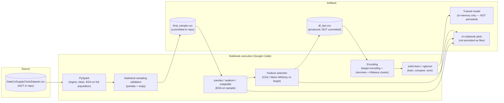

# Architecture Diagram — Notebook Data/ML Pipeline

Source of truth: [docs/PRD.md §15](../PRD.md#15-system-architecture). Duplicated here as a standalone reference per the requested `docs/architecture/` deliverable.

All elements above are **implemented**, except the two artifacts explicitly marked "NOT committed" / "NOT persisted," which the notebook produces transiently in-session but does not save to the repository.
