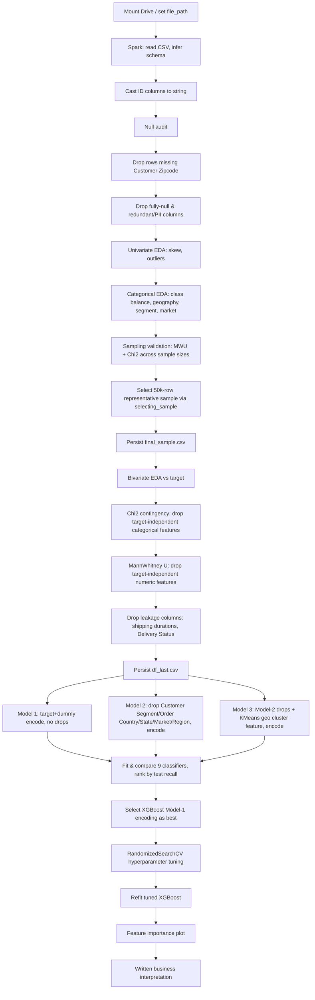
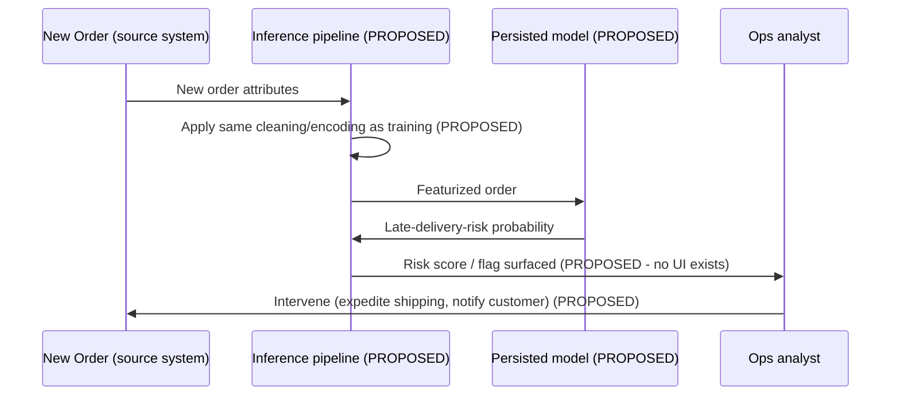

# Architecture Diagram — User Journeys

Source of truth: [docs/PRD.md §14](../PRD.md#14-user-journeys). Duplicated here as a standalone reference per the requested `docs/architecture/` deliverable.

## Implemented journey — data scientist runs the end-to-end analysis

## Proposed journey (NOT implemented) — ops analyst acts on a risk score

