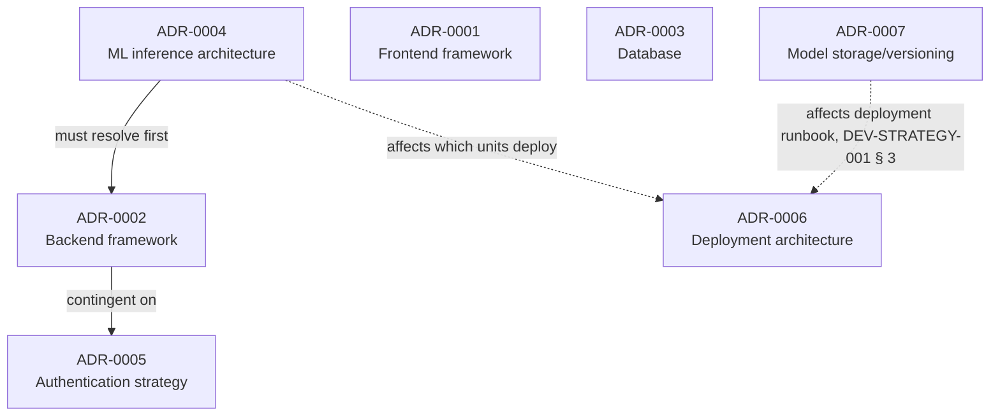

# Architecture Decision Summary & Implementation Gate

Produced by executing `ARCH-004` to resolve the governance blocker `ARCH-003` identified
([ARCH-BLOCKERS-001.md § BLOCK-001](ARCH-BLOCKERS-001.md#block-001-critical--zero-adrs-exist-implementation-may-not-begin-in-any-area))
and to propose a resolution for the `Type`-feature blocker
([BLOCK-002](ARCH-BLOCKERS-001.md#block-002-critical--type-feature-required-by-the-ml-pipeline-is-unavailable-in-the-database-schema)).
This document summarizes seven newly-drafted ADRs and one new schema-revision proposal; it
decides nothing itself. **No ADR is marked `Accepted` by this document or any other artifact in
this repository** — every one of the seven remains `Proposed`, awaiting a human reviewer.

## 1. The seven ADR recommendations

| ADR | Decision point | Recommended option (Proposed, not Accepted) | File |
|---|---|---|---|
| ADR-0001 | Frontend framework | Angular | [ADR-0001-frontend-framework.md](../../decisions/ADR-0001-frontend-framework.md) |
| ADR-0002 | Backend framework | Java Spring Boot (**contingent on ADR-0004**) | [ADR-0002-backend-framework.md](../../decisions/ADR-0002-backend-framework.md) |
| ADR-0003 | Database | PostgreSQL | [ADR-0003-database-selection.md](../../decisions/ADR-0003-database-selection.md) |
| ADR-0004 | ML inference architecture | Separate Python inference service | [ADR-0004-ml-inference-architecture.md](../../decisions/ADR-0004-ml-inference-architecture.md) |
| ADR-0005 | Authentication strategy | Session-based via Spring Security (**contingent on ADR-0002**) | [ADR-0005-authentication-strategy.md](../../decisions/ADR-0005-authentication-strategy.md) |
| ADR-0006 | Deployment architecture | Containerized (app components); serverless evaluated for the batch job specifically | [ADR-0006-deployment-architecture.md](../../decisions/ADR-0006-deployment-architecture.md) |
| ADR-0007 | Model storage/versioning | File-based for MVP, revisit at retraining-cadence time | [ADR-0007-model-storage-and-versioning.md](../../decisions/ADR-0007-model-storage-and-versioning.md) |

Every recommendation above is drawn directly from `ARCH-TRADEOFF-001`'s already-approved-for-use
trade-off analysis — none is a new evaluation; `ARCH-004`'s job was to formalize these into ADR
form, not to re-decide them.

## 2. Dependencies between decisions

- **ADR-0004 → ADR-0002:** `ARCH-TRADEOFF-001` § 2 and this review's `ADR-0002` text both state
  the Spring Boot recommendation only holds if ADR-0004 is accepted as recommended (a separate
  Python service). If a human instead rejects ADR-0004 in favor of an in-process/embedded
  approach, ADR-0002 must be re-evaluated before acceptance — it should not simply be accepted
  as-drafted in that scenario.
- **ADR-0002 → ADR-0005:** the Spring Security recommendation is explicitly tied to Spring Boot
  winning ADR-0002. A non-Java backend outcome requires re-evaluating ADR-0005 on that backend's
  own equivalent tooling.
- **ADR-0001 and ADR-0003** have no hard dependency on any other ADR — they can be accepted (or
  rejected) independently.
- **ADR-0006 and ADR-0007** are not blocked by the others, but their *content* (which deployable
  units exist, and how the model-version pointer is implemented) was written assuming ADR-0004's
  and ADR-0007's own recommended outcomes respectively — already reflected in
  `DEV-STRATEGY-001` § 1/§ 3, so no rework is needed there if all recommendations are accepted
  as-is.

## 3. What requires human approval

**Everything in § 1 and § 4 below requires human approval before it has any authorizing effect.**
Specifically:
- Each of the seven ADRs must be individually set to `Accepted` (or `Rejected`, or amended) by a
  human reviewer — no AI agent may do this, per `docs/decisions/README.md`'s own rule, restated
  and honored throughout this execution.
- The `Type`-feature resolution (§ 4) requires a human to choose Option A or B and then apply the
  corresponding revision to the affected Approved artifact(s) — this document and
  `DB-ARCH-REVISION-001` only recommend, per `ARCH-004`'s explicit constraint not to silently
  change any approved artifact.
- The PostgreSQL recommendation (ADR-0003) carries one specific open question only the business
  stakeholder can answer: whether an existing enterprise licensing/hosting agreement favors MySQL
  instead — flagged in ADR-0003 itself, not resolved here.
- The OAuth2/SSO alternative considered and not recommended for ADR-0005 depends on whether the
  business already operates an identity provider — also unconfirmed, flagged in ADR-0005.

## 4. The proposed `Type`-feature resolution

See [DB-ARCH-REVISION-001-type-feature.md](../database/DB-ARCH-REVISION-001-type-feature.md) for
the full analysis. Summary: **Option A is recommended** — add `type` as a new column on the
`order` entity in `DB-ARCH-001`. Verified directly against `final_sample.csv` (not assumed):
`Type` is 100%-populated, order-grain (confirmed by one customer's 18 orders using three
different payment types), and was already retained post-feature-selection even by the original
notebook's own leakage-affected pipeline (`df_last.csv`'s committed header includes it). This
path requires a one-column, additive schema change, no change to `BE-ARCH-001`'s contract, and no
ML retraining or re-approval of `ML-PIPELINE-001`/`ML-INFERENCE-001`. Option B (drop `Type` from
the model) was evaluated and not recommended — it would require a new training/evaluation run,
which this task is explicitly not authorized to execute, and would invalidate
`ML-PIPELINE-001`'s already-measured § 4 metrics without a clear offsetting benefit.

**This recommendation is not applied to `DB-ARCH-001` by this document.** A human (or a
subsequent, explicitly-scoped prompt execution) must apply the specific edit described in
`DB-ARCH-REVISION-001` § 5 and re-approve the revised `DB-ARCH-001`.

## 5. Decisions required before application scaffolding (`src/` creation)

Per `docs/IMPLEMENTATION_ROADMAP.md`'s Stage 5 gate and `PROJECT_CONTEXT.md § 4` rule 9, the
following must be `Accepted` (not merely `Proposed`) before any `src/frontend/`, `src/backend/`,
or `src/ml-service/` work begins:

- **ADR-0001** (frontend framework) — gates `src/frontend/`.
- **ADR-0002** (backend framework) — gates `src/backend/`; accept only after ADR-0004.
- **ADR-0003** (database) — gates the database schema's physical implementation.
- **ADR-0004** (ML inference architecture) — gates `src/ml-service/` and must be resolved before
  ADR-0002.
- **ADR-0005** (authentication strategy) — gates the backend's auth implementation specifically;
  accept only after ADR-0002.

**Additionally, before `FR-031` (batch scoring) can be implemented correctly:** the `Type`-feature
resolution (§ 4 above) must be applied — i.e., `DB-ARCH-001` revised and re-approved (if Option A
is chosen) or `ML-PIPELINE-001`/`ML-INFERENCE-001` revised, re-measured, and re-approved (if
Option B is chosen).

## 6. Decisions that can be completed later, without blocking scaffolding

- **ADR-0006** (deployment architecture) — affects where components run, not how they are built;
  a reasonable default (containers) can be assumed during early scaffolding and formally accepted
  before the first deployment, not before the first line of application code.
- **ADR-0007** (model storage/versioning) — affects how the trained model is persisted, which is
  needed by Stage 6 (ML integration), not Stage 5 (initial scaffolding of the non-ML-dependent
  flows, per the roadmap's own Stage 5 gate description: "a working backend + frontend skeleton
  implementing the MVP's non-ML-dependent flows, even with a stubbed risk score").
- The non-blocking findings carried forward from `ARCH-003` (CONS-004 through CONS-007 — see § 7
  below) do not gate scaffolding at all.

## 7. Future-improvements backlog (explicitly not expanded in this task)

Per `ARCH-004`'s instruction not to re-open all seven `ARCH-003` consistency findings, the
following remain open, tracked in
[ARCH-CONSISTENCY-001.md](ARCH-CONSISTENCY-001.md), and must not delay scaffolding unless new
evidence establishes a genuine implementation blocker:

- **CONS-004** — `Customer Id`/`Customer Zipcode` display-scope inconsistency between
  `NFR-WEB-003` and `BE-ARCH-001`'s actual contract.
- **CONS-005** — the batch-trigger endpoint's existence/authorization, and the batch-scoring
  cadence (`docs/PRD.md § 24` Open Question 7).
- **CONS-006** — the missing manual-refresh UI control flagged by `FE-ARCH-001` § 6.
- **CONS-007** — the "customer-identity/history context" interpretive gap between
  `UI-DESIGN-001` § 2 and `BE-ARCH-001` § 2.4.

(CONS-002 and CONS-003 — the zero-ADR governance gap and the stale `docs/decisions/README.md`
narrative — are resolved by this execution; see § 8.)

## 8. Traceability corrections applied by this execution

- `docs/decisions/README.md` — "Status as of 2026-11-03" narrative corrected (no longer claims
  "no ADR has been created yet" or that `DB-001`/`BE-001`/`FE-001`/`ML-002`/`SEC-001`/`DEV-001`
  "have not been executed yet either," both now false); backlog table updated with the seven new
  ADR file links, resolving `ARCH-003`'s CONS-002/CONS-003 findings.
- `prompt-library/PROMPT_INDEX.md` — `ARCH-004` registered as an executed prompt.
- Every ADR's `related_artifacts` front-matter links to its actual source `ARCH-TRADEOFF-001`
  section and the downstream artifact(s) it feeds, per `ARCH-004` § 5's instruction.
- No `related_decisions` field in any already-Approved artifact was edited — those fields already
  correctly listed the ADR numbers as forthcoming; they now resolve to real files instead of
  "not yet created."
