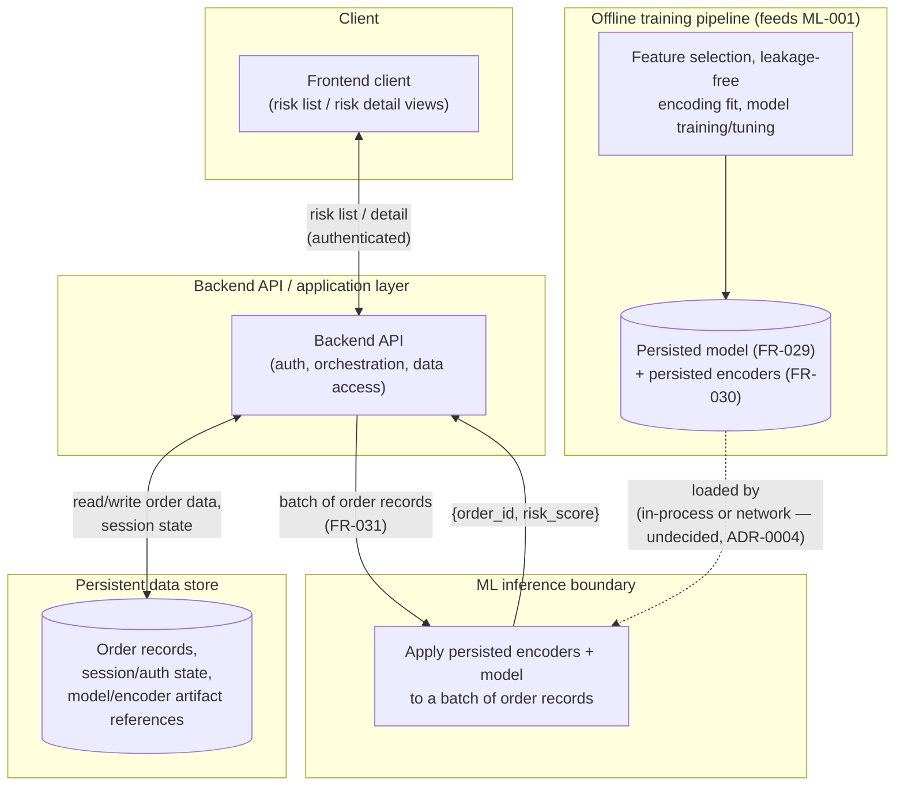
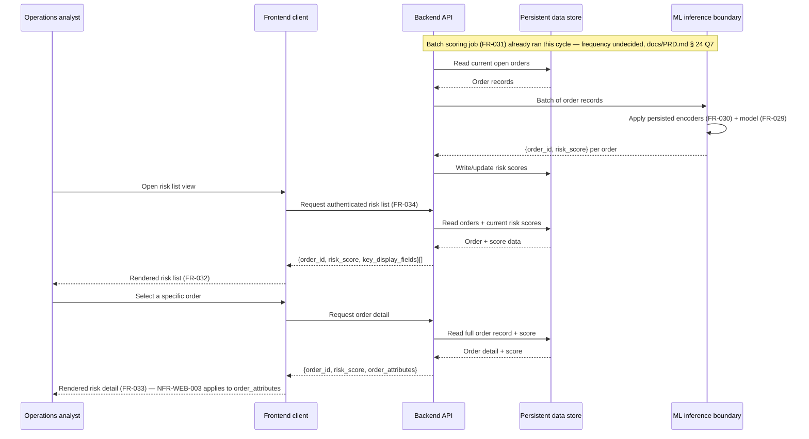

> **Approval note.** Approved 2026-11-03 by the project stakeholder in this session, against
> ARCH-001's validation requirements: no concrete technology named as a requirement (verified by
> grep), every contract specified abstractly, every decision point cross-referenced in the ADR
> backlog. Approved as-is, with no requested changes.

# Technical Architecture Design — High-Level, Technology-Agnostic

Produced by executing [ARCH-001](../../../prompt-library/03-system-architecture/ARCH-001-technical-architecture-design.md)
against `docs/PRD.md § 28` (approved), `§ 12`, `§ 15`, `docs/architecture/pipeline-architecture.md`,
`docs/architecture/user-journeys.md`, and [PD-VISION-001](../product/PD-VISION-001-mvp-scope.md).

**No frontend framework, backend framework, database product, or cloud provider is named as a
requirement anywhere below.** Where the stakeholder's stated preferences (Angular / Spring Boot /
Spring Security / Python ML service / PostgreSQL-or-MySQL) are mentioned, they are labeled
candidates pending `ARCH-002`, exactly as `PROJECT_CONTEXT.md § 1` and `docs/decisions/README.md`
already require.

## 1. Component boundaries

Four components are needed to satisfy the MVP FRs in `docs/PRD.md § 28` (FR-029–FR-034):

### 1.1 Frontend client
- **Responsibility:** Render the risk list view (FR-032) and risk detail view (FR-033) for the
  authenticated operations-analyst role; handle the authentication flow's client-side half
  (FR-034).
- **Must not be responsible for:** computing risk scores, applying any encoding/business logic
  to raw order data, or storing order data beyond what it needs to render the current view.
- **Contract exposed to its neighbor (backend):** none — it is a consumer only. **Contract it
  consumes from the backend:** a list of `{order_id, risk_score, key_display_fields}` for the
  list view, and a single `{order_id, risk_score, order_attributes}` for the detail view, both
  behind an authenticated request. Exact field list, transport (REST/GraphQL/etc.), and whether
  `Latitude`/`Longitude` appear in `order_attributes` is explicitly deferred — see
  `docs/PRD.md § 28`'s NFR-WEB-003 and Open Question 8.
- **Candidate technology** (per `PROJECT_CONTEXT.md § 1`, unapproved): Angular — to be evaluated
  by `ARCH-002` against alternatives in `FE-001`.

### 1.2 Backend API / application layer
- **Responsibility:** Own authentication/session handling (FR-034, NFR-WEB-001); serve the risk
  list/detail contracts to the frontend; own the persistent data store's access; trigger or
  orchestrate the batch risk-scoring job (FR-031); own the quasi-identifier display decision once
  made (NFR-WEB-003) — i.e., it is the enforcement point, even though the *decision itself* is a
  privacy-reviewer call this artifact does not make.
- **Must not be responsible for:** fitting or refitting the ML encoders, training the model, or
  deciding feature selection — those belong to the offline training pipeline (§ 2 below). The
  backend *applies* a persisted model/encoder pair; it does not derive one.
- **Contract exposed to the frontend:** see § 1.1. **Contract exposed to the ML inference
  boundary (§ 1.3):** a batch of order records to score, in a schema the backend owns (not
  necessarily `final_sample.csv`'s 32-column schema); it receives back `{order_id, risk_score}`
  pairs. Whether this contract is an in-process function call or a network call is exactly the
  decision deferred to § 1.3/ADR-0004.
- **Candidate technology** (unapproved): Java Spring Boot with Spring Security — to be evaluated
  by `ARCH-002` against alternatives in `BE-001`.

### 1.3 ML inference boundary
- **Responsibility:** Given a batch of order records in the backend's agreed schema, apply the
  **persisted** fitted encoders (FR-030) and the **persisted** trained model (FR-029) to produce
  a risk score per order. Nothing else.
- **Must not be responsible for:** fitting encoders, training or retraining the model, or
  deciding which features are used — all of that is the offline training pipeline's job (§ 2).
  This boundary only ever *applies* artifacts it did not create.
- **Explicitly undecided here, per ARCH-001's own mandate:** whether this is in-process with the
  backend (§ 1.2) or a separate service reached over a network boundary. `PROJECT_CONTEXT.md § 1`
  states a "Python ML inference service" as the stakeholder's preferred direction, but this
  artifact treats that as **one candidate among several** for `ARCH-002` to evaluate (ADR-0004),
  not a given — consistent with ARCH-001's technical constraints.
- **Contract:** input = batch of order records (backend's schema); output = `{order_id,
  risk_score}` pairs. No contract detail beyond this abstract shape — that is `ML-002`'s job.

### 1.4 Persistent data store
- **Responsibility:** Hold order records the web application operates on, the model/encoder
  artifacts' storage location (or a reference to where they live, if stored outside the
  database), and whatever session/authentication state FR-034 requires.
- **Must not be responsible for:** any ML computation — it is a store, not a compute component.
- **Contract:** read/write access for the backend only; no other component accesses it directly
  (the frontend never queries it, and the ML inference boundary receives data *through* the
  backend's contract in § 1.2, not by querying the store itself — this keeps the ML boundary
  swappable without the store needing to know about it).
- **Candidate technology** (unapproved): PostgreSQL or MySQL — to be evaluated by `ARCH-002`
  against alternatives in `DB-001`.

## 2. Mapping the existing notebook pipeline onto this architecture

Per `docs/architecture/pipeline-architecture.md`, cross-referenced against `docs/PRD.md § 20`'s
gap analysis and `PROJECT_CONTEXT.md § 3`'s carried-forward ML correctness concerns:

| Existing notebook stage | Maps to | Notes |
|---|---|---|
| Spark ingestion, type casting, null audit/cleanup (cells 4–32) | **Offline training pipeline** (feeds `ML-001`) | Unchanged in spirit; `ML-001` decides whether Spark is retained or replaced, not this artifact |
| Univariate/categorical/bivariate EDA, plots (cells 34–52, 79–92) | **Retired from the production pipeline** | These are exploratory-analysis aids for a data scientist, not a runtime dependency of either the offline training pipeline or the online inference path. Retiring them from production code does not mean deleting the notebook — it remains valid as an analysis tool, per `docs/PRD.md § 2`'s description of what it is. |
| Statistical sampling validation (MWU + Chi² across sample sizes, `final_sample.csv` generation) | **Open — not assigned here** | This stage exists only because the full raw dataset was apparently too costly to carry through the original pandas-based modeling stage. Whether a production training pipeline needs this sampling step at all (versus training on the full available order history) depends on answers this artifact cannot give: dataset-provenance/license (`docs/PRD.md § 24` Q1) and actual data volume in production. Flagged for `ML-001` to decide, not silently carried forward or silently dropped. |
| Statistical feature selection (Chi² contingency / Mann-Whitney U vs. target) | **Offline training pipeline** (feeds `ML-001`) | Retained — this is a genuine strength per `docs/PRD.md § 19`, not a defect. |
| Leakage-column removal (shipping-duration fields, `Delivery Status`) | **Offline training pipeline** | Retained as correct, pre-existing practice (`docs/PRD.md § 19`). |
| Target encoding + dummy encoding + K-Means geo cluster (Model 1/2/3) | **Offline training pipeline, with a mandatory fix** | **Must not be carried forward as-is.** `PROJECT_CONTEXT.md § 3` items 1–2 require encoders to be fit on the training fold only, never the full dataset, before this becomes part of a production pipeline. This architecture assigns that fix to the offline training pipeline (feeding `ML-001`), explicitly not yet performed here — ARCH-001 designs *where* the fix happens, per its own technical constraints, it does not perform it. |
| 9-classifier comparison, XGBoost hyperparameter tuning | **Offline training pipeline** (feeds `ML-001`) | Retained; `ML-001` also owns broadening the evaluation beyond recall/accuracy per `PROJECT_CONTEXT.md § 3` items 6–7. |
| Feature importance + business interpretation (cells 168–170) | **Retired from the production pipeline** | Useful, human-facing analysis, but not a runtime dependency of the MVP's risk list/detail views (FR-032/FR-033), which only need a numeric score, not an importance plot. |
| (Does not exist yet) Applying a persisted model+encoders to a *new* order | **Online inference path** (feeds `ML-002`, served through § 1.3) | This is new work — the notebook has no equivalent of this today (`docs/PRD.md § 8`, § 20 GAP-006/GAP-012). It is constrained by `PROJECT_CONTEXT.md § 3` item 4 (prediction-time feature availability), which this artifact does not resolve — see § 3 below. |

**Customer Id target-encoding risk (`PROJECT_CONTEXT.md § 3` item 3)** is not resolved by this
architecture either; it is carried forward as a property of whatever the offline training
pipeline produces, and the online inference path (§ 1.3) must be able to handle a `Customer Id`
value unseen during training (cold start) without erroring — this is stated here as a
**requirement on the inference boundary's contract**, not a fix, consistent with ARCH-001's
"design where the fix happens, don't perform it" mandate.

## 3. Diagrams

### 3.1 Component diagram

### 3.2 Sequence diagram — MVP primary journey (risk-score retrieval)

## 4. Decision points requiring an ADR

Every decision point below is already in `docs/decisions/README.md`'s anticipated-decisions
backlog — none is new, per ARCH-001's constraint not to invent decision points without
backlogging them:

| Decision point raised here | Backlog entry | Where it surfaced above |
|---|---|---|
| Frontend framework | ADR-0001 | § 1.1 |
| Backend framework | ADR-0002 | § 1.2 |
| Database product | ADR-0003 | § 1.4 |
| ML inference architecture (in-process vs. separate service) | ADR-0004 | § 1.3 — explicitly left open here, as required |
| Authentication strategy | ADR-0005 | § 1.2, NFR-WEB-001 |
| Deployment architecture | ADR-0006 | Not detailed in this artifact (out of scope for a component-boundary design); still applies once components are realized |
| Model storage and versioning | ADR-0007 | § 1.3/§ 2 — "persisted model/encoders" is deliberately not specified as file-based vs. a registry here |

No new decision point was identified beyond this existing list.

## 5. Explicitly not resolved by this artifact

- Whether the ML inference boundary is in-process or a separate service (ADR-0004, `ARCH-002`).
- Whether the statistical sampling-validation stage has any place in a production training
  pipeline (§ 2 table, row 3) — flagged for `ML-001`.
- The prediction-time feature-availability audit (`PROJECT_CONTEXT.md § 3` item 4) — this
  architecture states that the online inference path (§ 1.3) must only receive features
  genuinely available at order-placement time, but does not itself enumerate which of
  `final_sample.csv`/`df_last.csv`'s columns qualify. That enumeration is `ML-001`/`ML-002`'s job.
- The target-encoding/feature-selection leakage fix itself (§ 2 table, rows 4/6) — assigned to
  the offline training pipeline, not performed here.
- NFR-WEB-003's quasi-identifier display question — still a privacy-reviewer decision, not an
  architecture decision.
