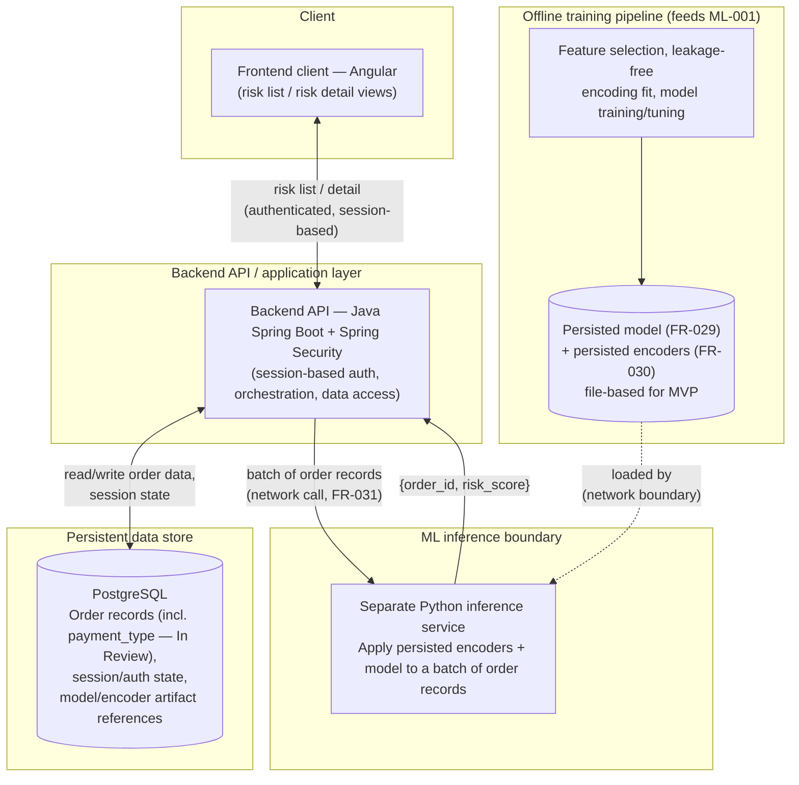

# Finalized Architecture — Component Design with Accepted Technology Choices

**What this is:** [ARCH-DESIGN-001](ARCH-DESIGN-001-high-level-architecture.md)'s component
design, with every technology candidate it deliberately left open now filled in with the
project owner's `Accepted` decision from [docs/decisions/](../../decisions/README.md), plus the
[`payment_type`](../database/DB-ARCH-REVISION-001-type-feature.md) schema revision folded in.
**What this is not:** a new architecture review. No component boundary, contract shape, or
responsibility below differs from `ARCH-DESIGN-001` — only the technology names attached to each
box have changed, from "candidate, pending `ARCH-002`" to "Accepted, `ADR-NNNN`." Where
`ARCH-DESIGN-001` left something genuinely unresolved (§ 5 there), it is still unresolved here —
this document does not quietly resolve anything ADR acceptance didn't actually resolve.

This is a convenience artifact, created directly on request rather than through a numbered
prompt-library execution. It supersedes nothing — `ARCH-DESIGN-001` remains the `Approved`,
technology-agnostic source of truth for the component boundaries themselves; this document is a
secondary, derived view for readability once the technology layer is settled.

## 1. Component boundaries, with accepted technology

### 1.1 Frontend client — **Angular** ([ADR-0001](../../decisions/ADR-0001-frontend-framework.md), Accepted)
- **Responsibility:** unchanged from `ARCH-DESIGN-001` § 1.1 — render the risk list view
  (FR-032) and risk detail view (FR-033); handle the client-side half of authentication
  (FR-034).
- **Must not be responsible for:** computing risk scores, applying encoding/business logic, or
  persisting order data beyond the current view — unchanged.
- **Contract:** unchanged — consumes `{order_id, risk_score, key_display_fields}[]` for the list
  view and `{order_id, risk_score, order_attributes}` for the detail view from the backend.
  **Still explicitly open** (per `ARCH-DESIGN-001` § 5 and `docs/PRD.md § 28` Open Question 8):
  the exact field list, transport style, and whether `Latitude`/`Longitude` appear in
  `order_attributes` — ADR acceptance did not resolve this; it remains a backend-contract
  decision, not an architecture one.

### 1.2 Backend API / application layer — **Java Spring Boot + Spring Security, session-based auth** ([ADR-0002](../../decisions/ADR-0002-backend-framework.md), [ADR-0005](../../decisions/ADR-0005-authentication-strategy.md), Accepted)
- **Responsibility:** unchanged from `ARCH-DESIGN-001` § 1.2 — own authentication/session
  handling, serve the risk list/detail contracts, own persistent-store access, trigger/
  orchestrate the batch risk-scoring job (FR-031), enforce the quasi-identifier display decision
  once made (NFR-WEB-003, still a privacy-reviewer call, not resolved here).
- **Must not be responsible for:** fitting/refitting encoders, training the model, or deciding
  feature selection — unchanged; those remain the offline training pipeline's job (§ 2).
- **Now able to supply `payment_type`:** per the accepted schema revision
  ([DB-ARCH-REVISION-001](../database/DB-ARCH-REVISION-001-type-feature.md), currently `In
  Review`), the backend's repository layer has a concrete column to read from when assembling
  the `type` field of an inference request — closing the gap `ARCH-BLOCKERS-001`'s BLOCK-002
  identified. This does not change the backend's contract shape (§ 1.2/§ 1.3 below), only what
  it can now read.
- **Session-based auth, not SSO:** `ADR-0005`'s acceptance explicitly recorded that no existing
  SSO/identity-provider requirement overrides this choice.

### 1.3 ML inference boundary — **separate Python inference service** ([ADR-0004](../../decisions/ADR-0004-ml-inference-architecture.md), Accepted)
- **Responsibility:** unchanged from `ARCH-DESIGN-001` § 1.3 — apply the persisted encoders
  (FR-030) and model (FR-029) to a batch of order records. Nothing else.
- **Must not be responsible for:** fitting encoders, training/retraining, or feature-selection
  decisions — unchanged.
- **Now resolved, where `ARCH-DESIGN-001` § 1.3 left it open:** this is a separate service
  reached over a network boundary, not in-process with the backend. The backend-to-inference
  contract (§ 1.2 of `ARCH-DESIGN-001`) is therefore a network call, per `ML-INFERENCE-001`'s
  nine-field request schema (`type`, `customerCity`, `customerId`, `customerZipcode`,
  `orderCity`, `orderCountry`, `orderRegion`, `orderState`, `shippingMode`) — unchanged by the
  `payment_type` schema revision, which only changes how the backend *populates* the `type`
  field, not the contract's shape.

### 1.4 Persistent data store — **PostgreSQL** ([ADR-0003](../../decisions/ADR-0003-database-selection.md), Accepted)
- **Responsibility:** unchanged from `ARCH-DESIGN-001` § 1.4 — hold order records, the model/
  encoder artifacts' storage location (or a reference to it), and session/authentication state.
- **Must not be responsible for:** any ML computation — unchanged.
- **Why PostgreSQL, not MySQL:** native row-level security, a direct fit for enforcing
  `DB-ARCH-001` § 2.2's `customer_location` access restriction at the data layer. `ADR-0003`'s
  acceptance explicitly recorded that no existing MySQL/Oracle hosting or licensing agreement
  overrides this choice.
- **Schema status:** [DB-ARCH-001](../database/DB-ARCH-001-schema-design.md) is `Approved` and
  unmodified; [DB-ARCH-REVISION-001](../database/DB-ARCH-REVISION-001-type-feature.md) (adding
  `order.payment_type`) is `In Review`, not yet `Approved` — see that artifact's § 7 checklist.

### 1.5 Deployment — **containerized app components; serverless evaluated for the batch job alone** ([ADR-0006](../../decisions/ADR-0006-deployment-architecture.md), Accepted)
- Not detailed as its own component in `ARCH-DESIGN-001` (out of scope for a component-boundary
  design); included here since it is now a settled decision. Frontend, backend, database, and
  the ML inference service are containerized; the periodic batch-scoring job (FR-031) alone may
  additionally use a serverless/function-based execution mechanism — the two are accepted as
  distinct, not collapsed into one blanket answer. **Still open:** which specific cloud provider
  or orchestrator — `ADR-0006`'s acceptance did not decide this.

### 1.6 Model storage — **file-based for MVP** ([ADR-0007](../../decisions/ADR-0007-model-storage-and-versioning.md), Accepted)
- The "persisted model (FR-029) / persisted encoders (FR-030)" artifacts `ARCH-DESIGN-001` § 1.3/
  § 2 deliberately left unspecified (file-based vs. registry) are now file-based: the model
  artifact in its native serialization format plus a JSON metadata sidecar, per
  `ML-PIPELINE-001` § 5 and `DEV-STRATEGY-001` § 3's hot-swappable pointer mechanism. **Revisit
  trigger preserved:** reconsider this once automated retraining becomes a recurring activity
  (`docs/PRD.md § 21` Phase 4) — acceptance did not make this permanent.

## 2. Mapping the existing notebook pipeline onto this architecture

Unchanged from [ARCH-DESIGN-001 § 2](ARCH-DESIGN-001-high-level-architecture.md#2-mapping-the-existing-notebook-pipeline-onto-this-architecture)
— no ADR touches the offline-training-pipeline mapping, the leakage-free-encoding-fit
requirement, or the statistical-sampling-validation open question. One addition: the "Target
encoding + dummy encoding ... (Model 1/2/3)" row's mandatory fix now has a concrete, settled
database source for one of its required inputs — `order.payment_type` — once
`DB-ARCH-REVISION-001` is approved and implemented; the fix itself (fitting encoders on the
training fold only) remains unperformed, exactly as `ARCH-DESIGN-001` stated.

## 3. Diagrams

### 3.1 Component diagram, with accepted technology labels

### 3.2 Sequence diagram — MVP primary journey

Unchanged from [ARCH-DESIGN-001 § 3.2](ARCH-DESIGN-001-high-level-architecture.md#32-sequence-diagram--mvp-primary-journey-risk-score-retrieval);
no accepted ADR altered the message sequence, only which concrete technology implements each
participant.

## 4. Decision points — now all Accepted

| Decision point | ADR | Accepted decision | Still open after acceptance |
|---|---|---|---|
| Frontend framework | [ADR-0001](../../decisions/ADR-0001-frontend-framework.md) | Angular | — |
| Backend framework | [ADR-0002](../../decisions/ADR-0002-backend-framework.md) | Java Spring Boot | — |
| Database product | [ADR-0003](../../decisions/ADR-0003-database-selection.md) | PostgreSQL | — |
| ML inference architecture | [ADR-0004](../../decisions/ADR-0004-ml-inference-architecture.md) | Separate Python service | Exact service framework/runtime not specified by the ADR |
| Authentication strategy | [ADR-0005](../../decisions/ADR-0005-authentication-strategy.md) | Session-based Spring Security | — |
| Deployment architecture | [ADR-0006](../../decisions/ADR-0006-deployment-architecture.md) | Containerized (+ serverless option for the batch job) | Specific cloud provider/orchestrator |
| Model storage and versioning | [ADR-0007](../../decisions/ADR-0007-model-storage-and-versioning.md) | File-based for MVP | Revisit once retraining is recurring |

## 5. Explicitly still not resolved by any of this

Carried forward unchanged from `ARCH-DESIGN-001` § 5, since no ADR touches these:

- The frontend-backend contract's exact field list / transport / `Latitude`/`Longitude`
  inclusion (`docs/PRD.md § 28` Open Question 8).
- Whether the statistical sampling-validation stage belongs in a production training pipeline —
  flagged for `ML-001`, still open.
- The prediction-time feature-availability audit's full enumeration — `ML-001`/`ML-002`'s job.
- The target-encoding/feature-selection leakage fix itself — assigned, not performed.
- NFR-WEB-003's quasi-identifier display question — a privacy-reviewer decision.
- **New, from this execution:** `DB-ARCH-REVISION-001`'s own artifact review (§ 7 checklist
  there) — the `payment_type` column exists on paper but is not yet `Approved`.
- No `src/` implementation exists yet for any component above — all seven ADRs being `Accepted`
  removes the governance blocker to starting it, but starting it is a separate decision.
