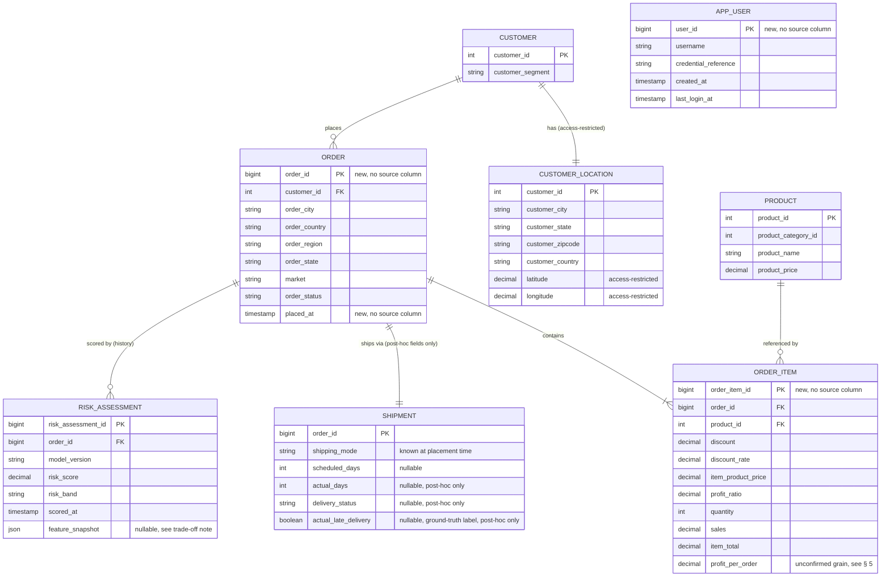

> **Approval note.** Approved 2026-11-03 by the project stakeholder in this session, including
> the surrogate `order_id`/`order_item_id`/`placed_at` additions and the 3 unconfirmed
> assumptions in § 5 (Customer Id uniqueness, order grain, order-to-shipment cardinality), which
> remain open for later verification rather than blocking this approval. Approved as-is, with no
> requested changes.

# Database Architecture & Schema Design — MVP

Produced by executing [DB-001](../../../prompt-library/05-database-design/DB-001-database-architecture.md)
against `docs/PRD.md § 12.1` (flat schema), `df_last.csv`'s header (the leakage-cleaned modeling
schema), and [ARCH-DESIGN-001](../architecture/ARCH-DESIGN-001-high-level-architecture.md)
(Approved). No RDBMS product is named as a requirement anywhere below — schema is written in
product-neutral standard-SQL types; any PostgreSQL/MySQL-specific note is explicitly marked
illustrative, not required, per `ARCH-002`'s still-pending ADR-0003.

## 1. Why the flat schema is not just re-drawn as the database

`docs/PRD.md § 12.1` documents `final_sample.csv` as **one denormalized entity** — itself flagged
there as a pre-feature-selection snapshot, not the final modeling table (GAP-002), and explicitly
described as "not a transactional schema." Carrying that flat structure into the web application's
database would just be the CSV with extra steps. § 2 below normalizes it into genuine entities.

## 2. Entities

### 2.1 `customer`
Core, non-sensitive customer attributes only.

| Column | Type | Notes |
|---|---|---|
| `customer_id` | INTEGER, PK | **Unconfirmed assumption**, per DB-001's own failure-handling clause: `docs/PRD.md` never confirms `Customer Id` is a genuine candidate key across the full population (only the 50,000-row sample was inspected) — see § 5. |
| `customer_segment` | VARCHAR | Consumer / Corporate / Home Office, per `docs/PRD.md § 12.1`. |

### 2.2 `customer_location` (isolated for the quasi-identifier concern)
Per `docs/PRD.md § 17`/GAP-013, `Customer Id` + location fields in combination form a
quasi-identifier set. **Decision (per DB-001 instruction 3): isolate the location fields in a
separate table with restricted access**, rather than a flag field on `customer` — this makes
"who can query raw customer location" a single, auditable grant, not a column-level policy
scattered across every query that touches `customer`.

| Column | Type | Notes |
|---|---|---|
| `customer_id` | INTEGER, PK, FK → `customer.customer_id` | |
| `customer_city` | VARCHAR | |
| `customer_state` | VARCHAR | |
| `customer_zipcode` | VARCHAR | Stored as text, not numeric — zip codes are not arithmetic values and some formats have leading zeros. |
| `customer_country` | VARCHAR | |
| `latitude` | DECIMAL | **Access-restricted** — this is the field `docs/PRD.md § 28`'s NFR-WEB-003 is most concerned about; this table's restricted access is this schema's enforcement mechanism for that still-open decision. |
| `longitude` | DECIMAL | Same restriction as `latitude`. |

### 2.3 `order`
**New primary key, not present in the source data.** The flat schema in `docs/PRD.md § 12.1` has
**no `Order Id` column at all** — this is a genuine gap this review surfaces, not assumed away:
the source rows appear to be one row per order (or possibly per order-line; the flat file does not
disambiguate this unambiguously). The web application introduces a surrogate `order_id` as a new,
web-application-only key; it does not come from the source CSVs.

| Column | Type | Notes |
|---|---|---|
| `order_id` | BIGINT, PK | **New, for the web application** — no source column. |
| `customer_id` | INTEGER, FK → `customer.customer_id` | |
| `order_city`, `order_country`, `order_region`, `order_state` | VARCHAR | Order **destination** geography — kept on `order`, not `customer_location`, since it describes where this specific order ships to, which may differ from the customer's home location; a lower privacy sensitivity than `customer_location`'s fields in this schema's judgment, but still not raw lat/long (none exists for order destination in the source data anyway). |
| `market` | VARCHAR | APAC / EMEA / LATAM / etc. |
| `order_status` | VARCHAR | COMPLETE / PENDING_PAYMENT / PROCESSING / CLOSED, etc. |
| `placed_at` | TIMESTAMP | **New, for the web application.** Needed to support "order-placement-time" scoring (`PD-VISION-001`'s MVP scope); the source CSVs carry no order-level timestamp. |

### 2.4 `product`
| Column | Type | Notes |
|---|---|---|
| `product_id` | INTEGER, PK | Mapped from `Order Item Cardprod Id`, which appears to be the actual per-product reference on an order line (distinct from `Product Category Id`, which is a coarser grouping — kept as a separate attribute below). |
| `product_category_id` | INTEGER | From `Product Category Id`. Note: this column was dropped by the *ML* feature-selection step (FR-015) for being statistically independent of the target — that is an ML-pipeline decision about predictive usefulness, not a reason to drop it from the *operational* schema, where it may still have display/reporting value. Kept here. |
| `product_name` | VARCHAR | From `Product Name`. Same FR-015 note as above — kept operationally despite being ML-feature-selected out. |
| `product_price` | DECIMAL | From `Product Price` — the product's base/list price. |

### 2.5 `order_item`
Per-line financial attributes — this is where most of the flat schema's numeric columns belong.

| Column | Type | Notes |
|---|---|---|
| `order_item_id` | BIGINT, PK | **New, for the web application** (no source column; the flat schema has no line-item key either). |
| `order_id` | BIGINT, FK → `order.order_id` | |
| `product_id` | INTEGER, FK → `product.product_id` | |
| `discount` | DECIMAL | From `Order Item Discount`. |
| `discount_rate` | DECIMAL | From `Order Item Discount Rate`. |
| `item_product_price` | DECIMAL | From `Order Item Product Price` — the actual transacted price for this line, which may differ from `product.product_price` due to the discount above; kept distinct intentionally. |
| `profit_ratio` | DECIMAL | From `Order Item Profit Ratio`. |
| `quantity` | INTEGER | From `Order Item Quantity`. |
| `sales` | DECIMAL | From `Sales`. |
| `item_total` | DECIMAL | From `Order Item Total`. |
| `profit_per_order` | DECIMAL | From `Order Profit Per Order`. **Note:** this is named per-order in the source but is mapped here at the `order_item` grain, pending confirmation of whether it is truly computed per line or per whole order — flagged as an **unconfirmed assumption**, not silently resolved (see § 5). |

### 2.6 `shipment`
Holds the fields that are only knowable **after** an order ships — kept structurally separate
from `order` specifically so the online inference path (ML inference boundary, per
`ARCH-DESIGN-001`) cannot accidentally read post-fulfillment fields when scoring a new order at
placement time (`PROJECT_CONTEXT.md § 3` item 4 — prediction-time feature availability).

| Column | Type | Notes |
|---|---|---|
| `order_id` | BIGINT, PK, FK → `order.order_id` | Modeled 1:1 with `order` for MVP — **unconfirmed assumption** that an order is never re-shipped/split into multiple shipments in this business's actual process; flagged, not asserted (see § 5). |
| `shipping_mode` | VARCHAR | From `Shipping Mode` — known at order-placement time (it's a selection made when the order is placed), so this is the one `shipment`-table field the online inference path *may* legitimately read; this is noted here, not decided — `ML-001`/`ML-002` make the final call on exactly which fields are prediction-time-available. |
| `scheduled_days` | INTEGER, nullable | From `Days for shipment (scheduled)`. |
| `actual_days` | INTEGER, nullable | From `Days for shipping (real)`. **Null until the order actually ships** — this field, along with `delivery_status`/`actual_late_delivery` below, must never be populated at order-placement time and must never be exposed to the online inference path as an input feature; it exists here only to support post-hoc model evaluation (ties to `PROJECT_CONTEXT.md § 3` item 5, reproducibility) once the real outcome is known. |
| `delivery_status` | VARCHAR, nullable | From `Delivery Status`. Same post-hoc-only caveat as `actual_days`. |
| `actual_late_delivery` | BOOLEAN, nullable | From `Late_delivery_risk` — this is the **ground-truth label** from the source dataset, renamed here to make clear it is the *observed outcome*, not a prediction. It is distinct from `risk_assessment.risk_score` (§ 2.7) and is populated only once delivery actually completes, for drift/evaluation purposes, not for display to the ops analyst as if it were a live prediction. |

### 2.7 `risk_assessment`
The new entity this web application actually needs that the notebook never produced (per
`docs/PRD.md § 8`/§ 20 GAP-006/GAP-012) — this is what makes risk scores auditable rather than
ephemeral, per DB-001 instruction 2.

| Column | Type | Notes |
|---|---|---|
| `risk_assessment_id` | BIGINT, PK | |
| `order_id` | BIGINT, FK → `order.order_id` | Not unique alone — an order gets a new row each scoring cycle (FR-031), preserving history. |
| `model_version` | VARCHAR, NOT NULL | **Required, not optional** — per DB-001 instruction 2, this directly supports ADR-0007 (model storage/versioning, `ARCH-TRADEOFF-001` recommended file-based storage for MVP); whatever identifies a specific persisted model file (e.g., a filename, hash, or semantic version string) goes here. Without this column, a risk score could never be traced back to which model produced it. |
| `risk_score` | DECIMAL | The model's output probability. |
| `risk_band` | VARCHAR | High / Medium / Low, per `UI-DESIGN-001`'s risk-band treatment — thresholds that map `risk_score` → `risk_band` are **not** decided here (that's `ML-001`/`ML-002`'s job); this column just stores the result of whatever thresholding they define. |
| `scored_at` | TIMESTAMP, NOT NULL | |
| `feature_snapshot` | JSON/TEXT, nullable | **Decision (per DB-001 instruction 2a):** store the feature values actually used for this specific prediction. **Trade-off stated, not silently picked:** this duplicates data already in `order`/`order_item`/`customer` as of the scoring time, and that duplication is deliberate — those source rows can change after the fact (e.g., a corrected address), so without this snapshot, a later drift/debugging analysis could not reconstruct exactly what the model saw. Given this project's order volumes (tens of thousands, not web-scale traffic), the storage cost of this duplication is judged acceptable against the debuggability benefit. If order volume grows substantially, this trade-off should be revisited. |

### 2.8 `app_user`
Supports FR-034's minimal, single-role authentication. No roles/permissions table is included —
per NFR-WEB-004 (`docs/PRD.md § 28`), multi-role authorization is explicitly out of MVP scope.

| Column | Type | Notes |
|---|---|---|
| `user_id` | BIGINT, PK | **New, for the web application** — no source column (the notebook's data has no concept of an application user). |
| `username` | VARCHAR, UNIQUE | |
| `credential_reference` | VARCHAR | Deliberately abstract — whether this is a password hash or a reference to an external identity provider is ADR-0005's decision (`ARCH-TRADEOFF-001` recommended session-based auth via Spring Security, contingent on the backend-framework ADR); this schema does not presume which. |
| `created_at`, `last_login_at` | TIMESTAMP | |

**`department_id` is explicitly dropped, not silently omitted.** `Department Id` appears in the
flat schema but is (a) already dropped by the ML pipeline's own feature selection (FR-015, as
statistically independent of the target) and (b) not required by any FR in `docs/PRD.md § 28` or
any screen in `UI-DESIGN-001`. No persona in `PD-VISION-001` is scoped to need it for display. If
a future requirement surfaces a business need for it, it can be added back — it is not
structurally precluded by this schema, just not included now.

## 3. ER diagram

*`APP_USER` has no relationship edge to the other entities above — it exists only to support
authentication (FR-034), not order/customer data ownership, so it is intentionally unconnected in
this diagram.*

## 4. Migration-readiness notes

- **Primary query pattern 1 — "fetch risk assessment(s) for order X":** index `risk_assessment
  (order_id, scored_at DESC)` to serve both "latest score for order X" and "full history for order
  X" efficiently.
- **Primary query pattern 2 — "list high-risk open orders" (Screen 1 / FR-032):** at this
  project's scale (tens of thousands of orders, not web-scale), a straightforward index on
  `risk_assessment(risk_score DESC, scored_at DESC)` combined with `order.order_status` is likely
  sufficient without denormalization. If query latency becomes a problem at a larger production
  scale, a denormalized `order.current_risk_score`/`current_risk_band` column (updated by the
  FR-031 batch job) is a reasonable future optimization — **not adopted now**, to avoid
  introducing a second source of truth before there's evidence it's needed.
- `customer_location`'s access restriction (§ 2.2) should be implemented as a database-level grant
  (e.g., a restricted role/row-level policy, illustrative only — not a required RDBMS feature) so
  "who can read raw lat/long" is enforced at the data layer, not only in application code.
- No RDBMS-specific feature is required by this design. Where PostgreSQL's row-level security
  (`ARCH-TRADEOFF-001`'s stated rationale for recommending PostgreSQL for ADR-0003) would make the
  `customer_location` access restriction easier to implement, that is noted as illustrative,
  pending ADR-0003, not assumed here.

## 5. Unconfirmed assumptions (not silently resolved)

1. **`Customer Id` uniqueness across the full population** is not confirmed — only the 50,000-row
   sample has been inspected (per `docs/generated/product/PD-REVIEW-001-existing-project-digest.md`).
   A real production rollout must verify this before treating `customer_id` as a true candidate
   key; if it is not unique across markets, this schema's `customer.customer_id` PK would need
   revisiting.
2. **Order granularity:** whether the flat source file's one-row-per-record is one row per order
   or one row per order-line is not disambiguated by the documentation inspected — `order_item`
   assumes the latter (hence a separate `order_item` table); if it is actually the former, some
   `order_item`-grain columns (e.g., `profit_per_order`) may actually belong on `order` instead.
3. **Order-to-shipment cardinality** is modeled as 1:1 for MVP; whether this business ever splits
   an order into multiple shipments is not evidenced either way in the repository.

## 6. Traceability table — flat schema → normalized schema

| Source column (`docs/PRD.md § 12.1`) | Destination | Notes |
|---|---|---|
| `Type` | *Dropped* | Payment type — no FR in `docs/PRD.md § 28` or screen in `UI-DESIGN-001` needs it; not an ML feature of interest for the web app's MVP scope either. Can be re-added if a future requirement needs it. |
| `Days for shipping (real)` | `shipment.actual_days` | Post-hoc only — see § 2.6. |
| `Days for shipment (scheduled)` | `shipment.scheduled_days` | |
| `Delivery Status` | `shipment.delivery_status` | Post-hoc only. |
| `Late_delivery_risk` | `shipment.actual_late_delivery` | Renamed to distinguish ground-truth outcome from `risk_assessment.risk_score` (a prediction). |
| `Customer City` | `customer_location.customer_city` | |
| `Customer Country` | `customer_location.customer_country` | |
| `Customer Id` | `customer.customer_id` | See § 5 item 1. |
| `Customer Segment` | `customer.customer_segment` | |
| `Customer State` | `customer_location.customer_state` | |
| `Customer Zipcode` | `customer_location.customer_zipcode` | |
| `Department Id` | *Dropped* | See § 2.8's explicit justification. |
| `Latitude` | `customer_location.latitude` | Access-restricted. |
| `Longitude` | `customer_location.longitude` | Access-restricted. |
| `Market` | `order.market` | |
| `Order City` | `order.order_city` | |
| `Order Country` | `order.order_country` | |
| `Order Item Cardprod Id` | `product.product_id` (via `order_item.product_id`) | Reinterpreted as the product reference, not a line-item attribute. |
| `Order Item Discount` | `order_item.discount` | |
| `Order Item Discount Rate` | `order_item.discount_rate` | |
| `Order Item Product Price` | `order_item.item_product_price` | |
| `Order Item Profit Ratio` | `order_item.profit_ratio` | |
| `Order Item Quantity` | `order_item.quantity` | |
| `Sales` | `order_item.sales` | |
| `Order Item Total` | `order_item.item_total` | |
| `Order Profit Per Order` | `order_item.profit_per_order` | Grain unconfirmed — see § 5 item 2. |
| `Order Region` | `order.order_region` | |
| `Order State` | `order.order_state` | |
| `Order Status` | `order.order_status` | |
| `Product Category Id` | `product.product_category_id` | |
| `Product Name` | `product.product_name` | |
| `Product Price` | `product.product_price` | |
| `Shipping Mode` | `shipment.shipping_mode` | |
| *(no source column)* | `order.order_id` | New — see § 2.3. |
| *(no source column)* | `order.placed_at` | New — needed for order-placement-time scoring. |
| *(no source column)* | `order_item.order_item_id` | New. |
| *(no source column)* | `risk_assessment.*` (entire table) | New — the web application's core new capability. |
| *(no source column)* | `app_user.*` (entire table) | New — supports FR-034. |

Every column from `docs/PRD.md § 12.1`'s flat schema is accounted for above — either mapped or
explicitly dropped with a stated reason, per DB-001's validation requirement.
