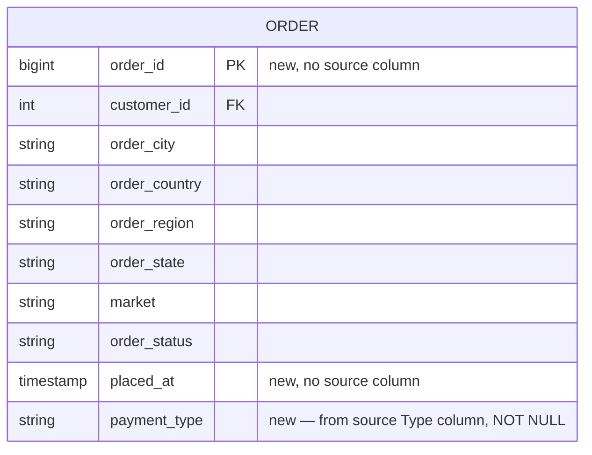

> **Approval record.** The project owner explicitly approved all five items in this artifact's
> § 7 review checklist on **2026-11-03**: the column name `payment_type`, the `order` entity
> placement, the `VARCHAR` type, the `NOT NULL` nullability, and the absence of a CHECK/enum
> constraint — and confirmed this is to remain a separate, superseding revision record rather
> than an in-place edit of `DB-ARCH-001`. `IMPL-001` recorded this approval and changed this
> artifact's status from `In Review` to `Approved` accordingly; it did not re-evaluate any of the
> five items. **This is now the authoritative superseding change for the `order` entity's
> `payment_type` attribute.** `docs/generated/database/DB-ARCH-001-schema-design.md` remains
> `Approved` and **unmodified** — this artifact supersedes its § 6 traceability row for `Type`
> (see § 4.3 below) without editing that file directly; a future consolidation of the two into
> one canonical schema document remains a separate editorial decision (see
> `docs/implementation/IMPLEMENTATION-READINESS-001.md` for that open item).

# Database Schema Revision — Add `payment_type` to the Order Entity

Produced by executing `ARCH-005` to apply the project owner's approved Option A resolution to
[ARCH-BLOCKERS-001.md § BLOCK-002](../architecture/ARCH-BLOCKERS-001.md#block-002-critical--type-feature-required-by-the-ml-pipeline-is-unavailable-in-the-database-schema).
Supersedes the proposal-only version of this same file produced by `ARCH-004`, which evaluated
Option A vs. Option B without applying either (see that evaluation preserved in § 3 below, since
`ARCH-005`'s instructions require it not be re-litigated, only acted on).

## 1. Original issue

`DB-ARCH-001` § 6 (Approved) drops the source `Type` (payment type) column entirely, reasoning —
before `ML-001` had run — that it was "not an ML feature of interest." `ML-PIPELINE-001` § 1 and
`ML-INFERENCE-001` § 1 (both Approved, produced later in the dependency chain) require `type` as
one of exactly nine input features for every batch-scoring request. As a result, no entity in
the current schema stores this value, so the backend's repository layer has no column to read it
from when assembling a scoring request for `FR-031`.

## 2. Approved resolution

**Option A, approved by the project owner on 2026-11-03:** preserve payment type in the database
schema as an order-level attribute. Option B (dropping `Type` from the ML feature set, requiring
a new training/evaluation run) was evaluated and not selected — see `ARCH-DECISIONS-001-summary.md`
§ 4 for the comparison that led to this choice. This artifact applies Option A only.

## 3. Evidence supporting order-level ownership (verified directly, not assumed)

- **Full population, zero nulls:** `Type` is present for all 50,000 rows of `final_sample.csv`:
  `CASH` (5,464), `DEBIT` (19,126), `PAYMENT` (11,528), `TRANSFER` (13,882).
- **Grain is order-level, not customer-level — payment type varies between orders belonging to
  the same customer:** verified directly against customer `847` (18 rows in the sample, one of
  the most frequent `Customer Id` values), whose own orders show `Type` values of `DEBIT` (8),
  `PAYMENT` (2), and `TRANSFER` (8) — the same customer pays by three different methods across
  their own order history. This rules out placing the column on `customer` or
  `customer_location`; it must live on `order` (or `order_item`).
- **Order-level, not order-item-level:** nothing in the source data distinguishes payment type
  per line item — it is recorded once per source row. `DB-ARCH-001` § 5 item 2 already flags the
  source row's exact grain (order vs. order-line) as an unconfirmed assumption; placing
  `payment_type` on `order` (not `order_item`) is the conservative choice consistent with how
  `DB-ARCH-001` already placed `market`/`order_status` on `order` rather than `order_item`.
- **Already retained by the original pipeline, not only by `ML-001`:** `df_last.csv` (the
  original notebook's own post-feature-selection, post-leakage-drop output, already documented in
  `docs/generated/product/PD-REVIEW-001-existing-project-digest.md` Confirmed Fact #2) retains
  `Type` as its first column — the original, leakage-affected pipeline's own feature selection
  also kept it. `DB-ARCH-001`'s drop was a miss against evidence available in this same
  dependency chain at the time, not only against `ML-001`'s later result.

## 4. Schema changes

### 4.1 `order` entity — revised

Per `DB-ARCH-001` § 2.3's naming convention (snake_case, source-attribute columns alongside
`market`/`order_status`). **New column, added at the end of the existing column list — no
existing column renamed or removed:**

| Column | Type | Notes |
|---|---|---|
| `order_id` | BIGINT, PK | *(unchanged)* |
| `customer_id` | INTEGER, FK → `customer.customer_id` | *(unchanged)* |
| `order_city`, `order_country`, `order_region`, `order_state` | VARCHAR | *(unchanged)* |
| `market` | VARCHAR | *(unchanged)* |
| `order_status` | VARCHAR | *(unchanged)* |
| `placed_at` | TIMESTAMP | *(unchanged)* |
| **`payment_type`** | **VARCHAR, NOT NULL** | **New.** From the source `Type` column. Named `payment_type`, not the bare reserved-adjacent word `type`, to avoid ambiguity against the generic SQL/ORM term `type` and to match this schema's existing descriptive-column-name style (e.g. `order_status`, not `status`). Maps to the ML inference contract's `features.type` key by *meaning*, not by identical spelling — the backend's repository-to-inference mapping layer is responsible for that rename, exactly as it already renames `order.order_city` → the response field `destination.city` (`BE-ARCH-001` § 2.3/2.4) and `shipment.shipping_mode` → `shippingMode`. **Not constrained to an enumerated/`CHECK` list of values** — consistent with how `order_status` and `market` are already modeled as open `VARCHAR` domains in this schema, and per this revision's own instruction not to invent a constraint the source data does not already enforce. The four values observed in the current sample (`CASH`, `DEBIT`, `PAYMENT`, `TRANSFER`) are documented here as the known domain, not hard-coded as the only permitted ones — a payment type absent from the current 50,000-row sample is not assumed impossible in a full production population. |

**`NOT NULL` justification, stated explicitly (not silently assumed):** every row in the
inspected `final_sample.csv` has a non-null `Type`, consistent with payment type being selected
at order placement and therefore always present by the time an order exists at all. This mirrors
the same evidentiary standard `DB-ARCH-001` already applied to `risk_assessment.model_version`'s
`NOT NULL` constraint (§ 2.7 there) — a constraint justified by the data inspected, carried
forward with the same caveat `DB-ARCH-001` § 5 already applies to its other population-level
assumptions (only the 50,000-row sample has been directly verified, not the full raw population).

### 4.2 ER diagram — revised `ORDER` entity

*(Every other entity and relationship in `DB-ARCH-001` § 3's ER diagram is unchanged by this
revision; only the `ORDER` entity's attribute list gains one row.)*

### 4.3 Traceability table — revised row

`DB-ARCH-001` § 6's `Type` row is superseded by:

| Source column (`docs/PRD.md § 12.1`) | Destination | Notes |
|---|---|---|
| `Type` | `order.payment_type` | **Revised 2026-11-03 (`ARCH-005`), supersedes `DB-ARCH-001` § 6's original `*Dropped*` entry.** Required by `ML-PIPELINE-001` § 1's retained feature set and `ML-INFERENCE-001` § 1's finalized request schema (`features.type`). Order-grain, confirmed by direct data inspection (§ 3 above), not customer-grain. |

## 5. Migration considerations

- **Additive only.** One new, `NOT NULL` column on one existing entity (`order`). No key
  changes, no new relationships, no change to any other entity.
- **No live data to migrate yet.** Confirmed by repository listing: no `src/` directory exists
  anywhere in this repository, and no database has been provisioned — this is still a
  pre-implementation schema design. There is no existing `order` table with rows that would need
  a backfill strategy for the new `NOT NULL` column. **If this schema is implemented after some
  `order` rows already exist** (e.g., during active development against a seeded dataset before
  this revision lands), the migration would need either (a) a default/backfill value before
  applying the `NOT NULL` constraint, or (b) adding the column nullable first and tightening it
  to `NOT NULL` in a second migration once backfilled — standard practice, not special to this
  column, and not elaborated further here since no such live data exists today.
- **No index added.** Nothing in `DB-ARCH-001` § 4's migration-readiness notes (query patterns 1
  and 2) reads or filters by payment type; an index is not warranted by any stated query pattern.
  If a future query pattern needs one, it can be added independently of this revision.

## 6. Backend and ML contract implications

- **`BE-ARCH-001` § 3.1 is unaffected.** That contract deliberately left the inference-request
  feature-key list unenumerated ("sending whatever feature set `ML-001`/`ML-002` confirm is
  valid"); this revision supplies the column the backend's (not-yet-written) repository/ML-client
  code will read `payment_type` from when assembling that request's `features.type` value. No
  change to `BE-ARCH-001`'s documented request/response shapes is required.
- **`ML-INFERENCE-001` § 1's nine-feature request contract is unchanged** — still exactly `type`,
  `customerCity`, `customerId`, `customerZipcode`, `orderCity`, `orderCountry`, `orderRegion`,
  `orderState`, `shippingMode`. This revision makes the backend *able* to supply `type`; it does
  not add, remove, or rename any contract field.
- **No endpoint in `BE-ARCH-001` § 2 is required to expose `payment_type` to the frontend.** Per
  `UI-DESIGN-001`'s screens, no screen needs payment type displayed; this column exists solely to
  feed the ML inference boundary, mirroring how `customer_location`'s fields are read internally
  but never serialized into an API response.
- **The backend can retrieve this value for ML inference** directly via the repository layer's
  existing read path for `order` (the same query that already reads `order_city`/`order_region`/
  etc. for the detail/queue endpoints can additionally select `payment_type`; no new query shape
  is introduced).

## 7. Validation checklist — all five items approved 2026-11-03

- [x] Confirmed `payment_type` (not a different name) is an acceptable column name, given it
      maps to the ML contract's `type` key by meaning, not by identical spelling.
- [x] Confirmed `order` (not `order_item`) is the correct entity, given the order-vs-order-line
      grain ambiguity `DB-ARCH-001` § 5 already carries as unconfirmed.
- [x] Confirmed `NOT NULL` is acceptable given it is justified only against the 50,000-row sample,
      not a verified full population (same caveat already accepted elsewhere in `DB-ARCH-001`).
- [x] Confirmed no `CHECK`/enum constraint is wanted despite only four values being observed so
      far (this revision deliberately does not add one, per the instruction not to invent
      constraints the source data doesn't already enforce).
- [x] Confirmed this revision's § 4.3 traceability-table update is the correct way to supersede
      `DB-ARCH-001` § 6's original `Type` row (a separate, superseding revision record, not an
      in-place edit).

All five items were approved by the project owner on 2026-11-03 and recorded by `IMPL-001`; this
artifact's `status` field is accordingly `Approved`. Applying a corresponding status change to
the **original** `DB-ARCH-001-schema-design.md` file (rather than only to this revision artifact)
remains a separate editorial decision, left open — this revision does not presume how the two
files are eventually reconciled into one canonical schema document; see
`docs/implementation/IMPLEMENTATION-READINESS-001.md` for that open item.

## 8. Source artifacts and related ADRs

- **Source of the conflict:** `docs/generated/architecture/ARCH-CONSISTENCY-001.md` § CONS-001;
  `docs/generated/architecture/ARCH-BLOCKERS-001.md` § BLOCK-002.
- **Artifacts this revision is derived from:** `docs/generated/database/DB-ARCH-001-schema-design.md`
  § 2.3, § 3, § 6 (unmodified, still `Approved` — this is a separate revision artifact, not an
  edit to that file); `docs/generated/ml/ML-PIPELINE-001-leakage-free-training.md` § 1 (feature
  requirement, unmodified); `docs/generated/ml/ML-INFERENCE-001-service-contract.md` § 1 (request
  contract, unmodified); `docs/generated/backend/BE-ARCH-001-api-and-layering.md` § 3.1
  (unmodified).
- **Related ADRs:** [ADR-0003](../../decisions/ADR-0003-database-selection.md) (Database
  Selection, `Accepted` — PostgreSQL; this revision's schema is written in product-neutral
  standard-SQL types consistent with that ADR's scope) and
  [ADR-0004](../../decisions/ADR-0004-ml-inference-architecture.md) (ML Inference Architecture,
  `Accepted` — separate Python inference service; this revision's § 6 confirms the backend, not
  the inference service, owns reading `payment_type` from the database and passing it across
  that service boundary).
- **No model retraining occurred, and no ML evaluation metric changed** as part of this
  revision, per `ARCH-005`'s explicit constraint — `ML-PIPELINE-001` § 4's reported metrics
  already reflect `Type`'s inclusion as a feature and are unaffected by adding the corresponding
  database column.
