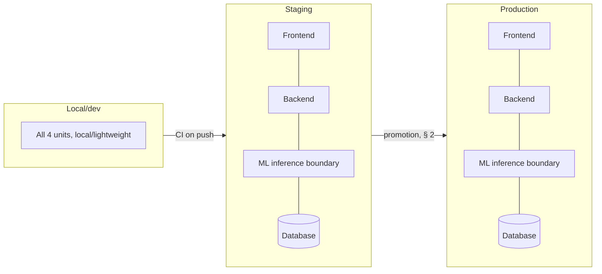

> **Approval note:** Approved by the project stakeholder on 2026-11-03. The environment topology,
> CI/CD gating structure (§2), hot-swappable model-versioning procedure (§3), and deployment
> runbook (§5) are accepted as the deployment strategy for the MVP. The batch-cadence placeholder
> (§4), the dependency-scanning/secrets-handling gap flagged against `SEC-THREATMODEL-001` (§2
> note), and the no-24/7-on-call assumption (§6) remain open items for follow-up rather than
> blockers to approval.

# Deployment & DevOps Strategy — MVP

Produced by executing [DEV-001](../../../prompt-library/11-deployment-and-devops/DEV-001-deployment-devops-strategy.md)
against [ARCH-DESIGN-001](../architecture/ARCH-DESIGN-001-high-level-architecture.md),
[QA-STRATEGY-001](../testing/QA-STRATEGY-001-testing-strategy.md),
[SEC-THREATMODEL-001](../security/SEC-THREATMODEL-001-threat-model.md), and
[ML-INFERENCE-001](../ml/ML-INFERENCE-001-service-contract.md) (all Approved). No specific cloud
provider or orchestration platform is required anywhere below — every capacity/tiering choice is
grounded in this project's actual known scale (a 50,000-row dataset, one MVP persona), not
generic enterprise boilerplate, per DEV-001's own technical constraint.

## 1. Environment topology

**Three tiers — deliberately minimal, not an enterprise multi-region topology sized for a system
this project doesn't have:**

| Tier | Purpose | Deployable units present |
|---|---|---|
| **Local/dev** | Individual developer iteration | All four (frontend, backend, ML inference boundary, database) running locally or in lightweight containers; no production data |
| **Staging** | Pre-release validation of a release candidate against something close to production, before the single ops-analyst role depends on it | All four, sized identically in *kind* to production but not necessarily in capacity (e.g., a single small instance of each, not a cluster) |
| **Production** | The one environment the ops-analyst role actually uses | All four, per `ARCH-DESIGN-001` § 1's component boundaries |

**No fourth tier (e.g., a separate QA or pre-prod environment) is proposed** — this project has one
primary persona and a batch (not high-traffic) workload; an additional tier would add operational
overhead with no corresponding risk it reduces at this scale.

## 2. CI/CD pipeline stages — `QA-001` suites and `SEC-001` requirements wired as named gates

Every stage below is named so a specific suite/requirement can be pointed to, per DEV-001's
validation requirement (not just mentioned in passing):

| Stage | What runs | Gates on |
|---|---|---|
| 1. Build | Compile/lint each unit | — |
| 2. Unit tests | `QA-STRATEGY-001` § 1 (backend service, frontend component/state, ML feature-transformation unit tests) | Must pass to proceed |
| 3. ML-specific pre-deploy checks | `QA-STRATEGY-001` § 4.1 (training-pipeline regression test) and § 4.2 (feature-availability contract test) — **both required gates before any new model artifact or `ML-002` contract change is promoted**, per `QA-STRATEGY-001` § 6's explicit presence/absence bar | Must pass; an unexplained metric improvement in § 4.1 **fails** this gate (per `ML-PIPELINE-001` § 4.2's own framing), it is not treated as a pass |
| 4. Security checks | Dependency/vulnerability scanning and secrets-scanning (no hardcoded credentials, tied to `SEC-THREATMODEL-001` REQ-AUTH-003's "never plaintext" requirement) | Must pass |
| 5. Integration tests | `QA-STRATEGY-001` § 2 (backend↔database against real schema constraints; backend↔ML-inference-boundary **including the failure-simulation test double**, per that section's explicit instruction; auth-enforcement functional check) | Must pass |
| 6. End-to-end tests | `QA-STRATEGY-001` § 3, all 7 scenarios (happy path through staleness display) | Must pass before promotion to staging |
| 7. Deploy to staging | Per § 4 below | — |
| 8. Staging smoke/health check | § 5's health-check spec, run against staging | Must pass before promotion to production |
| 9. Deploy to production | Per § 4 below | — |
| 10. Post-deploy monitoring (ongoing, not a gate) | `QA-STRATEGY-001` § 4.3's data-drift smoke test **activates here** — it was explicitly "design only, not yet executable" until live production data exists; this is that activation point | N/A — this is continuous monitoring, not a pass/fail gate on a single deploy |

**Note on stage 4:** `SEC-THREATMODEL-001` did not itself name a dependency-scanning or
secrets-handling requirement explicitly (its requirements are REQ-AUTH/AUTHZ/INPUT/TLS/AUDIT/
RATE) — dependency scanning and secrets scanning are added here as standard DevOps/CI hygiene
that DEV-001 itself is responsible for proposing (per this prompt's own instruction 2, which
names them as examples), not because `SEC-001`'s artifact already specified them. **This is
flagged back as a possible gap for a future `SEC-001` revision to consider naming explicitly**,
rather than this artifact implying it was sourced from there when it wasn't.

## 3. ML model deployment and versioning (consistent with `DB-ARCH-001` and `ML-PIPELINE-001`)

**Decision: the model artifact is deployed independently of the ML inference service's own code
deployment (hot-swappable), not bundled into the service's deployment package.**

- The inference service reads its model artifact from a fixed storage location at each batch run
  (per `ML-INFERENCE-001` § 4's recommended batch pattern) — not baked into a container image at
  build time. This decouples "ship new inference-service code" from "ship a new trained model,"
  consistent with `ARCH-TRADEOFF-001` § 7's file-based-for-MVP recommendation (ADR-0007).
- A new model version's artifact and metadata (per `ML-PIPELINE-001` § 5 — feature list, encoder
  maps, training-data snapshot identifier, metric values, library versions) is published to the
  storage location, and a separate **"current production model version" pointer** is updated to
  reference it only once stage 3's gates (§ 2 above) pass.
- **This directly satisfies `DB-ARCH-001` § 2.7's requirement that every `risk_assessment` row's
  `model_version` must always be resolvable:** the batch job reads the pointer immediately before
  each run and writes that exact version string into `risk_assessment.model_version` — the
  pointer and the recorded value can never silently drift apart, because the job never caches a
  stale pointer value across runs.
- **Model rollback** is re-pointing the "current production model version" pointer to a prior
  retained version — **no inference-service redeployment is needed**, which is the direct
  operational benefit of the hot-swappable decision above. Retain at least the current and
  previous model version's artifacts (not an unbounded history) — a reasonable minimum for MVP,
  not a full model-registry retention policy (which `ARCH-TRADEOFF-001` § 7 already deferred).

## 4. Batch job scheduling/orchestration and failure handling

**Scheduling cadence: explicitly a placeholder, not decided here** — `docs/PRD.md § 24` Open
Question 7 (batch-scoring cadence) remains unresolved by every artifact so far, this one
included. A nightly schedule is used below purely as an illustrative placeholder; the actual
value depends on that open question being answered by a product/business decision this artifact
is not authorized to make.

**Orchestration, portable across the realistic candidates `ARCH-TRADEOFF-001` evaluated:** a
scheduled job (illustrative: a cron-triggered container, or the serverless option
`ARCH-TRADEOFF-001` § 6 specifically considered for this exact workload) triggers the batch run
defined by `BE-ARCH-001` § 2.7/`ML-INFERENCE-001` § 4. No specific platform is required — this is
exactly ADR-0006's open decision.

**Failure handling, consistent with `ML-INFERENCE-001` § 5 (restated here as an operational
procedure, not re-decided):**
- **Whole-run failure:** no partial writes to `risk_assessment`; previous scores remain as the
  latest known values, each still carrying its own `scored_at` — `FE-ARCH-001` § 2.3's
  `scoresAsOf` display surfaces this staleness to the ops analyst automatically, rather than this
  pipeline needing a separate user-facing "degraded mode" banner. **Alerting:** the run failure
  triggers a notification (see § 6's assumption on who receives it).
- **Per-order failure within an otherwise-successful run:** that order's `risk_assessment` is
  simply not updated this cycle; logged for investigation, not alerted individually (consistent
  with avoiding per-row noise, mirroring `QA-STRATEGY-001` § 5's audit-logging scoping decision).
- **Retry policy (placeholder):** one immediate retry of a failed whole-run, then wait for the
  next scheduled cycle rather than retrying indefinitely — sized to this project's batch (not
  real-time) workload; no basis exists yet to tune this further.

## 5. Deployment runbook

### 5.1 Deploy steps per unit

| Unit | Steps |
|---|---|
| Frontend | Build static assets → deploy to hosting (candidate, pending ADR-0006) → invalidate any CDN cache if one is in front of it |
| Backend | Build container image → run database migrations against `DB-ARCH-001`'s schema (forward-compatible; see rollback note below) → deploy new image → verify health check (§ 5.2) before routing traffic to it |
| ML inference boundary | Build container image (if ADR-0004 selects a separate service; if in-process instead, this step merges into the backend's) → deploy → verify it can load the **current** model artifact per § 3, not just that the process starts |
| Database | Apply migrations (additive-preferred, per `DB-ARCH-001`'s own schema-design discipline) before the backend version that depends on them is routed traffic |
| Model artifact | Publish per § 3 — **independent of the above**, may happen between code deployments, not only alongside one |

### 5.2 Rollback procedure

- **Application code (any unit):** revert to the previous deployed image/build — standard
  redeploy-of-prior-version, no data migration implied by this alone.
- **Database:** migrations should be written with an explicit down-migration or be purely
  additive where feasible (per `DB-ARCH-001`'s normalized schema design); a rollback that would
  require destructive schema changes should be treated as a higher-risk, manually-reviewed
  operation, not an automated rollback step.
- **Model version:** re-point the "current production model version" pointer (§ 3) — no code
  redeploy required, by design.

### 5.3 Health-check / monitoring spec

**Explicitly more than "the server is up," per DEV-001 instruction 5:**

| Unit | Liveness (is it running) | Readiness/health (is it actually usable) |
|---|---|---|
| Backend | Process responds to a basic ping | Can reach the database and (if in-process) the model artifact |
| ML inference boundary | Process/service responds | **Can successfully load the current model artifact and its metadata** (per § 3) — a service that is "up" but cannot load its model is not healthy, and this check must say so, not report green |
| Database | Accepts connections | Migrations are at the expected version |
| Batch job | N/A (not a long-running process) | **"Time since last successful run" is tracked as a metric**, alerted on once it exceeds the (still-undecided) expected cadence from § 4 — this is the one health signal this system has for "is scoring actually keeping up," distinct from any individual unit's uptime |

## 6. Operational capacity assumption (flagged, per DEV-001's failure-handling clause)

**No document in this repository states who is on call or what infrastructure budget exists.**
Per DEV-001's own instruction, this is stated as an assumption needing stakeholder confirmation,
not silently resolved by picking the most sophisticated option: **this strategy assumes a small
team without a dedicated 24/7 on-call rotation**, consistent with an internal, single-persona MVP
tool rather than a customer-facing production system with an SLA. Alerting (§ 2 stage 4's
security scanning failures, § 4's batch-run failures) is designed as **business-hours
notification** (e.g., a message to a team channel/inbox), not a paging system. **This assumption
should be confirmed by whoever owns on-call/operations before this strategy is treated as final**
— if a 24/7 SLA is actually required, the alerting design above would need to change.
