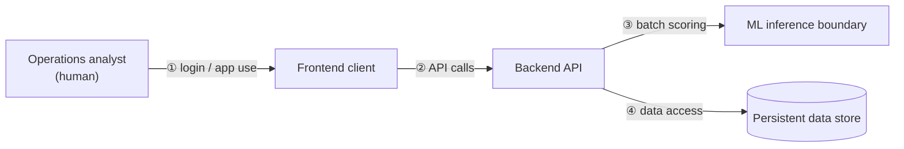

> **Approval note.** Approved 2026-11-03 by the project stakeholder in this session, including
> the STRIDE analysis, the PII-exposure finding (§ 2), and the 3 open items in § 7 (left
> unresolved, not blocking this approval). Approved as-is, with no requested changes.

# Security & Threat Model — MVP

Produced by executing [SEC-001](../../../prompt-library/10-security-and-performance/SEC-001-security-threat-modeling.md)
against `docs/PRD.md § 17` (directly referenced, not re-derived), and the Approved
[ARCH-DESIGN-001](../architecture/ARCH-DESIGN-001-high-level-architecture.md),
[BE-ARCH-001](../backend/BE-ARCH-001-api-and-layering.md), and
[DB-ARCH-001](../database/DB-ARCH-001-schema-design.md).

## 1. Trust boundaries and STRIDE analysis

Based directly on `ARCH-DESIGN-001` § 3.1's component diagram — four boundary crossings:

| # | Boundary | Threat (STRIDE) | Concern | Mitigation (requirement, detailed in § 3–6) |
|---|---|---|---|---|
| ① | Analyst ↔ Frontend | Spoofing | Credential theft / session hijacking | REQ-AUTH-002/003 (§ 3) |
| ① | Analyst ↔ Frontend | Repudiation | Analyst denies having viewed a specific order's risk data | REQ-AUDIT-001 (§ 5) |
| ① | Analyst ↔ Frontend | Denial of Service | Credential-stuffing / brute-force against login | REQ-RATE-001 (§ 6) |
| ① | Analyst ↔ Frontend | Elevation of Privilege | Not currently applicable — `NFR-WEB-004` (`docs/PRD.md § 28`) scopes MVP to a single role, so there is no privilege tier to escalate *to* yet. **This threat re-activates the moment a second role is added** — flagged here as a forward-looking risk, not a current gap. | — (tracked, not mitigated, since it doesn't exist yet) |
| ② | Frontend ↔ Backend | Spoofing | Forged/unauthenticated requests to any endpoint | REQ-AUTH-001 (§ 3) |
| ② | Frontend ↔ Backend | Tampering | Manipulated query/path params (`orderId`, `riskBand`, `status`) used unsafely | REQ-INPUT-001/002 (§ 4) |
| ② | Frontend ↔ Backend | Information Disclosure | Quasi-identifier exposure; verbose error messages leaking internals | § 2 (dedicated PII section); REQ-INPUT-004 (§ 4) |
| ② | Frontend ↔ Backend | Denial of Service | Endpoint flooding; unbounded/unpaginated queries | REQ-RATE-002 (§ 6) |
| ② | Frontend ↔ Backend | Elevation of Privilege | `BE-ARCH-001` § 2.7's still-undecided batch-trigger endpoint, if ever exposed to the single ops-analyst role, would hand that role a capability (triggering a scoring run) arguably beyond "view risk scores" | **Not resolved here — inherited from `BE-ARCH-001` § 5's own open scope question; this threat-model entry exists so that question's security dimension isn't lost when it's eventually answered** |
| ③ | Backend ↔ ML inference boundary | Spoofing / Tampering | If ADR-0004 selects a separate networked service (`ARCH-TRADEOFF-001`'s recommendation), request/response forgery or in-transit tampering between backend and that service | REQ-TLS-002 (§ 4); service-to-service authentication, contingent on ADR-0004 (see note below) |
| ③ | Backend ↔ ML inference boundary | Information Disclosure | The scoring request payload itself carries `Customer Id` and other quasi-identifier-adjacent fields (`ML-INFERENCE-001` § 1) — if the inference boundary is ever hosted outside the organization's own trust boundary (e.g., `ARCH-TRADEOFF-001` § 4's option (c), not recommended there), this data leaves that boundary | § 2 (dedicated PII section) notes this explicitly; mitigated today by `ARCH-TRADEOFF-001` already recommending option (a), not (c) |
| ③ | Backend ↔ ML inference boundary | Denial of Service | Lower risk given the batch (not synchronous) integration pattern `ML-INFERENCE-001` § 4 confirmed — a backlog, not an outage, is the realistic failure mode | Not a priority mitigation target for MVP |
| ④ | Backend ↔ Database | Tampering | SQL injection via any unsanitized input reaching a query | REQ-INPUT-002 (§ 4) |
| ④ | Backend ↔ Database | Information Disclosure | `customer_location`'s quasi-identifier fields (`DB-ARCH-001` § 2.2); overly broad database credentials | § 2 (dedicated PII section); REQ-AUTHZ-002 (§ 3, least-privilege DB role) |
| ④ | Backend ↔ Database | Denial of Service | Unbounded queries (e.g., an unpaginated `GET /orders` at a future, larger order volume) degrading the database | REQ-RATE-002 (§ 6) notes this; full capacity planning is `DEV-001`'s job, not this artifact's |

**Note on the ③ service-to-service authentication mitigation:** this is stated *contingently* —
if ADR-0004 instead selects an in-process/embedded inference approach, this boundary and its
network-level threats (spoofing, tampering, TLS) do not apply at all, since there is no network
hop. This threat model does not pre-decide ADR-0004; it states what changes under each outcome,
consistent with `ARCH-DESIGN-001` § 5 leaving that decision open.

## 2. PII / quasi-identifier section (dedicated, per SEC-001 instruction 2)

**Directly referencing `docs/PRD.md § 17`, not re-deriving it:** `Customer Id`, `Customer
Zipcode`, `Latitude`/`Longitude`, and `Customer City`/`State` form a quasi-identifier set that,
in combination, could support re-identification — § 17's finding stands unmodified here.

**Who can currently see this data through the UI: nobody.** This is a finding from re-reading
`BE-ARCH-001` § 2.3/2.4's actual response schemas, not an assumption: `GET /orders` returns
`orderId, riskBand, riskScore, shippingMode, destination{city, region}, scoredAt` and `GET
/orders/{orderId}` returns `orderId, placedAt, orderStatus, shippingMode, destination{city,
region}, customer{segment}, currentRisk{...}`. **Neither response includes `Customer Id`,
`Customer Zipcode`, or `Latitude`/`Longitude` at all** — not masked, not restricted, simply never
serialized into any response. This exceeds `docs/PRD.md § 28`'s `NFR-WEB-003`, which only
required `Latitude`/`Longitude` to be withheld pending a privacy-reviewer decision and explicitly
anticipated `Customer Id`/`Customer Zipcode` *might* be shown ("may be shown to the authenticated
operations-analyst role... consistent with that role's legitimate business need").

**Cross-artifact inconsistency flagged, not silently reconciled (per the AI Agent Execution
Rules):** `NFR-WEB-003` (in the Approved `docs/PRD.md § 28`) anticipated `Customer Id`/zip being
shown; the Approved `BE-ARCH-001` contract never actually includes them in any response shape.
Both artifacts are individually internally consistent — this is a gap *between* two already-
approved artifacts that neither one's own review caught. **This is recorded here as an open item
for the product owner, not resolved unilaterally:** should `docs/PRD.md § 28`'s `NFR-WEB-003` be
updated to reflect that the current design already withholds these fields entirely (a stronger
position than that NFR required), or does the ops-analyst persona actually need `Customer Id`
visible (per the original vision statement's "legitimate business need" framing), in which case
`BE-ARCH-001`'s contract would need a revision to add it back under an explicit access
justification?

**Where the data still lives, and what controls apply regardless of the question above:**
- `customer_location` (`DB-ARCH-001` § 2.2) holds the zip/lat/long fields with a stated
  **access-restricted** design — this restriction should be enforced as an organizational
  least-privilege control (not just an app-role control), since the people with any direct
  database access (engineers, support, future admin tooling) are a different population than
  "the ops-analyst role," and § 17's quasi-identifier concern applies to all of them equally.
- `risk_assessment.feature_snapshot` (`DB-ARCH-001` § 2.7) stores the exact feature vector used
  for each prediction, which — per `ML-INFERENCE-001` § 1 — includes `Customer Id`, `Customer
  City`, `Customer Zipcode`, and the order-destination fields. **No `BE-ARCH-001` endpoint exposes
  `feature_snapshot`**, so this is at-rest-only exposure (direct database access), not an
  application-layer one — the same least-privilege DB control above applies to it.

**Is an aggregated/masked view needed for MVP?** Given the finding above, **no masking scheme is
currently needed** — the application simply does not surface these fields at all today, which
satisfies `PD-VISION-001`'s MVP use case (per the vision statement's framing: shipping mode and
destination region are what the analyst acts on, not raw coordinates) without needing a masking
design. This conclusion depends on the open item above being resolved in favor of keeping the
current, more conservative contract — if the product owner instead decides `Customer Id` must be
shown, a masking/partial-display scheme would need to be designed at that point, not before.

## 3. Authentication and authorization requirements (feeds ADR-0005)

Stated at the requirement level — no specific framework is assumed to implement these, per
SEC-001's technical constraint:

- **REQ-AUTH-001:** every `BE-ARCH-001` endpoint except `POST /auth/sessions` (§ 2.1 there)
  requires a valid, authenticated session. (`BE-ARCH-001` § 2.7's batch-trigger endpoint inherits
  this requirement *if* it ends up existing at all — see § 1's note on that still-open question.)
- **REQ-AUTH-002:** the session mechanism must support secure, explicit invalidation (`DELETE
  /auth/sessions`, `BE-ARCH-001` § 2.2) and a bounded idle-session lifetime. **Placeholder
  recommendation, explicitly marked as such (no team policy exists yet):** a 30-minute idle
  timeout, reasonable for an internal operational tool, not a consumer-facing session.
- **REQ-AUTH-003:** whatever `credential_reference` (`DB-ARCH-001` § 2.8) turns out to mean once
  ADR-0005 is decided, credentials must never be stored or transmitted in plaintext — if
  password-based, hashed with a modern adaptive algorithm (illustrative only: bcrypt/argon2-class,
  not mandating a specific library ahead of ADR-0005).
- **REQ-AUTHZ-001:** per `NFR-WEB-004` (already approved), no differentiated authorization logic
  is required for MVP beyond "authenticated or not" — but the implementation must not hardcode
  this single-role assumption so deeply that adding a second role later requires a redesign
  rather than an extension (a forward-compatibility note, not a new functional requirement).
- **REQ-AUTHZ-002:** the backend's own database credentials/service account must follow
  least-privilege (no broader access than `DB-ARCH-001`'s schema actually requires) — this is an
  infrastructure-level authorization control distinct from end-user authorization.

## 4. Input validation, injection prevention, and transport security

- **REQ-INPUT-001:** every path/query parameter in `BE-ARCH-001` § 2 is validated against its
  expected type/enum before use — `orderId` as a well-formed identifier, `riskBand` restricted to
  `UI-DESIGN-001` § 3.1's defined set (`high`/`medium`/`low`/`stale`), `status` similarly
  restricted — unrecognized values are rejected, not passed through.
- **REQ-INPUT-002:** all database access uses parameterized queries/prepared statements (or an
  ORM that does so by construction) — no string-concatenated SQL anywhere against `DB-ARCH-001`'s
  schema. This is the primary SQL-injection mitigation (STRIDE row ④ above).
- **REQ-INPUT-003:** request bodies (`POST /auth/sessions`'s credentials; any future body on
  `POST /risk-assessments/batch-runs` if it is eventually built) are validated for type/size
  limits before processing.
- **REQ-INPUT-004:** any server-supplied string rendered by the frontend (shipping mode, city/
  region names) is output-encoded at render time, preventing stored/reflected XSS — a requirement
  on `FE-ARCH-001`'s rendering layer, not just the backend.
- **REQ-TLS-001:** all frontend↔backend traffic uses TLS; no plaintext HTTP outside local
  development.
- **REQ-TLS-002:** backend↔ML-inference-boundary traffic uses TLS **if** ADR-0004 selects a
  separate networked service (contingent, per § 1's note — does not apply to an in-process
  option).
- **REQ-TLS-003:** backend↔database traffic is encrypted in transit — standard, available
  capability on both PostgreSQL and MySQL (`ARCH-TRADEOFF-001`'s two ADR-0003 candidates), not an
  RDBMS-specific requirement.

## 5. Audit logging requirements for risk-assessment access

- **REQ-AUDIT-001:** every read of a *specific* order's risk assessment (`GET
  /orders/{orderId}`, and `GET /orders/{orderId}/risk-assessments` if used) is logged with: the
  authenticated user, the order identifier, a timestamp, and the endpoint called. This is a
  data-governance control justified by § 17's already-identified PII sensitivity, applied as
  defense-in-depth even though § 2 found these specific responses currently carry no raw
  quasi-identifier — if that changes (per § 2's open item), the audit trail is already in place.
- **REQ-AUDIT-002 (scoped deliberately, stated explicitly, not a silent gap):** the risk *queue*
  endpoint (`GET /orders`) returns many orders per call by nature; logging every individual order
  at the same per-row granularity as a single-order lookup would be high-volume and low
  investigative value. **Recommendation:** log the list-query event itself (user, filter
  parameters, result count), not a per-row entry.
- **REQ-AUDIT-003:** audit log entries must never themselves contain quasi-identifier values (no
  zip/lat-long in a log line) — logging *that* an access happened, not reproducing the accessed
  data, avoids creating a second leak surface for exactly what § 17/§ 2 are concerned about.

## 6. Rate limiting / abuse prevention (performance-and-security intersection)

**Assumption stated explicitly, per SEC-001 instruction 6:** this is a small, internal
operational tool for a single ops-analyst role (`NFR-WEB-004`, `PD-VISION-001`), not a
public-facing, high-traffic consumer product — expected concurrent usage is small (tens of users,
not thousands). The numbers below are sized to that assumption; they are **not** enterprise-scale
figures, and would need re-evaluation if that assumption changes.

- **REQ-RATE-001 (placeholder):** `POST /auth/sessions` is rate-limited per IP/username (e.g., 10
  attempts per 15 minutes, illustrative) — login endpoints are a generic credential-stuffing
  target regardless of an application's size or user count, so this applies even to a small
  internal tool.
- **REQ-RATE-002:** general API endpoints need only basic abuse protection (a generous per-session
  limit) sized to "catch a misbehaving client or bug," not "withstand a distributed attack" — full
  capacity planning for the batch-scoring job and database load at a larger future scale belongs
  to `DEV-001`, not this artifact.

## 7. Open items (not resolved here)

1. The `Customer Id`/`Customer Zipcode` display inconsistency between `NFR-WEB-003` and
   `BE-ARCH-001`'s actual contract (§ 2) — for the product owner to ratify one way or the other.
2. `BE-ARCH-001` § 2.7's batch-trigger endpoint — both its existence and, if it exists, its
   authorization requirement (§ 1, ② Elevation of Privilege row) remain unresolved, inherited
   from `BE-001`'s own open scope question.
3. Service-to-service authentication specifics for boundary ③ are contingent on ADR-0004, not
   decided here.
