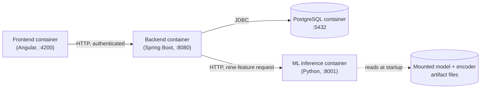

# Stage 5 Implementation Readiness Report

Produced by executing `IMPL-001`. This is a verification and preparation report, not a new
architecture review — every finding below is checked against the current content of the files
named, not re-derived or re-evaluated.

## 1. Stage 5 entry-gate results

`docs/IMPLEMENTATION_ROADMAP.md`'s Stage 3→4 and Stage 5 gates, checked directly:

| Gate condition | Required by | Result |
|---|---|---|
| `ARCH-001`, `DB-001`, `BE-001` artifacts `Approved` | Stage 3→4 gate | **Pass** — `ARCH-DESIGN-001`, `DB-ARCH-001`, `BE-ARCH-001` are all `status: Approved` |
| ADR-0001–0003 and ADR-0005 at least drafted | Stage 3→4 gate | **Pass, exceeded** — all seven ADRs exist and are `Accepted`, not merely drafted |
| `UI-001` artifact `Approved` | Stage 4→5 gate | **Pass** — `UI-DESIGN-001-design-system-and-screens.md` is `status: Approved` |
| Frontend framework, backend framework, database, auth-strategy ADRs `Accepted` before `src/` is created | Stage 5, `PROJECT_CONTEXT.md § 4` rule 9 | **Pass** — ADR-0001, ADR-0002, ADR-0003, ADR-0005 are all `Accepted` (2026-11-03) |

**Conclusion: Stage 5 entry conditions are satisfied.** `src/frontend/`, `src/backend/`, and
`src/ml-service/` may now exist as workspaces, per the roadmap's own gate — this report does not
relax or reinterpret that gate, it confirms the gate's own stated condition is met.

## 2. Technology-choice agreement check

Each `Accepted` ADR's decision, cross-checked against
[ARCH-DESIGN-002-finalized-architecture.md](../generated/architecture/ARCH-DESIGN-002-finalized-architecture.md)
§ 1 (the consolidated component view) for agreement, not re-decided:

| Component | ADR decision | Matches ARCH-DESIGN-002 § 1? |
|---|---|---|
| Frontend | Angular (ADR-0001) | Yes — § 1.1 |
| Backend | Java Spring Boot (ADR-0002) | Yes — § 1.2 |
| Database | PostgreSQL (ADR-0003) | Yes — § 1.4 |
| ML inference | Separate Python service (ADR-0004) | Yes — § 1.3 |
| Authentication | Session-based Spring Security (ADR-0005) | Yes — § 1.2 |
| Deployment | Containerized app components; serverless for the batch job alone (ADR-0006) | Yes — § 1.5 |
| Model storage | File-based for MVP (ADR-0007) | Yes — § 1.6 |

No disagreement found between any ADR's recorded decision and the finalized architecture
document.

## 3. Database revision status

[DB-ARCH-REVISION-001-type-feature.md](../generated/database/DB-ARCH-REVISION-001-type-feature.md)
is now `status: Approved` — `IMPL-001` recorded the project owner's approval of all five § 7
checklist items (column `payment_type`, entity `order`, type `VARCHAR`, nullability `NOT NULL`,
no CHECK/enum constraint) on 2026-11-03.
[DB-ARCH-001-schema-design.md](../generated/database/DB-ARCH-001-schema-design.md) itself remains
`Approved` and **unmodified**; the revision artifact is the authoritative superseding change for
the `order` entity's `payment_type` attribute (its own § 4.3). The ML inference contract
(`ML-INFERENCE-001` § 1, nine features) and the trained model are unchanged — no retraining
occurred as part of recording this approval.

## 4. Critical blocker closure

Both Critical blockers `ARCH-BLOCKERS-001.md` identified are closed, verified directly against
that file's current content (both sections now carry a dated closure note, not re-derived):

| Blocker | Status |
|---|---|
| BLOCK-001 — zero ADRs existed | **Closed 2026-11-03** — all seven now `Accepted` |
| BLOCK-002 — `Type` feature missing from schema | **Closed 2026-11-03** — `DB-ARCH-REVISION-001` now `Approved` |

## 5. `src/` existence check

Repository listing confirms: **no `src/` directory existed before this execution.** `IMPL-001`
created `src/frontend/`, `src/backend/`, `src/ml-service/`, `infra/docker/`, `scripts/`, and
`tests/` as empty workspace directories, each containing only a `README.md` stating its
ownership and scope — **no application code, scaffold, or boilerplate was generated**, per
`IMPL-001`'s own constraint. This report does not assume any implementation exists; it records
that the workspace now exists to receive one.

## 6. Accepted architecture decisions (summary)

See [ARCH-FINALIZATION-001.md](../generated/architecture/ARCH-FINALIZATION-001.md) § 1 for the
full acceptance register (order, dates, dependency verification). In summary: Angular, Java
Spring Boot + Spring Security (session-based), PostgreSQL, a separate Python ML inference
service, containerized deployment for app components with serverless optionally available for
the batch job alone, and file-based model storage for MVP.

## 7. Approved database revision reference

[DB-ARCH-REVISION-001-type-feature.md](../generated/database/DB-ARCH-REVISION-001-type-feature.md)
(now `Approved`) — adds `order.payment_type` (`VARCHAR`, `NOT NULL`, no enum constraint),
superseding `DB-ARCH-001` § 6's original `Type`-drop row without modifying that file.

## 8. Remaining non-blocking findings (carried forward, not resolved here)

Per `ARCH-CONSISTENCY-001.md`, carried forward exactly as that artifact and `IMPL-001` state them
— none of these block Stage 5 entry, and none is resolved by this report:

- **CONS-004 — Display scope.** Implement the existing `BE-ARCH-001` contract as specified. Do
  not expose `Customer Id`, `Customer Zipcode`, `Latitude`, or `Longitude` to the frontend
  without explicit approval — the current contract is already the more conservative option.
- **CONS-005 — Batch execution.** The batch-trigger endpoint's existence/authorization and the
  production batch-scoring cadence remain unresolved. Scheduler-based execution is the
  documented baseline; the actual cadence is configurable and explicitly marked `TBD` (see
  `.env.example`'s `BATCH_SCORING_CADENCE_CRON`). Do not expose a manual batch-trigger endpoint
  without approval.
- **CONS-006 — Manual refresh.** A small UI improvement, tracked but not a blocker to the
  initial scaffold.
- **CONS-007 — Customer history context.** Use the existing `customer.segment` field for MVP. Do
  not invent customer-history metrics or additional API fields.

## 9. Component ownership

| Component | Directory | Owns | ADR(s) |
|---|---|---|---|
| Frontend client | `src/frontend/` | Risk list (FR-032) and risk detail (FR-033) views; client-side auth (FR-034) | ADR-0001 |
| Backend API | `src/backend/` | Auth/session (FR-034, NFR-WEB-001); risk list/detail contracts; persistent-store access; batch-job orchestration (FR-031) | ADR-0002, ADR-0005 |
| ML inference service | `src/ml-service/` | Applying persisted encoders (FR-030) and model (FR-029) to a batch of order records | ADR-0004, ADR-0007 |
| Local orchestration | `infra/docker/` | Local container topology for the four always-on components | ADR-0006 |
| Dev scripts | `scripts/` | Database initialization/migration, seed data, local setup | — |
| Cross-service tests | `tests/` | Integration/contract tests spanning component boundaries | — |

## 10. Runtime and development dependencies

**Runtime:**
- Frontend: Angular (version TBD — ADR-0001 names the framework, not a version; pick the current
  LTS release when `FE-001`'s implementation begins).
- Backend: Java (LTS version TBD), Spring Boot, Spring Security, a PostgreSQL JDBC driver.
- ML inference service: Python (version TBD), whatever serialization library the persisted model
  format requires (per `ML-PIPELINE-001` § 5 — e.g. XGBoost's native format or `joblib`), and an
  HTTP framework to serve the nine-feature contract.
- Database: PostgreSQL (version TBD).

**Development:**
- Docker and Docker Compose (for `infra/docker/`'s local orchestration).
- Node.js + npm/yarn (Angular tooling).
- A Java build tool (Maven or Gradle — not decided by any ADR; an implementation-level choice).
- Python's standard packaging tooling (pip/venv, or Poetry — not decided by any ADR).

No specific version or build-tool choice above is an ADR-level decision; each is deferred to
whoever implements that component, consistent with `ADR-0006` not deciding a cloud provider or
orchestrator either.

## 11. Local development prerequisites

- Docker Desktop (or an equivalent local container runtime) running.
- Ports available locally: `5432` (PostgreSQL), `8080` (backend, placeholder), `8001` (ML
  service, placeholder), `4200` (Angular dev server, Angular CLI's conventional default).
- The model and encoder artifacts referenced by `ML-PIPELINE-001` § 5 present on disk, or an
  explicit acknowledgment that they do not yet exist (see § 5 of
  [IMPLEMENTATION-PLAN-001.md](IMPLEMENTATION-PLAN-001.md) for how the first milestone handles
  that case).

## 12. Environment variable inventory

See [`.env.example`](../../.env.example) at the repository root — PostgreSQL connection
parameters, the backend's session secret and ML-service URL, the ML service's port and
artifact paths, the frontend's API base URL, and an explicit `TBD` marker for the batch-scoring
cadence (not an invented production value).

## 13. Container communication plan

All four always-on components run as separate containers on a shared local Docker network
(`infra/docker/`), consistent with ADR-0004 (separate ML service, reached over a network
boundary) and ADR-0006 (containerized deployment). No cloud provider or orchestrator is implied
by this local topology.

## 14. Database migration strategy

1. `scripts/` holds the initialization script applying `DB-ARCH-001`'s schema plus the
   `Approved` `DB-ARCH-REVISION-001` addition (`order.payment_type`) as one combined migration
   for a fresh local database — there being no live production data to migrate around yet (per
   that revision's own § 5 migration-considerations note).
2. Future schema changes follow the same revision-artifact pattern: a new
   `DB-ARCH-REVISION-NNN-*.md`, human review, then a corresponding migration script — never an
   in-place edit of an already-`Approved` schema artifact.

## 15. Model and encoder artifact mounting strategy

Per ADR-0007 (file-based storage) and `DEV-STRATEGY-001` § 3's hot-swappable pointer design: the
ML inference container mounts a local directory (`MODEL_ARTIFACT_PATH`,
`ENCODER_ARTIFACT_PATH` in `.env.example`) read-only, rather than baking the model into the
container image — so a new model version can be published without rebuilding the image. If the
mounted path is empty when the service starts, the service must report that explicitly at
startup, not substitute a fabricated prediction.

## 16. Service health-check expectations

Each of the three application containers (frontend, backend, ML inference) exposes a basic
health endpoint (e.g. `/health` or framework-conventional equivalent) returning a simple
up/down status — sufficient for the first integration milestone's requirement 7
(`IMPLEMENTATION-PLAN-001.md` § "First implementation milestone"). A fuller health-check
specification (dependency checks, readiness vs. liveness distinction) is deferred to
`DEV-STRATEGY-001`'s own runbook work, not re-specified here.

## 17. Test strategy for cross-service integration

`tests/` holds tests verifying, at minimum: (a) the backend can reach PostgreSQL and perform a
read/write; (b) the backend can reach the ML inference service and receive a well-formed
`{order_id, risk_score}` response for a valid nine-feature request; (c) the ML inference
service rejects or clearly errors on a malformed request (missing/extra feature) rather than
silently guessing. Per `QA-STRATEGY-001`'s integration layer; unit tests for each component's
own internal logic live under that component's own `src/` subdirectory instead.

## 18. Explicit exclusions from this report and this execution

- No application code was written in any `src/` subdirectory.
- No cloud provider or orchestrator was selected (ADR-0006 does not decide this).
- No production batch-scoring cadence was invented (`BATCH_SCORING_CADENCE_CRON=TBD`).
- No new API field was invented beyond what `BE-ARCH-001`/`ML-INFERENCE-001` already specify.
- No ADR was reopened, reconsidered, or re-evaluated.
- No new cross-artifact consistency review was run.
- No ML model was trained, retrained, or had its feature set or metrics changed.
- `DB-ARCH-001-schema-design.md` was not modified.
